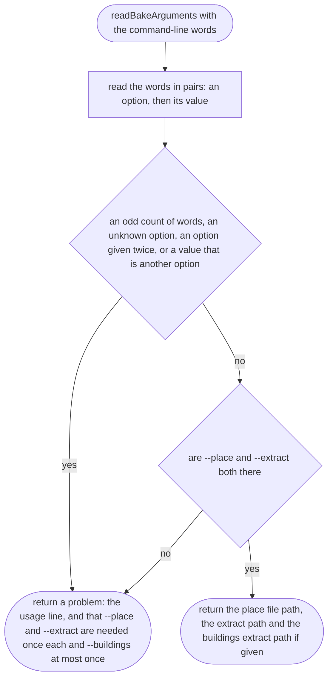
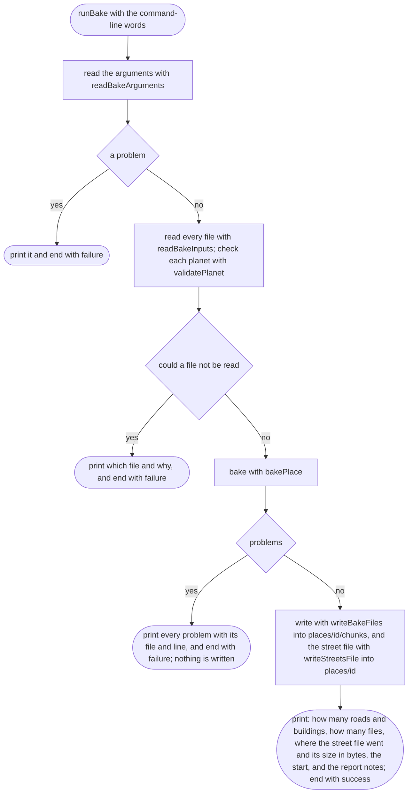
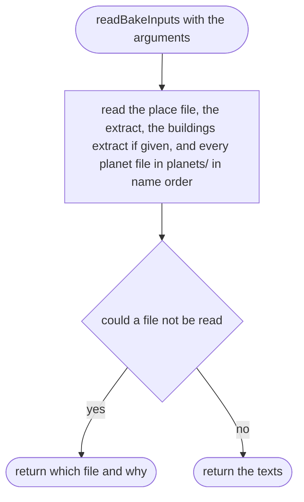

# tools/bake/cli.ts

Status: approved by the orchestrator in one pass (Scope 006, lighter process, 2026-10-11).

New in scope 005 (item 2). The command the orchestrator runs on a computer:

    npm run bake -- --place places/omole.json --extract raw-data/omole-roads.opl --buildings raw-data/omole/omole-buildings.opl

`--buildings` is optional (scope 006): without it the map has roads only. The
buildings extract is cut the same way with `osmium tags-filter … nwr/building`
before `add-locations-to-ways`, so multipolygon relations and their untagged
ring ways come along.

The extract is cut beforehand with osmium (osmium-tool, GPL-3.0, run only,
never copied; research/36 section 2), for example
`osmium extract --bbox W,S,E,N nigeria-latest.osm.pbf -o omole.osm.pbf`, then
`osmium tags-filter omole.osm.pbf w/highway -o omole-roads.osm.pbf`, then
`osmium add-locations-to-ways omole-roads.osm.pbf -f opl,add_metadata=false,locations_on_ways=true -o omole-roads.opl`.
The third step must be `add-locations-to-ways`, not `osmium cat`: `cat` has
no location index, and the writer option `locations_on_ways` only writes
positions a way already has, so with `cat` the nodes come out as `n1xy`, with
no position (approver's F18, measured with pyosmium, which uses the same
libosmium OPL writer). These steps go in the README. The pictures drawn from the code will be in
`docs/flows/tools/bake/cli.md`.

## readBakeArguments

Why the game needs it: a mistyped command should say what is expected, not crash.

## runBake

Why the game needs it: one command makes the map, prints what it did, and leaves the old map untouched if anything is wrong.

## readBakeInputs

Why the game needs it: every file the bake reads, read before anything is baked, so a missing file stops the bake with its name.

