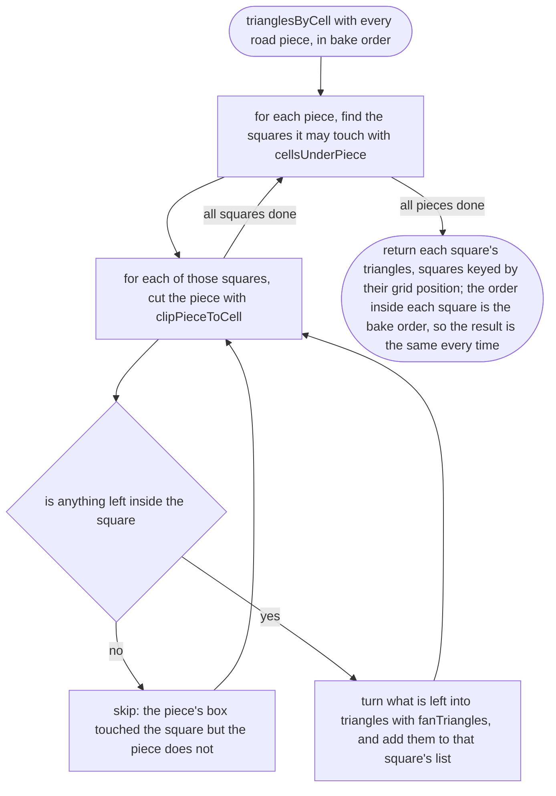
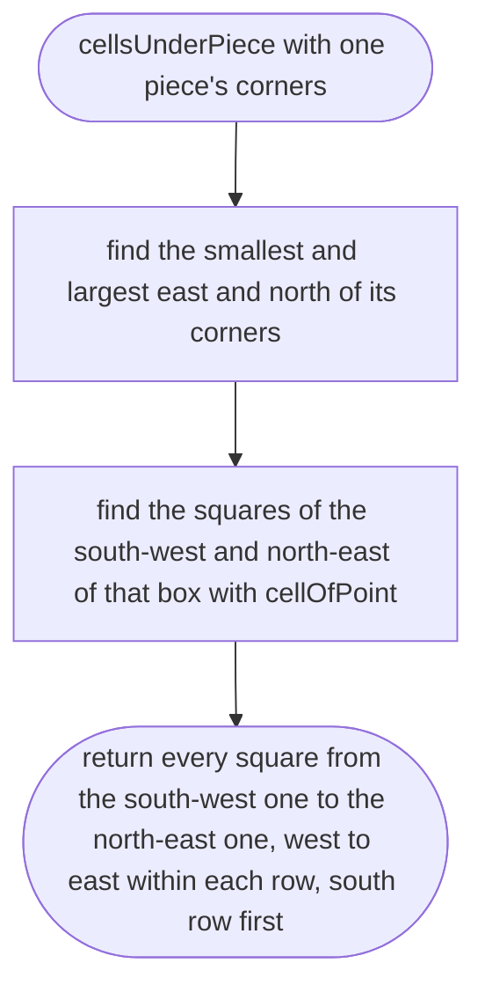
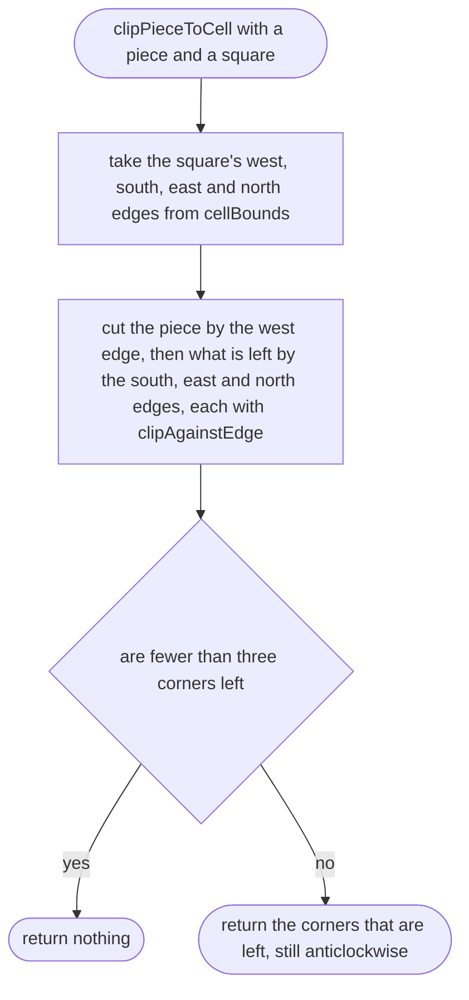
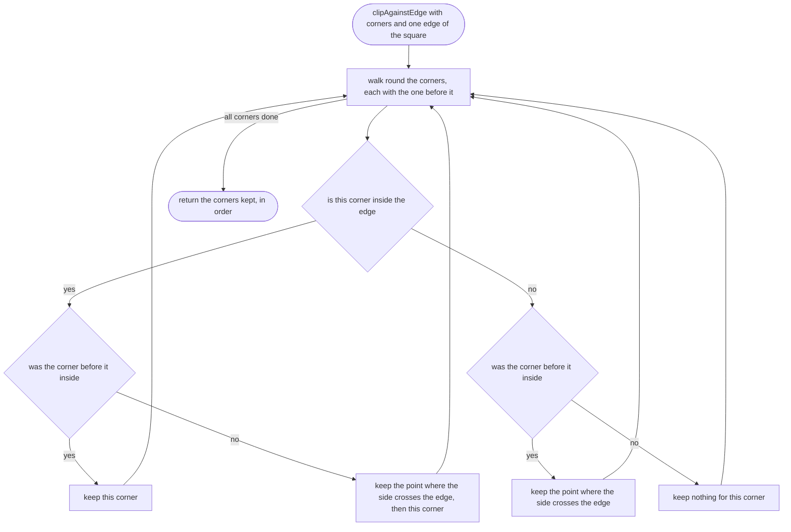
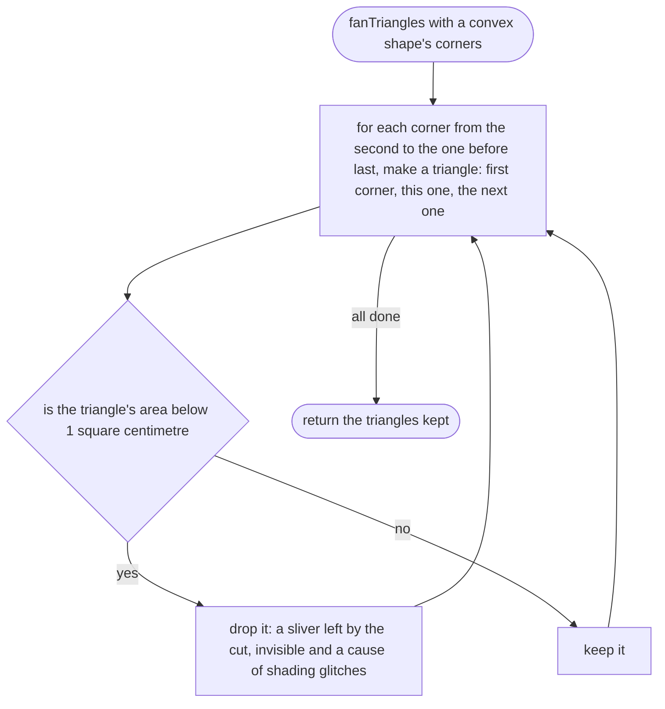

# tools/bake/clip.ts

Status: draft

New in scope 005 (item 2). Cuts the road pieces into the 100 m squares the
game streams (D-0008), and turns each cut piece into triangles the phone can
draw. Clipping a convex shape against the four edges of a square, one edge at
a time, is the Sutherland–Hodgman method (Sutherland and Hodgman, "Reentrant
polygon clipping", Communications of the ACM 17(1), 1974; named from our own
knowledge, not opened this session; the approver checks the citation). A
convex piece cut by a square stays convex, so a fan of triangles from its
first corner is always right. The square sums come from `src/world/grid.ts`.
The pictures drawn from the code will be in `docs/flows/tools/bake/clip.md`.

## trianglesByCell

Why the game needs it: the phone loads the map one 100 m square at a time, so every bit of road must be in the square it lies in, and nowhere else.

## cellsUnderPiece

Why the game needs it: cutting every piece against every square would be slow for a whole town; a piece's bounding box says which few squares to try.

## clipPieceToCell

Why the game needs it: keeps exactly the part of a piece that lies inside one square, so neighbouring squares meet with no gap and no overlap.

## clipAgainstEdge

Why the game needs it: one step of the cut: keep what is on the inside of one straight edge of the square.

## fanTriangles

Why the game needs it: the graphics card draws triangles, not shapes with many corners.

