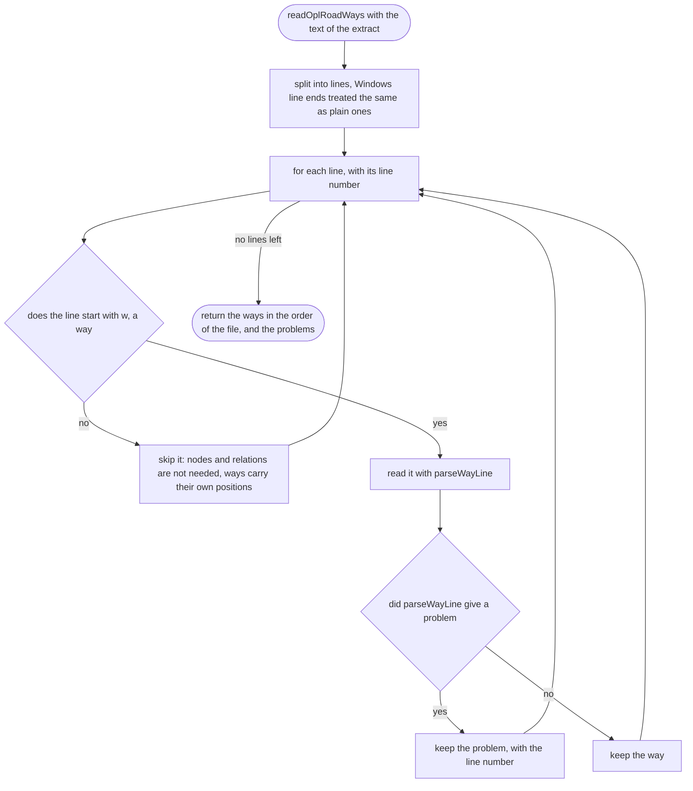
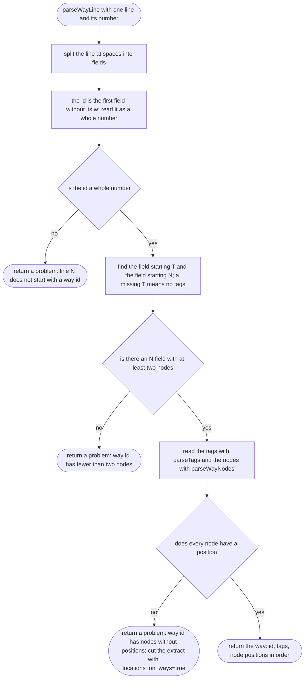
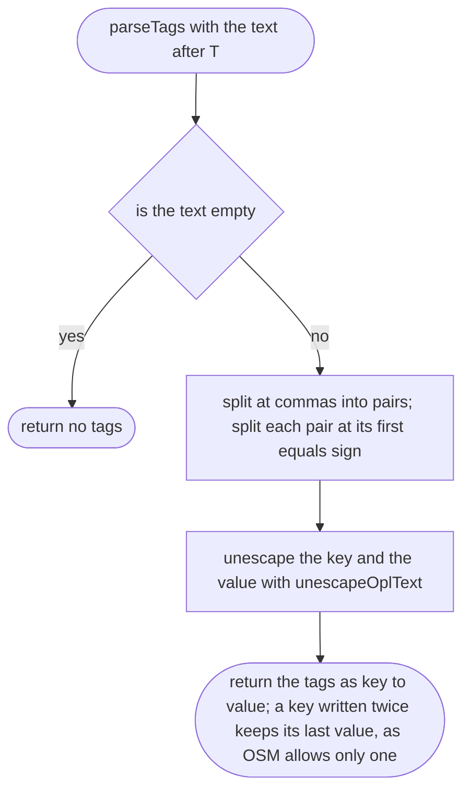
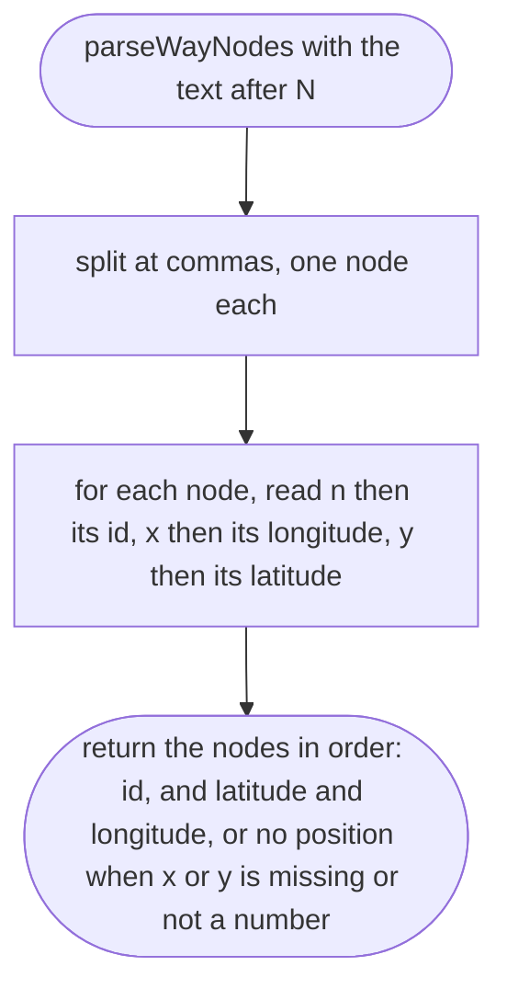
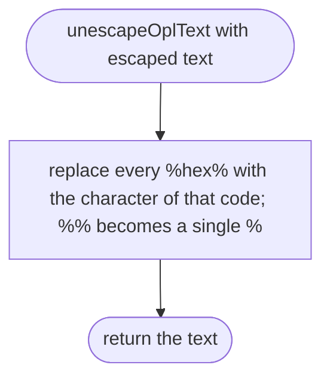

# tools/bake/opl.ts

Status: draft

New in scope 005 (item 2). Reads the OpenStreetMap extract the orchestrator
cuts on his computer. The extract is an OPL file (one OSM object per line),
written by `osmium` with `add_metadata=false` and `locations_on_ways=true`, so
every way line carries its own node positions and the bake needs no other
lines. Format facts from libosmium's OPL reader
(`include/osmium/io/detail/opl_parser_functions.hpp`, BSL-1.0, technique
only; research/36 section 2). The pictures drawn from the code will be in
`docs/flows/tools/bake/opl.md`.

A way line looks like `w123 Thighway=residential,name=Babatunde%20%Ladega N n1x3.3601y6.6302,n2x3.3605y6.6304`:
an id, then fields that each start with one letter. Only `T` (tags) and `N`
(nodes) are used.

## readOplRoadWays

Why the game needs it: the streets in the game are the streets in the map; if a line in the extract is broken, the bake must say which line, not quietly lose a road.

## parseWayLine

Why the game needs it: one way is one street (or a piece of one); its id keeps the bake's order the same every time, its tags say what kind of road it is, its nodes say where it runs.

## parseTags

Why the game needs it: the tags say whether a car may use the road, whether it is one-way, and how wide it is.

## parseWayNodes

Why the game needs it: the node positions are the road's line on the map.

## unescapeOplText

Why the game needs it: street names with spaces or accents are written with escapes in OPL, and the bake report should show them as people write them.

