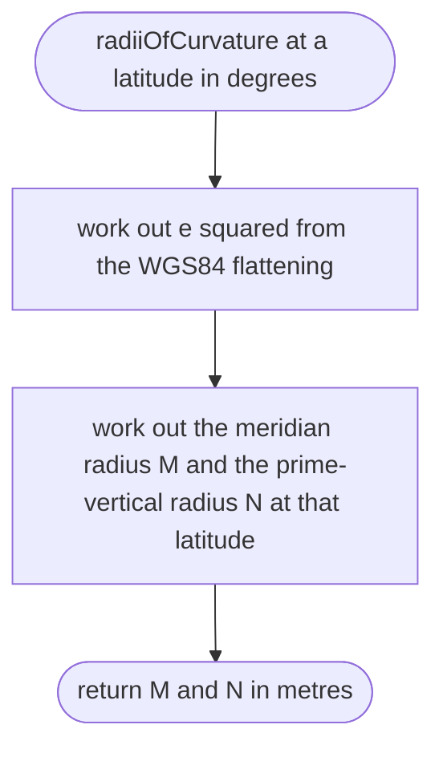
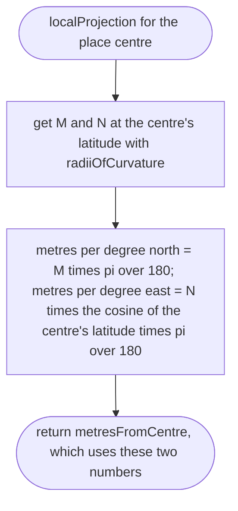
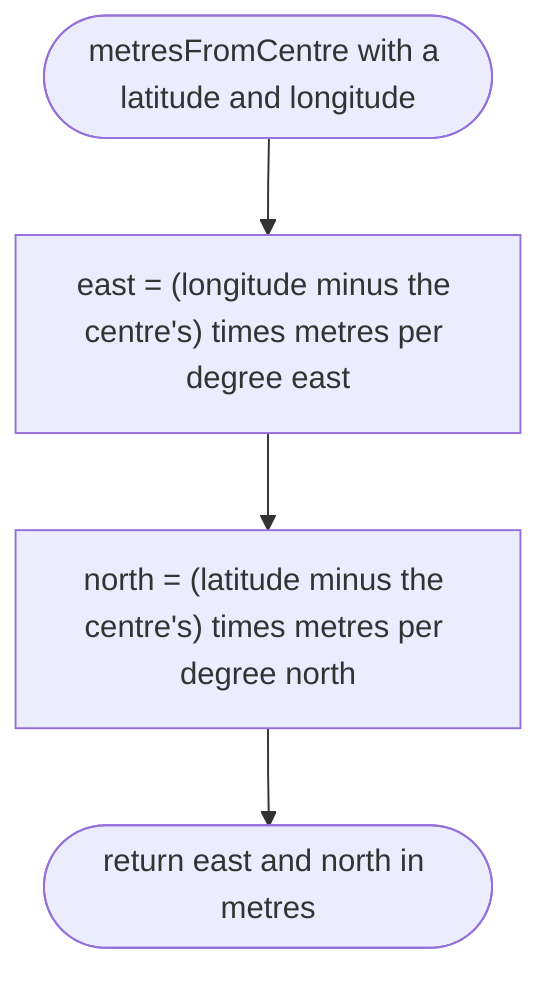

# tools/bake/projection.ts

Status: draft

New in scope 005 (item 2). Turns latitude and longitude into metres east and
north of the place centre. For a 3 km place, a flat map using the Earth's
curvature at the centre is accurate to about 4 cm at the far corners
(research/36 section 2, item 5). WGS84 defining values a = 6378137 m,
f = 1/298.257223563 (the same ellipsoid as the place files' gravity,
research/30). Radii of curvature: meridian M = a(1 − e²) / (1 − e² sin²φ)^1.5,
prime vertical N = a / √(1 − e² sin²φ), e² = f(2 − f); standard geodesy, the
page that gives them could not be opened by this session (research/36), so the
approver checks them. The pictures drawn from the code will be in
`docs/flows/tools/bake/projection.md`.

## radiiOfCurvature

Why the game needs it: one degree of longitude is shorter than one degree of latitude away from the equator; without this, every street would be stretched sideways.

## localProjection

Why the game needs it: every road, the car and the camera share one flat map in metres, with the place centre at zero, so positions stay precise (no floating origin needed at this size; research/36 section 5).

## localProjection > metresFromCentre

Why the game needs it: the same sum for every node, so two roads that share a node meet exactly.

