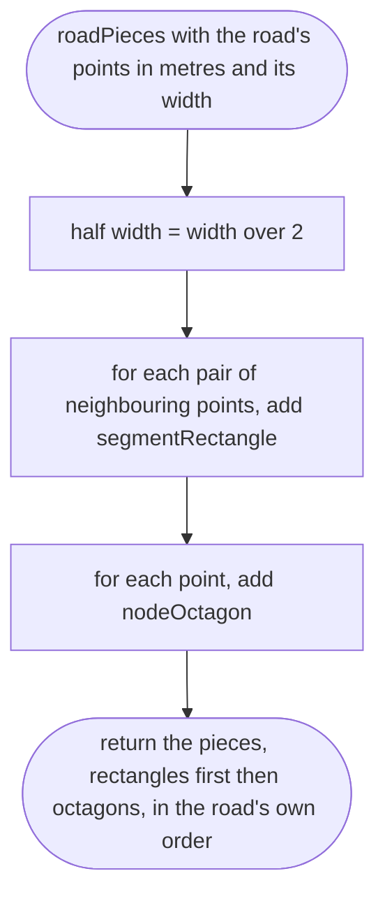
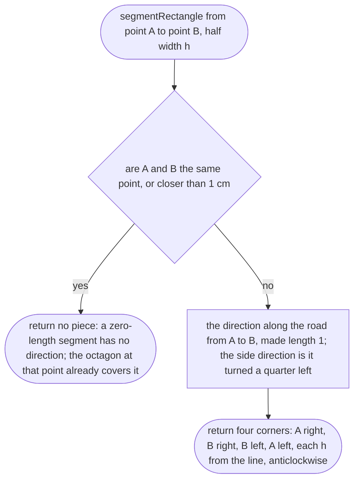
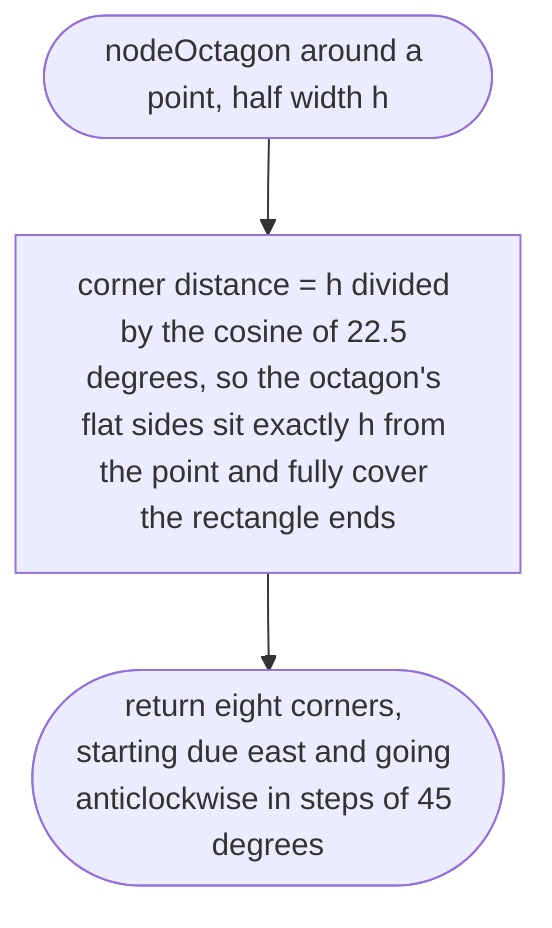

# tools/bake/ribbons.ts

Status: approved. Judged by the delegated approver (docs/reviews/slice-1-approver.md); its fixes F1 to F24 and the orchestrator's decisions on E1 to E3 applied in one pass.

New in scope 005 (item 2). Turns one road (its line in metres and its width)
into flat convex pieces of grey road: a rectangle along each segment and an
octagon at each node. Overlaps are invisible because every road is the same
grey and is drawn without depth (research/36 section 2, items 3 and 4). Our
own simplification; osm2streets' junction polygons (Apache-2.0,
`geometry/general_case.rs`) are the later replacement. The pictures drawn from
the code will be in `docs/flows/tools/bake/ribbons.md`.

Every piece is a list of corners in metres (east, north), going round
anticlockwise seen from above, so the clipping and triangles that follow all
face up.

## roadPieces

Why the game needs it: a road on the map is a line; in the game it is a strip as wide as the real street, with no gaps at bends, ends or junctions.

## segmentRectangle

Why the game needs it: the straight part of a road between two map points.

## nodeOctagon

Why the game needs it: fills the wedge on the outside of every bend, rounds dead ends, and fills junctions where roads meet, without any junction maths.

