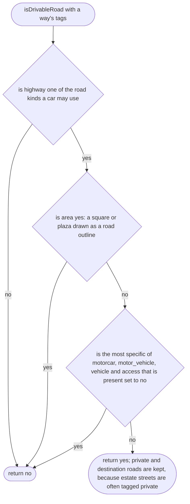
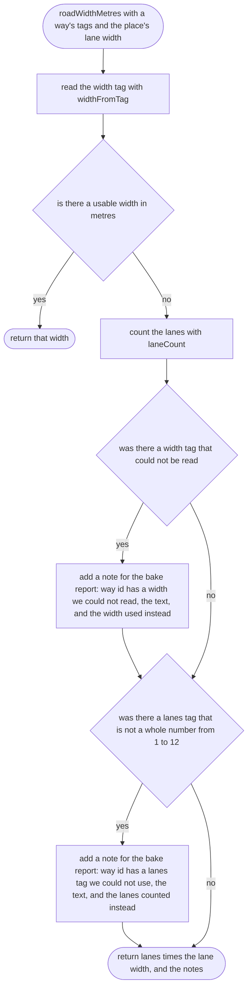
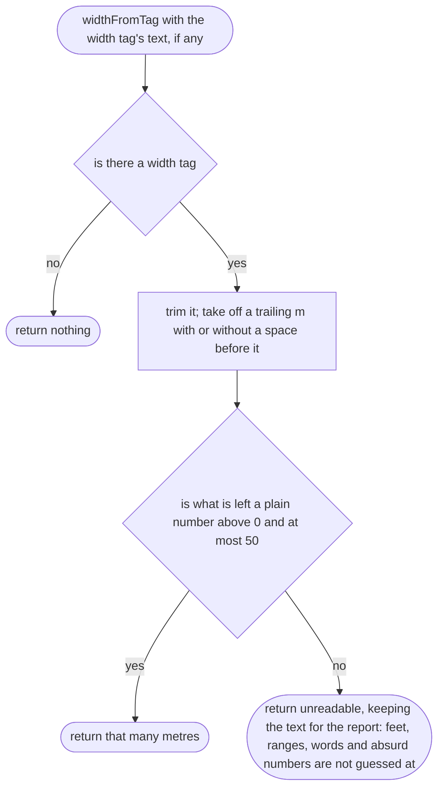
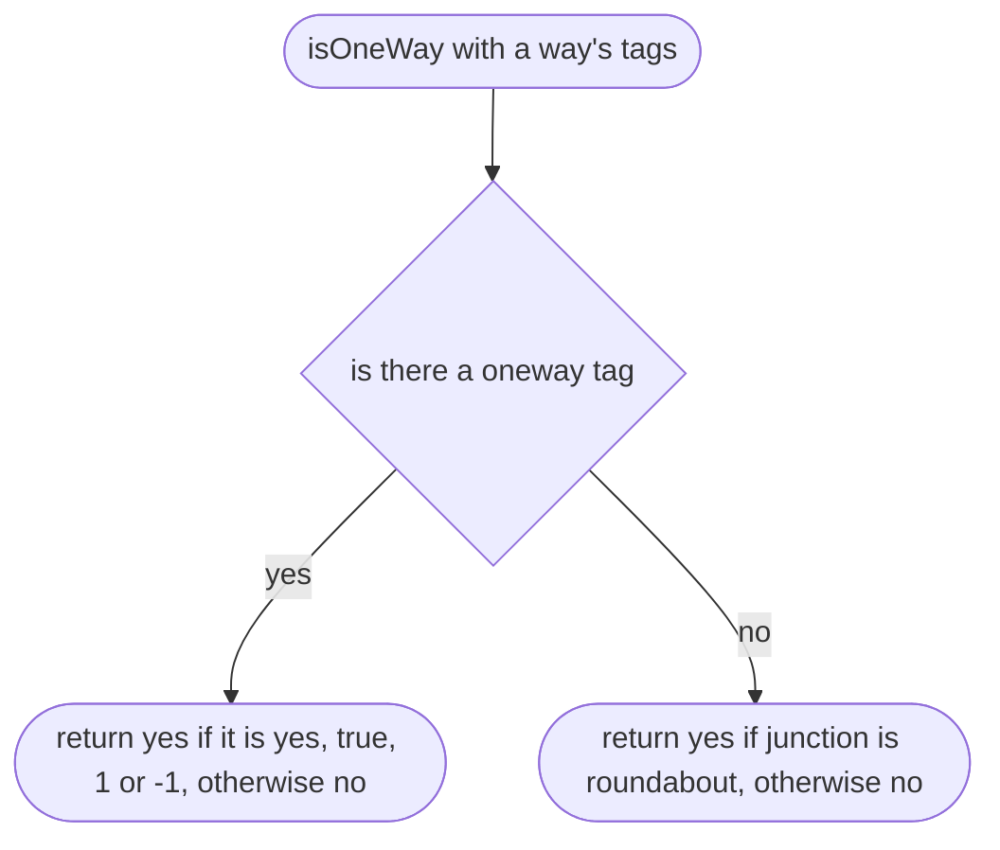
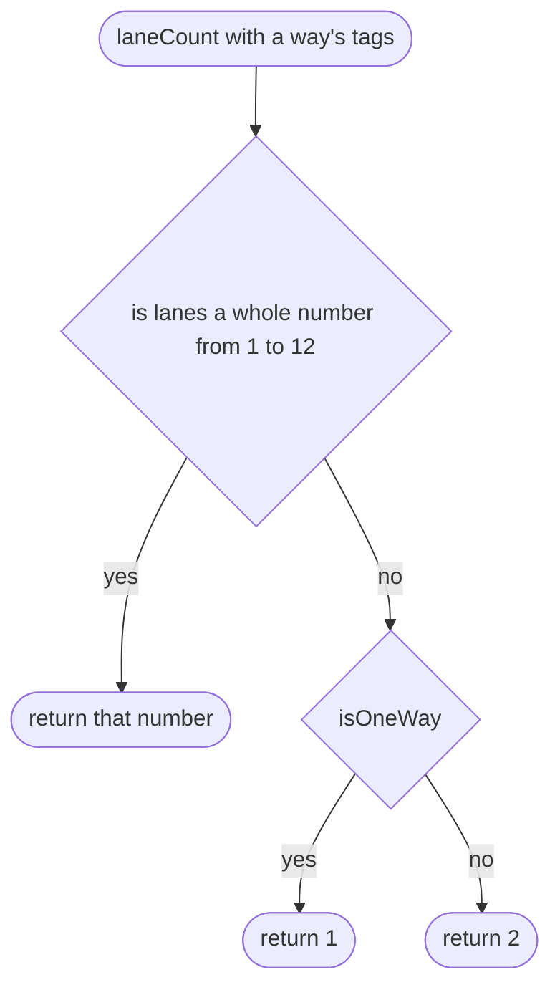
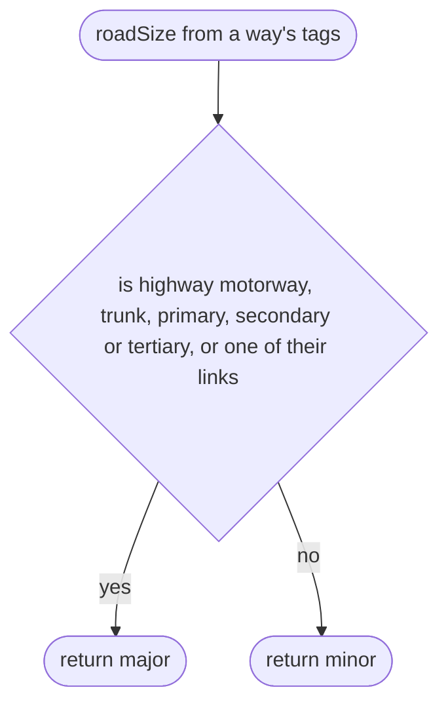

# tools/bake/roads.ts

Status: approved by the orchestrator in one pass (Scope 005b, the owner's lighter process for non-physics work, 2026-10-11).

New in scope 005 (item 2). Decides which OSM ways are roads a car may use and
how wide each one is. Sources: osm2lanes (Apache-2.0, `locale.rs` lane widths
by country, `counts.rs` lane counts), SUMO's use of the `width` tag (our
research/world-drive/28), and the OSM `highway` values (OSM wiki Key:highway,
search only; research/36 section 2 lists what the owner should confirm). The
pictures drawn from the code will be in `docs/flows/tools/bake/roads.md`.

Two sanity limits are our own choice, not measured, and are named constants
with that said beside them: a width tag above 50 m and a lanes tag above 12
are treated as typing mistakes (the widest roads near Omole are far below
both; a mistake would otherwise paint a grey blob across the map). The bake
report lists every way where a limit was used, so a real exception is seen:
an unreadable `width` tag and an unusable `lanes` tag both get a note
(approver's F22).

The road kinds a car may use are one fixed list in this file:
`motorway`, `trunk`, `primary`, `secondary`, `tertiary`, the same five with
`_link`, `unclassified`, `residential`, `living_street`, `service`, `road`.

## isDrivableRoad

Why the game needs it: the player should be able to drive every street a car can use in real life, and should not find footpaths and farm tracks drawn as roads. Access follows OSM's order, from the most specific tag to the most general: `motorcar`, then `motor_vehicle`, then `vehicle`, then `access`; the most specific one present decides (OSM wiki Key:access, the transport-mode hierarchy; approver's F22). So `vehicle=no` drops a way, and `access=no` with `motorcar=yes` keeps it.

## roadWidthMetres

Why the game needs it: a wide road looks and drives wide and a lane looks like a lane; a mapper's measured width wins over our estimate.

## widthFromTag

Why the game needs it: mappers write widths in several ways; only metres are safe to use without guessing.

## isOneWay

New in scope 005 (approver's F22). Why the game needs it: a roundabout is one-way even when nobody tagged it so, as in osm2lanes (`transform/tags_to_lanes/oneway.rs`, Apache-2.0, technique, checked by the approver); otherwise every untagged roundabout is drawn twice as wide. One rule, used by both the lane count and the car's start (`start.md`), so the two can never disagree.

## laneCount

Why the game needs it: most streets have no lanes tag, so the bake needs the usual guess that mapping tools use: one lane on a one-way street, one each way otherwise.

## roadSize

New in Scope 005b. Why the game needs it: the small map draws the bigger roads wider and writes their names (the scope's "road names on the bigger roads"). Major is a tertiary road and up, with their link roads: tertiary is the smallest kind that links towns or districts rather than serving houses (OSM wiki, Key:highway). Every other drivable road is minor.

