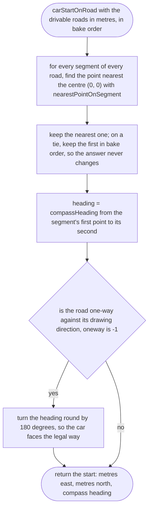
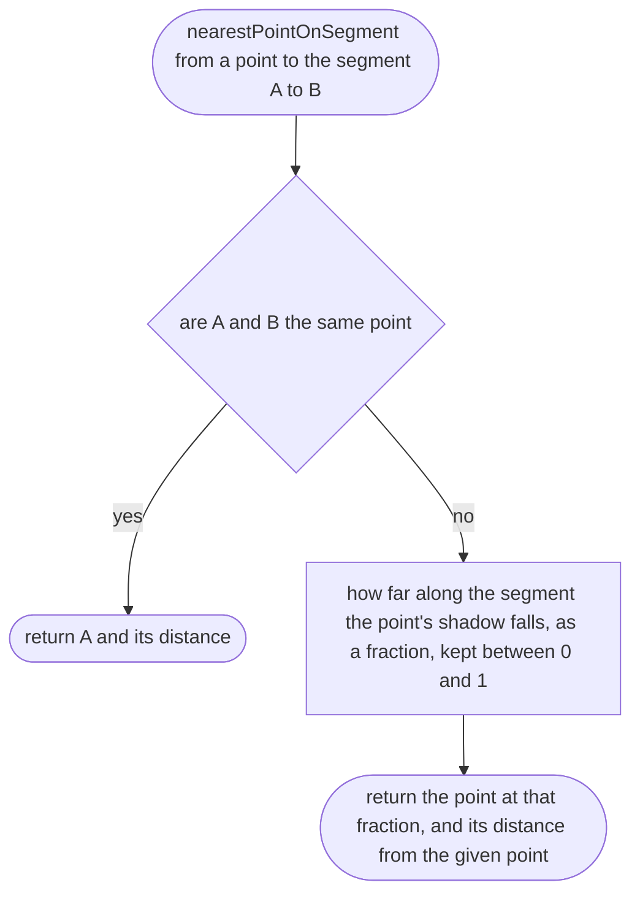
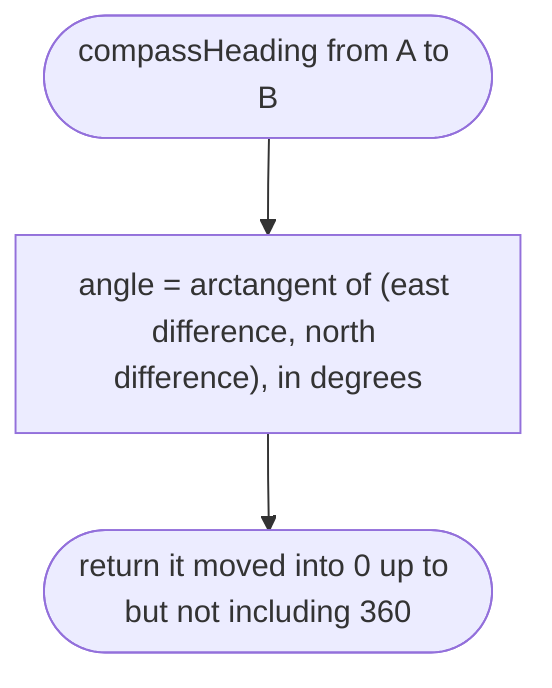

# tools/bake/start.ts

Status: draft

New in scope 005 (items 2 and 3). Finds where the car is parked when the game
opens: on the road nearest the place centre (the place file's centre is on the
owner's street, taken from the map), facing along it. The game then moves it
to the place's driving side (`src/vehicle/car.ts`). The pictures drawn from
the code will be in `docs/flows/tools/bake/start.md`.

## carStartOnRoad

Why the game needs it: the player opens the game and is on his own street, on the road, facing a way he could actually drive, not in a field or a wall.

## nearestPointOnSegment

Why the game needs it: the place centre is rarely exactly on a road line.

## compassHeading

Why the game needs it: the index file uses map words, degrees clockwise from north, which a person can check against a map.

