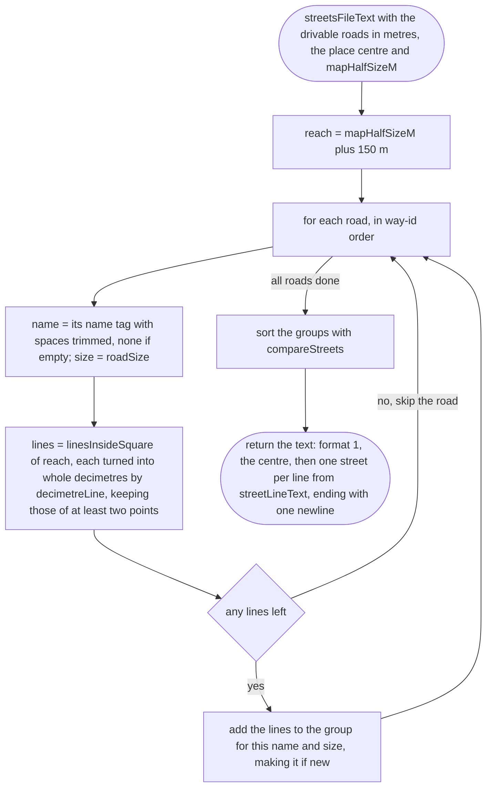
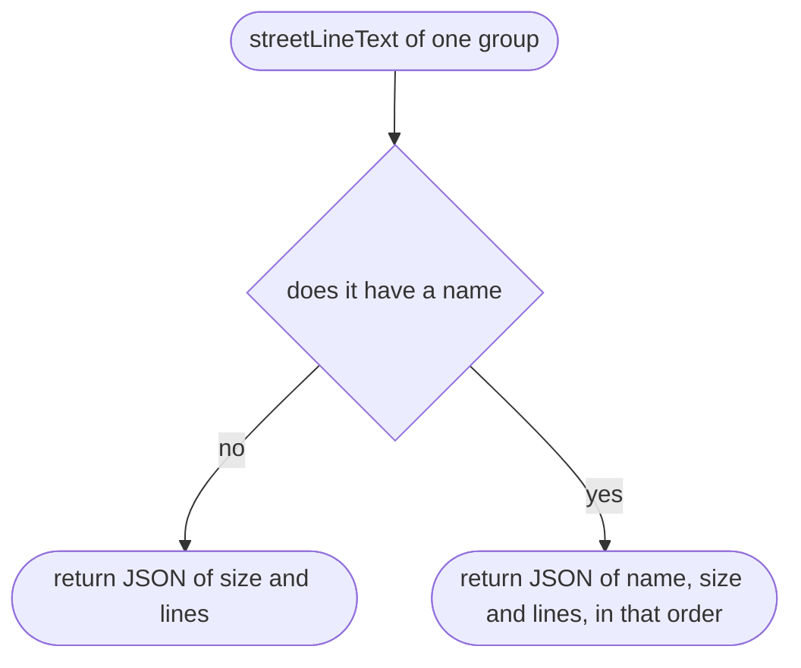
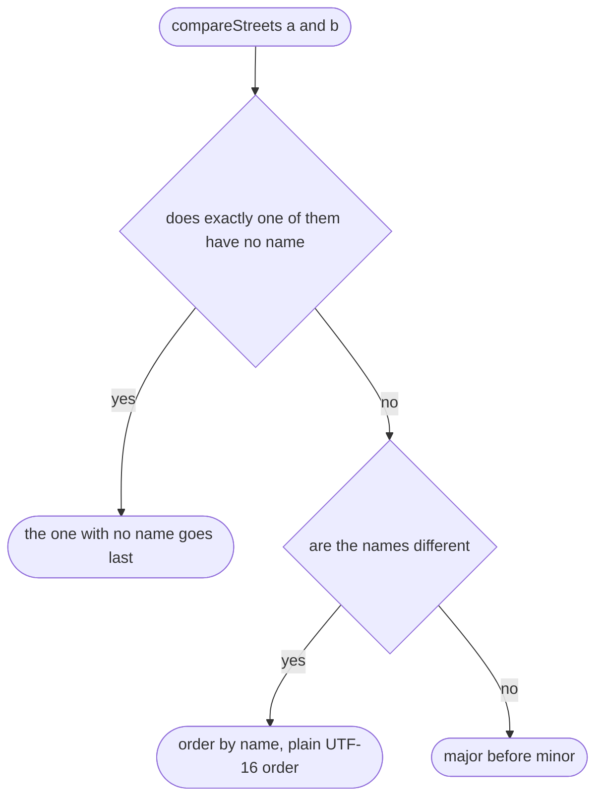
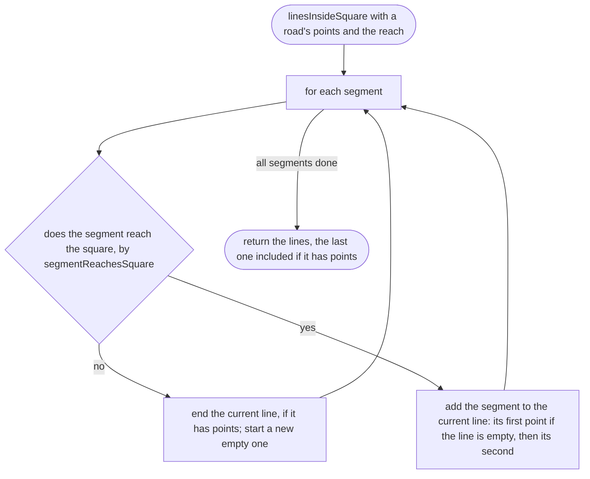
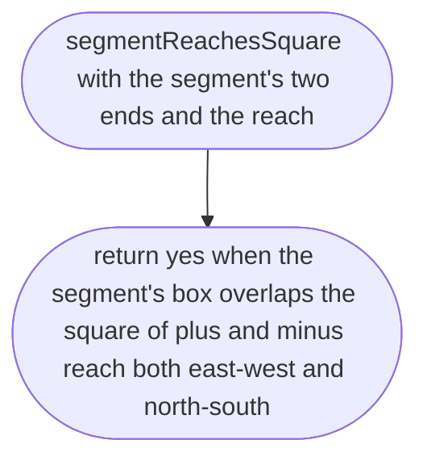
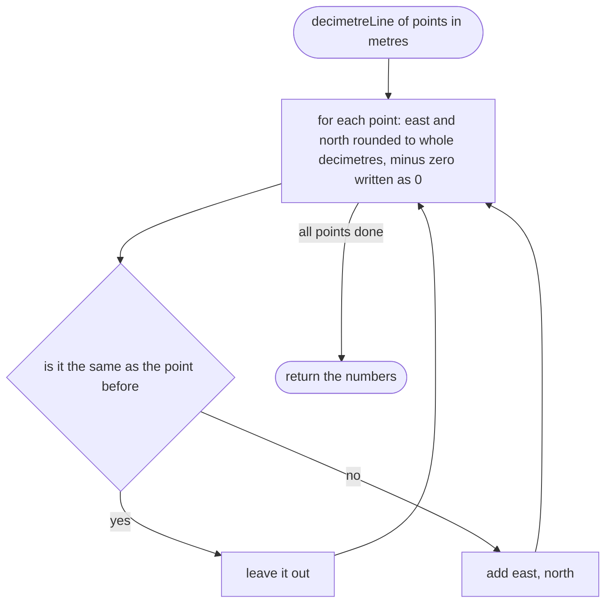

# tools/bake/streets.ts

Status: approved by the orchestrator in one pass (Scope 005b, the owner's lighter process for non-physics work, 2026-10-11).

New in scope 005b (item 1). Writes `places/<id>/streets.json` (format in
`src/world/streets.md`): every road a car may use, as its name when
OpenStreetMap has one, its size and its centre line, in the same projection
as the chunks. The same bytes every time for the same input: streets in name
order, lines in way-id order (the order `drivableRoadsInMetres` gives), every
number a whole decimetre. Roads are kept 150 m past the map's edge, half the
small map's 300 m, so the map near the edge shows what is there rather than a
blank (our own choice, from the scope's map size). Omole's file is 91,988
bytes (37 kB compressed). The pictures drawn from the code will be in
`docs/flows/tools/bake/streets.md`.

## streetsFileText

Why the game needs it: the game needs every road's line to draw the small map, and every name to say which street the car is on.

## streetLineText

Why the game needs it: one street on one line keeps the file readable and its changes small in git; a road with no name has no name key at all, rather than an empty one.

## compareStreets

Why the game needs it: every machine bakes the same bytes, so names are compared in plain UTF-16 order, not the computer's language; the street first in the file also wins a tie in the game's street finder.

## linesInsideSquare

Why the game needs it: `osmium extract` keeps whole ways, so one trunk road can run kilometres past the place; only the part near the map is kept, and a road that leaves and comes back becomes two lines.

## segmentReachesSquare

Why the game needs it: a long segment that crosses the map with both ends outside it must still be kept (found by the trunk road in the tiny test town).

## decimetreLine

Why the game needs it: decimetres are plenty for a name within 15 m and a map at 2 m a pixel, and keep the file small.

