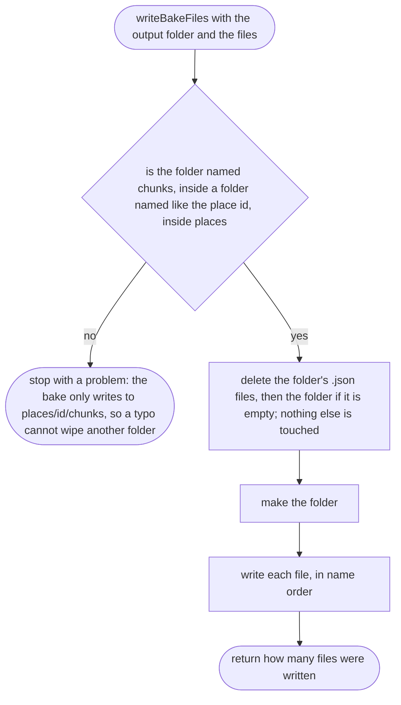

# tools/bake/write.ts

Status: approved. Judged by the delegated approver (docs/reviews/slice-1-approver.md); its fixes F1 to F24 and the orchestrator's decisions on E1 to E3 applied in one pass.

New in scope 005 (item 2). Puts the baked files on disk. Node's `fs`
(`rm`, `mkdir`, `writeFile`) is the only API used. The pictures drawn from
the code will be in `docs/flows/tools/bake/write.md`.

## writeBakeFiles

Why the game needs it: a re-bake must replace the old map completely; a square that no longer has road must not linger from an earlier bake and show a road that is gone.

