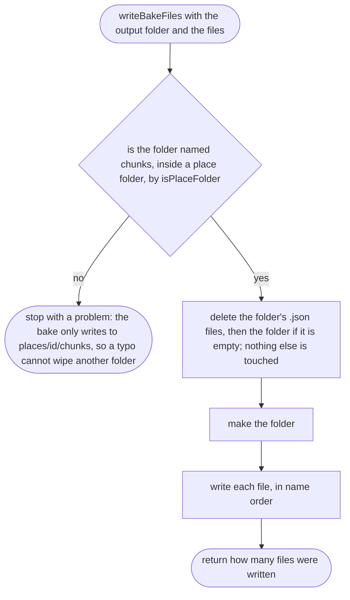
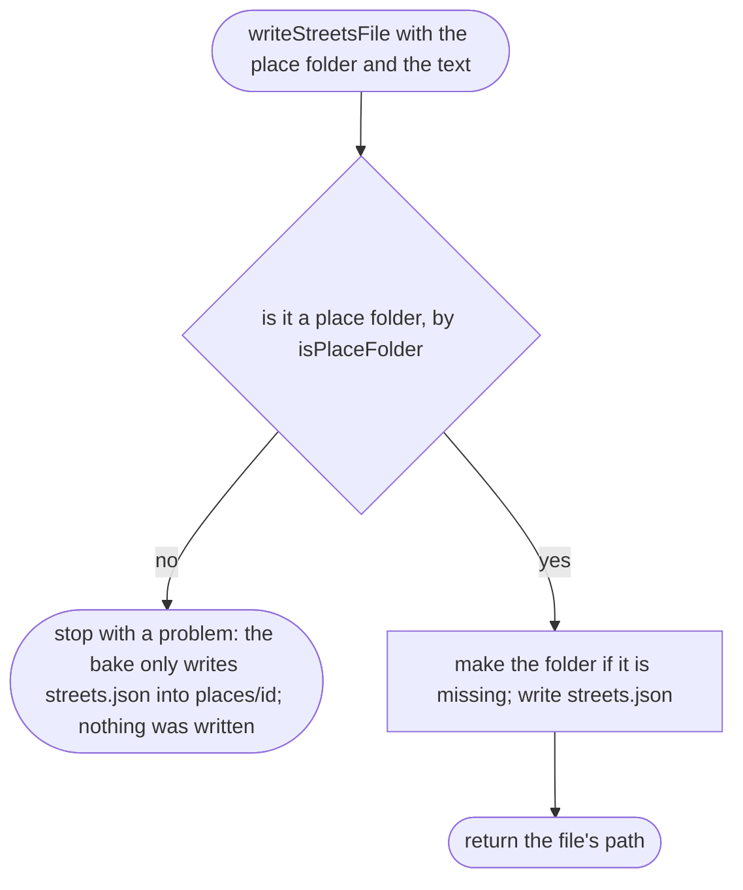
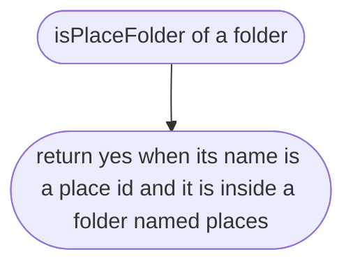

# tools/bake/write.ts

Status: approved by the orchestrator in one pass (Scope 005b, the owner's lighter process for non-physics work, 2026-10-11).

New in scope 005 (item 2). Puts the baked files on disk. Node's `fs`
(`rm`, `mkdir`, `writeFile`) is the only API used. The pictures drawn from
the code will be in `docs/flows/tools/bake/write.md`.

## writeBakeFiles

Why the game needs it: a re-bake must replace the old map completely; a square that no longer has road must not linger from an earlier bake and show a road that is gone.

## writeStreetsFile

New in Scope 005b. Why the game needs it: the street file sits beside the chunks, at `places/<id>/streets.json`, and is replaced whole on every bake; the same guard means a typo cannot write anywhere else.

## isPlaceFolder

New in Scope 005b, the check `writeBakeFiles` already made, now shared. Why the game needs it: one rule for where the bake may write.

