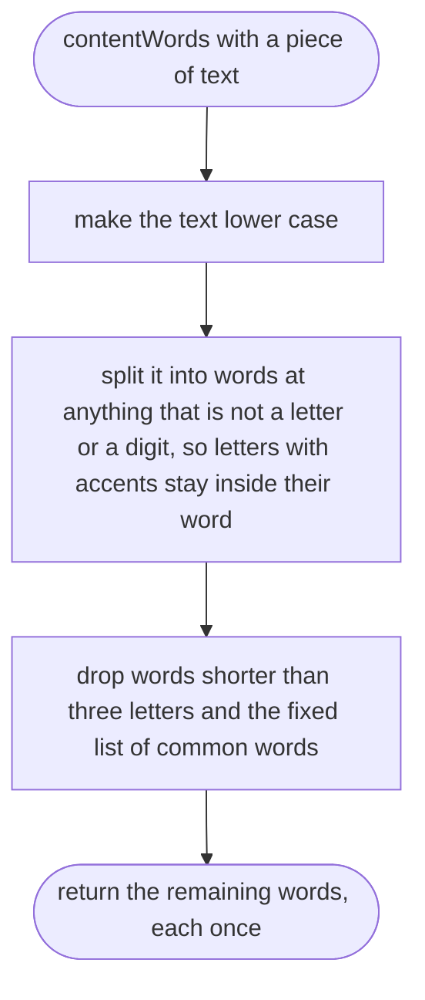

# tools/decisions/clash.ts

Status: draft

New in scope 004 (item 4, the clash check). Given what the orchestrator is
about to do (a line of text and some tags), finds the decisions in force that
share a tag with it or are worded close to it. It only finds candidates; a
person (the orchestrator, then the owner) judges whether they really clash.
The pictures drawn from the code will be in
`docs/flows/tools/decisions/clash.md`.

Open choices for the approver (each a number or a rule the tests will pin):

- "Close wording" here means: at least two content words in common between
  the query and the entry's Decision line, after dropping short and common
  words. Two is a starting value, the owner's call to keep or change.
- The list of common words to drop is short and fixed in the code (words
  such as the, and, every, must). Its source is our own choice; no
  stemming, so "push" and "pushes" are different words.
- Before code is written, the pipeline should look for an existing small
  MIT or Apache text-matching technique (CLAUDE.md, "Find code before
  writing code") and note it in `research/`; this design does not depend
  on one.

## contentWords

Why the game needs it: "a push review" and "Push review:" must count as the same words, or the check misses a clash over capital letters and punctuation.

## matchOf

Why the game needs it: the orchestrator has to tell the owner why an old decision came up ("it shares the tag money", "it also talks about payouts"), so each match says what matched.

## findClashes

Why the game needs it: the strongest and newest candidates come first, so the owner hears about the decision most likely to clash before older or weaker ones.

