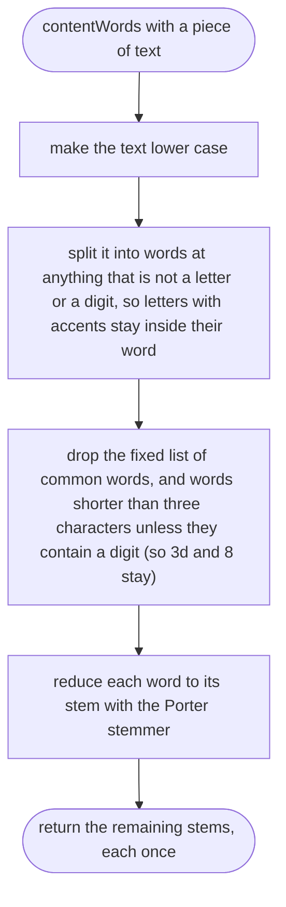
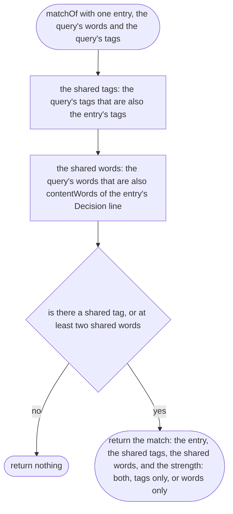
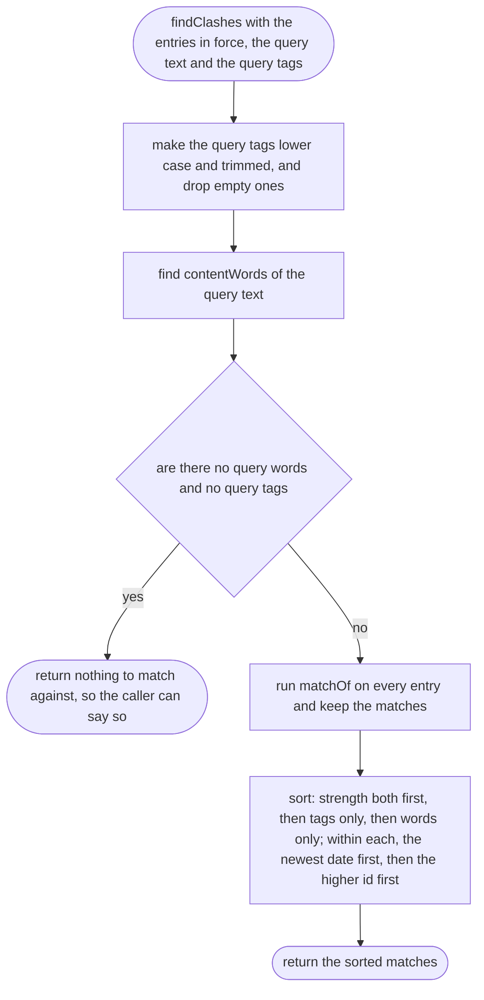

# tools/decisions/clash.ts

Status: approved. Judged by the delegated approver (docs/reviews/clash-approver.md); its fixes drawn in.

New in scope 004 (item 4, the clash check). Given what the orchestrator is
about to do (a line of text and some tags), finds the decisions in force that
share a tag with it or are worded close to it. It only finds candidates; a
person (the orchestrator, then the owner) judges whether they really clash.
The pictures drawn from the code will be in
`docs/flows/tools/decisions/clash.md`.

Settled by the delegated approver, 2026-10-11, after trying them on the real
log:

- "Close wording" means at least **2** content words in common between the
  query and the entry's Decision line.
- Words are reduced to their stem with the Porter stemmer from the npm
  package `stemmer` 2.0.1 (MIT, github.com/words/stemmer; algorithm: M. F.
  Porter, "An algorithm for suffix stripping", *Program* 14(3), 1980), so
  "push" and "pushes", or "approve" and "approvals", count as the same word.
  Credit it in `research/` as found code.
- The fixed list of common words to drop is our own choice: the, and, every,
  must, for, with, not, are, but, from, that, this, into, only, its, any,
  all, each, one, was, has, have, will, can, our, his, her, their, than,
  then, when, what, which, who, why, how, also, else, never, may, let, use,
  own, new, off, per, via, before, after, about, under, plus.
  Dropping "never" and "only" is deliberate: "always push" and "never push"
  should match each other, because that is exactly the clash we want to find.

## contentWords

Why the game needs it: "a push review" and "Push review:" must count as the same words, or the check misses a clash over capital letters and punctuation.

## matchOf

Why the game needs it: the orchestrator has to tell the owner why an old decision came up ("it shares the tag money", "it also talks about payouts"), so each match says what matched.

## findClashes

Why the game needs it: the strongest and newest candidates come first, so the owner hears about the decision most likely to clash before older or weaker ones.

