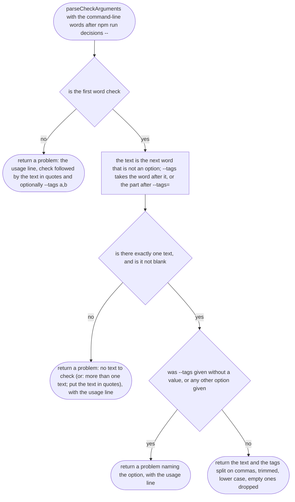
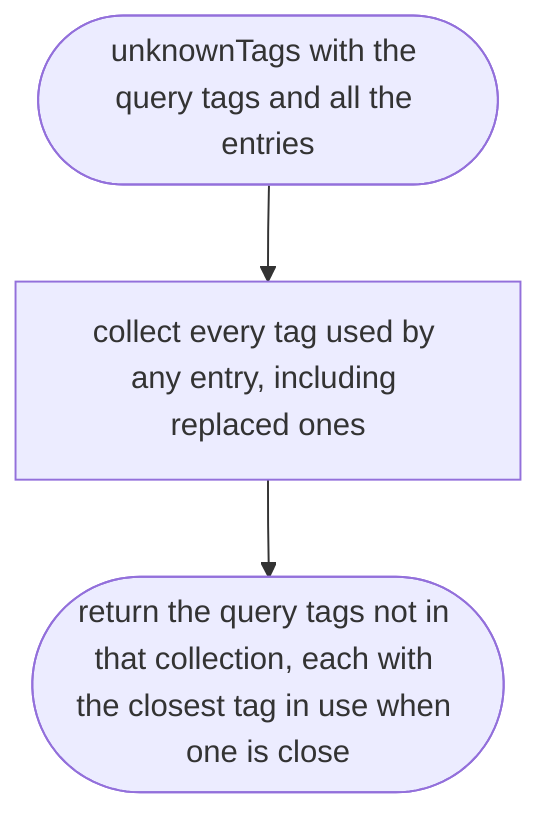
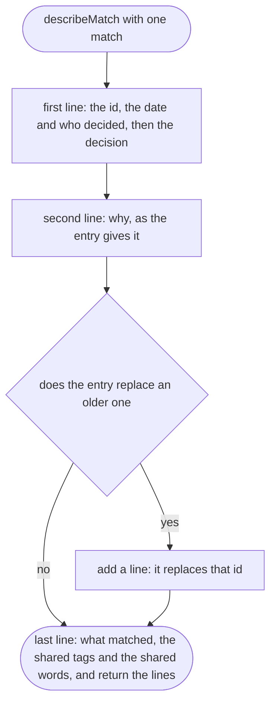
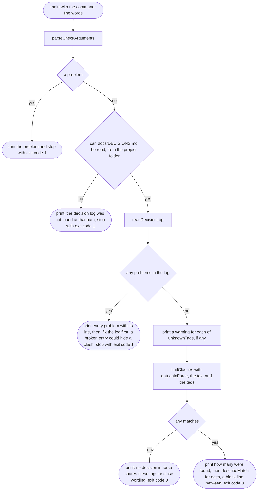

# tools/decisions/cli.ts

Status: draft

New in scope 004 (item 4, the clash check). The command the orchestrator and
the note-taker run: `npm run decisions -- check "<text>" --tags a,b`. It
reads `docs/DECISIONS.md`, finds the decisions in force that share a tag or
close wording with the text, and prints each so the orchestrator can tell the
owner "you decided X on <date> because Y; this would change Z". It prints
and nothing else: it never changes the log. The pictures drawn from the code
will be in `docs/flows/tools/decisions/cli.md`.

Exit codes: 0 when the check ran (whether or not it found anything); 1 when
it could not run (wrong arguments, no log, a broken log). A match is not a
failure: deciding whether it really clashes is a person's job.

## parseCheckArguments

Why the game needs it: the orchestrator runs this before acting on the owner's words; a mistyped command must say exactly what is wrong instead of checking nothing and reporting "no clash".

## unknownTags

Why the game needs it: a misspelt tag (monye for money) would quietly match nothing; naming it, with the tags in use, lets the orchestrator fix the check instead of trusting an empty answer.

## describeMatch

Why the game needs it: the owner hears the old decision in its own words, with its date, its reason and who made it, and why it came up, so the conversation starts from facts.

## main

Why the game needs it: one command, run before acting, that answers "has the owner already decided something about this?" from the one log every session reads.

