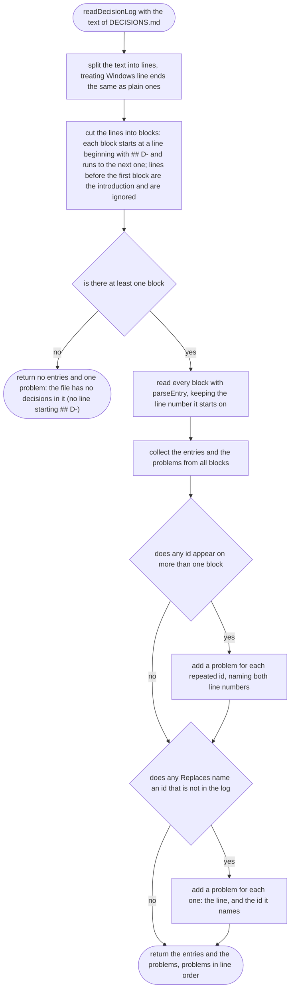
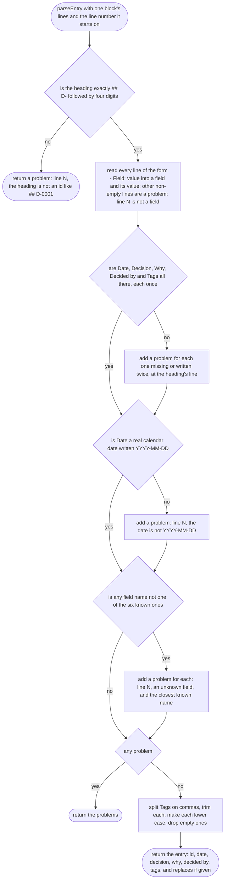
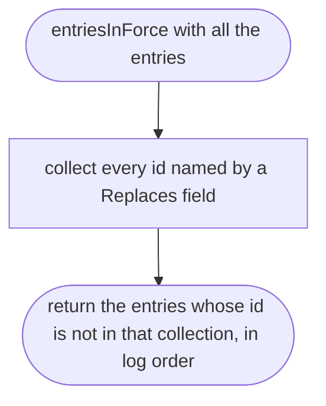

# tools/decisions/log.ts

Status: draft

New in scope 004 (item 4, the clash check). Reads `docs/DECISIONS.md` into
entries the clash check can compare, and finds what is wrong with the file so
a broken entry is never silently skipped. The entry format is the one
`docs/DECISIONS.md` describes at its top: a `## D-0001` heading, then the
fields `Date`, `Decision`, `Why`, `Decided by`, `Tags`, and `Replaces` when
there is one, each as a `- Field: value` line. The pictures drawn from the
code will be in `docs/flows/tools/decisions/log.md`.

## readDecisionLog

Why the game needs it: the clash check is only as good as the log it reads. If one entry is broken and quietly skipped, the orchestrator would tell the owner "no clash" when there is one, and the game drifts from what the owner decided.

## parseEntry

Why the game needs it: each decision must carry its date, its reason and who made it, because the orchestrator tells the owner "you decided X on that date because Y". A missing field is reported by line, so whoever wrote the entry can fix it at once.

## entriesInForce

Why the game needs it: when the owner changes a decision, the newer entry says `Replaces: D-00xx`. The clash check must compare against what holds today, not against a decision the owner already overturned.

