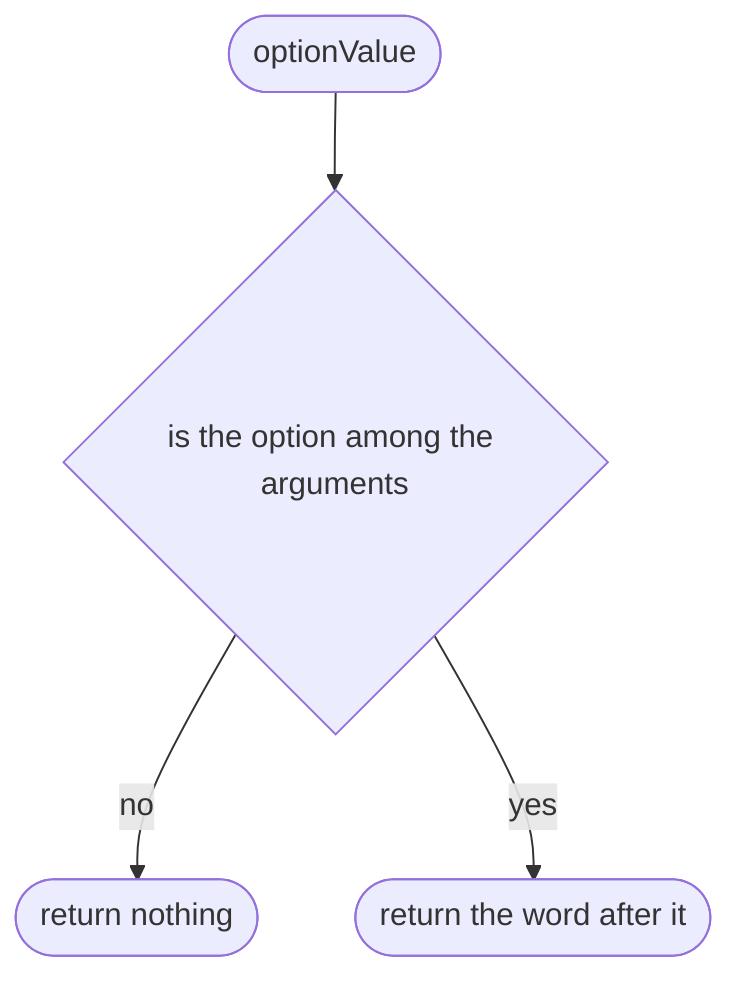
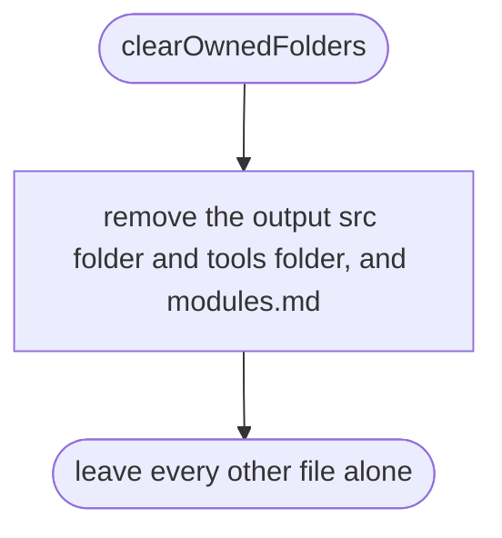
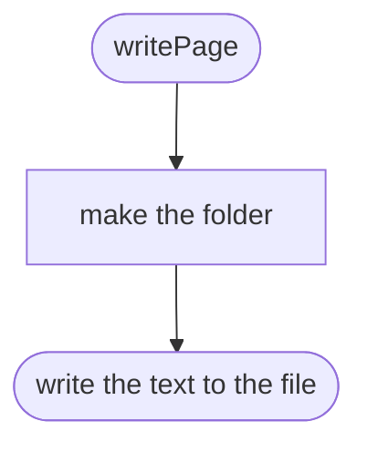
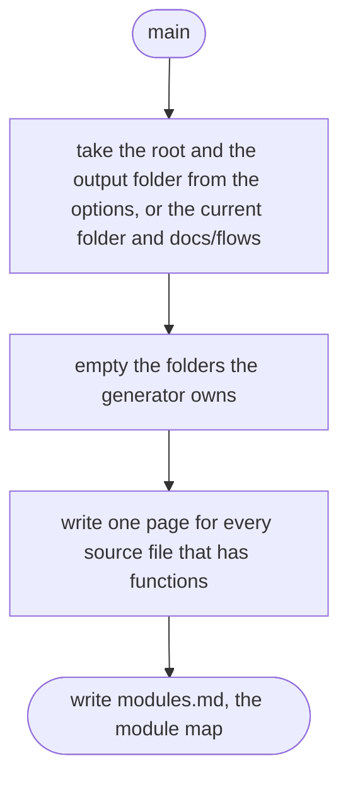

# tools/diagrams/cli.ts

Status: approved by Daramola in chat, 2026-10-10 (batch approval of the diagram tool's own designs; written after the code, see Scope 002).

The design for each function, written in plain words. The pictures drawn from the code are in `docs/flows/tools/diagrams/cli.md`.

## optionValue

Reads the value that follows an option such as --out.

## clearOwnedFolders

Empties the folders the generator owns, so pages for deleted source files do not linger.

## writePage

Writes one page, making its folders first.

## main

Draws everything.

