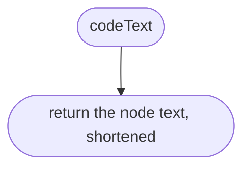
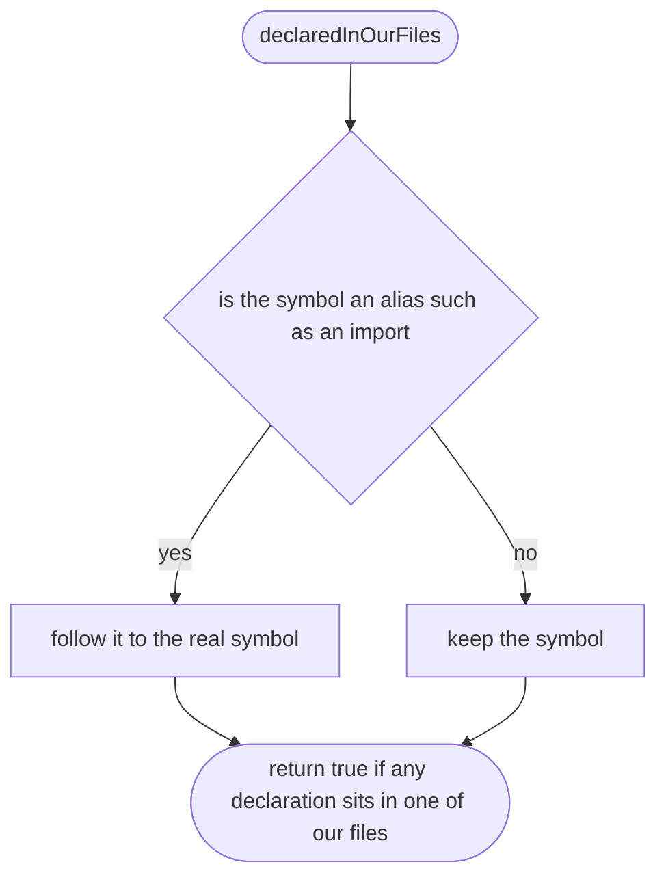
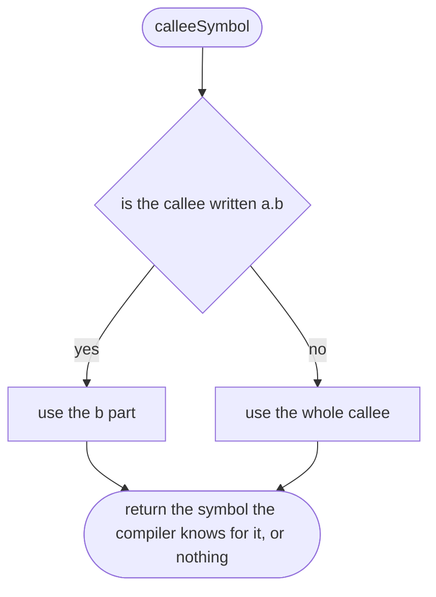
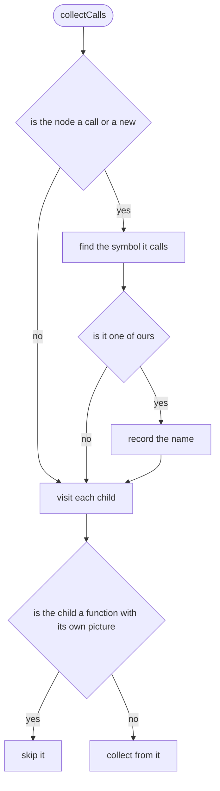
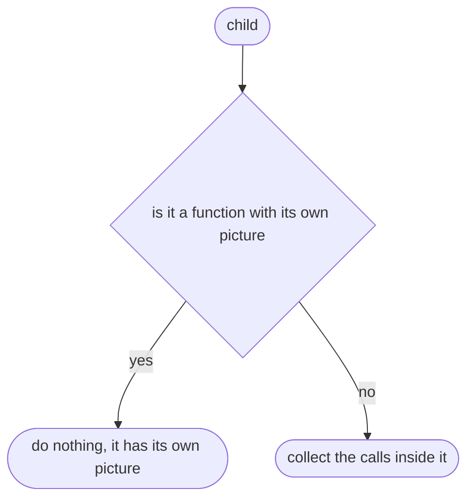
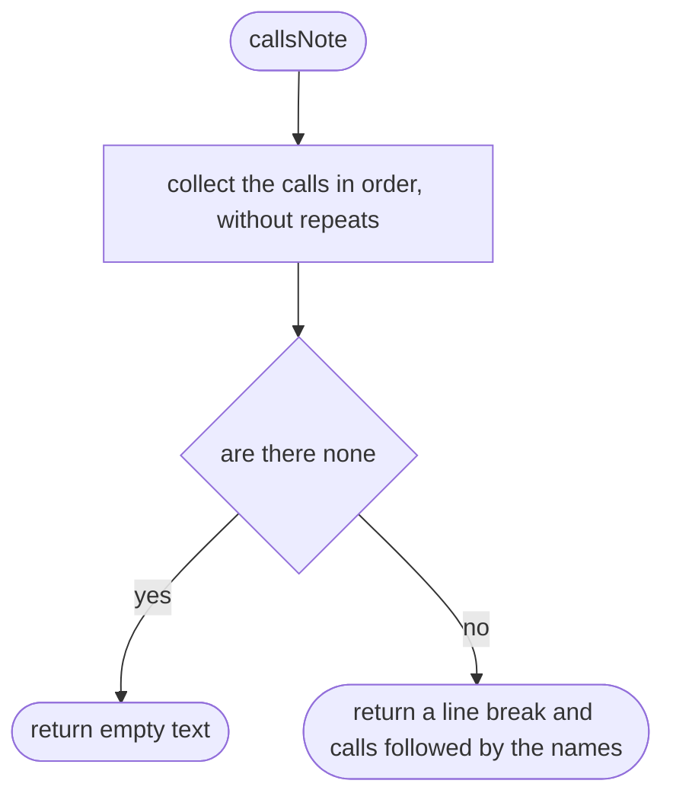

# tools/diagrams/context.ts

Status: draft. Waiting for the owner's approval; the approval commit changes this line to `Status: approved`.

The design for each function, written in plain words. The pictures drawn from the code are in `docs/flows/tools/diagrams/context.md`.

## codeText

The code of a node on one line, shortened.

## declaredInOurFiles

Says whether a symbol is declared in one of our own files.

## calleeSymbol

Finds the compiler symbol for the thing a call calls.

## collectCalls

Collects the names of our functions called inside a piece of code.

## collectCalls > inner function 1

Visits one child.

## callsNote

The line saying which of our functions a piece of code calls.

