# tools/diagrams/expressions.ts

Status: draft. Waiting for the owner's approval; the approval commit changes this line to `Status: approved`.

The design for each function, written in plain words. The pictures drawn from the code are in `docs/flows/tools/diagrams/expressions.md`.

## step

One open arrow leaving a box, with an optional label.

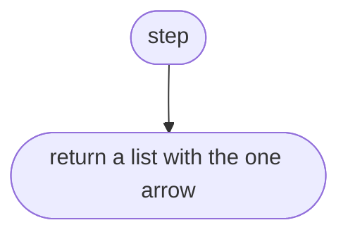

## drawBox

Draws a box for a piece of code and joins the open arrows to it.

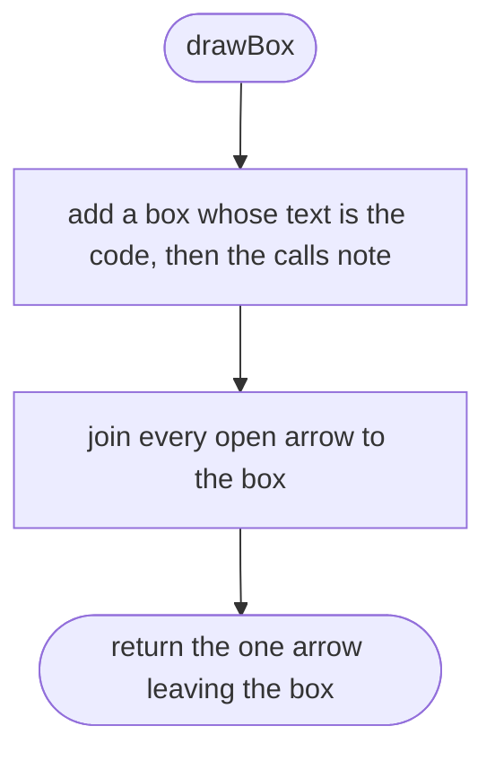

## unwrap

Removes brackets round an expression.

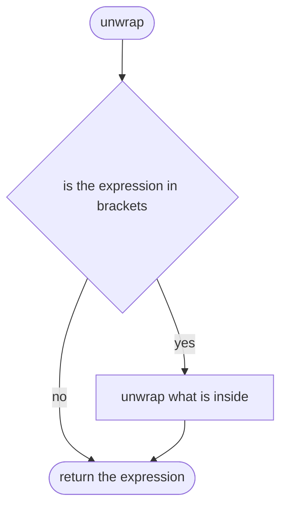

## splitGuard

Draws a && or a || as two questions.

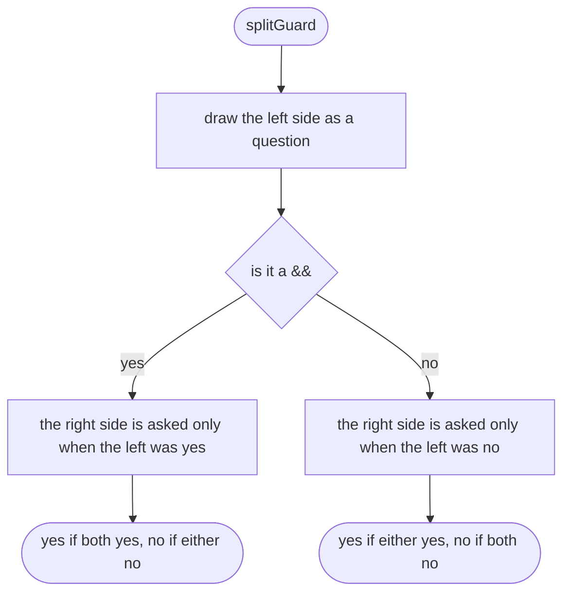

## isAndOr

Says whether an expression is a && or a ||.

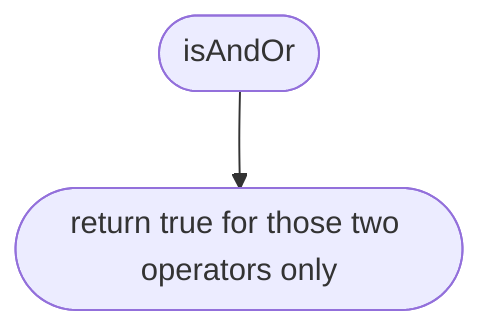

## lowerCondition

Draws a condition as yes and no ways out.

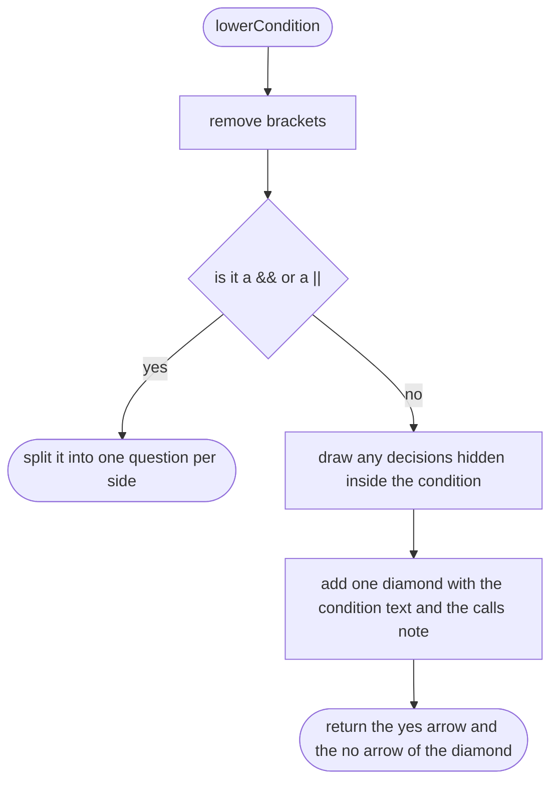

## drawBranch

Draws one side of a ternary or a guard.

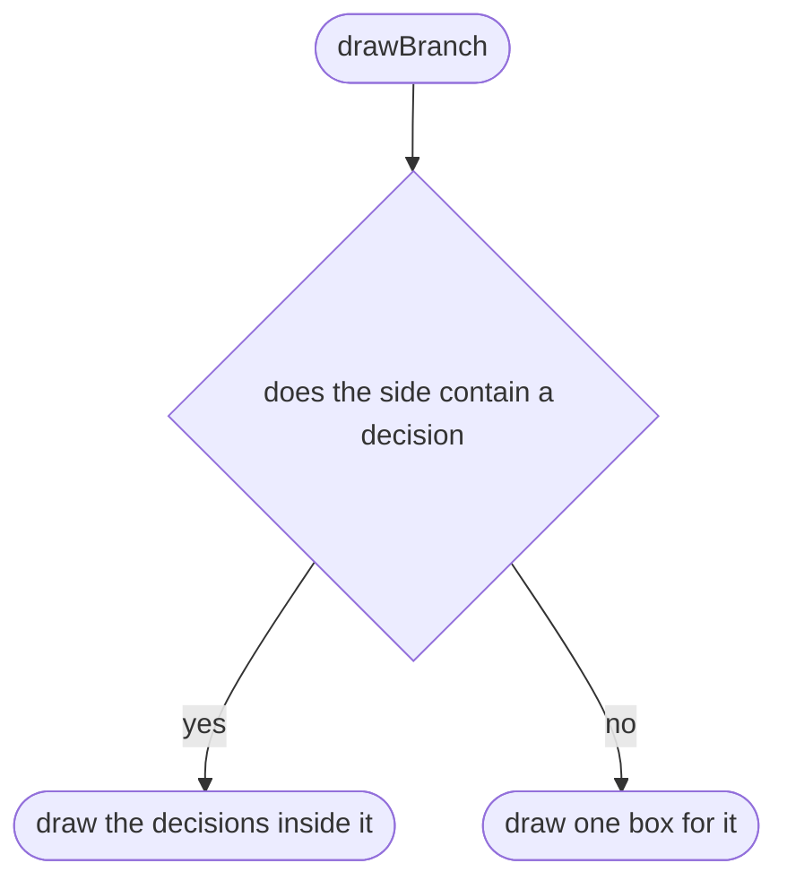

## drawTernary

Draws a c ? x : y.

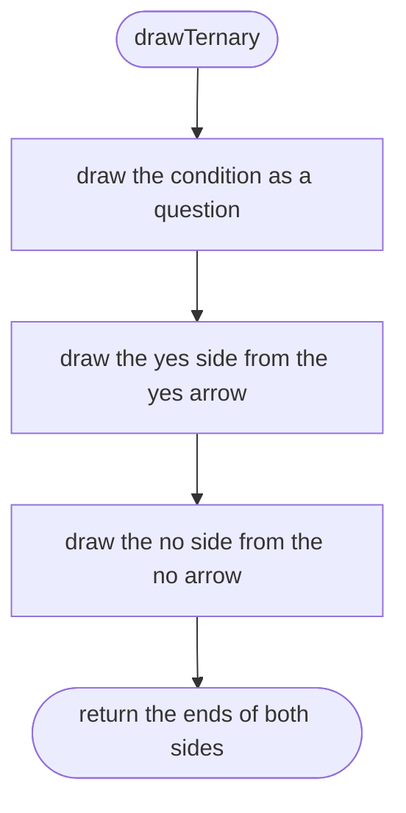

## drawMissingCheck

Draws a ?? b.

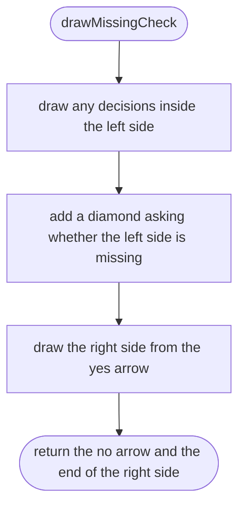

## drawAndOr

Draws a && or a || that is part of a value.

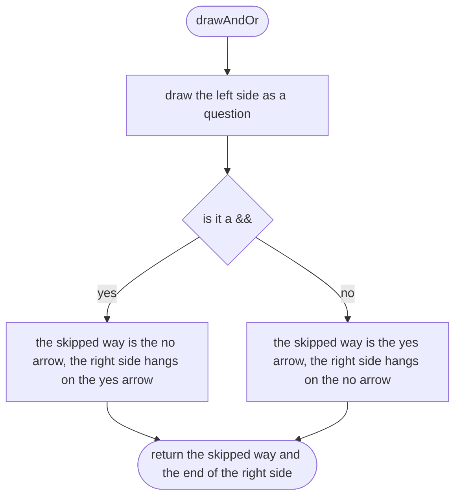

## drawGuard

Draws a guard, choosing by its operator.

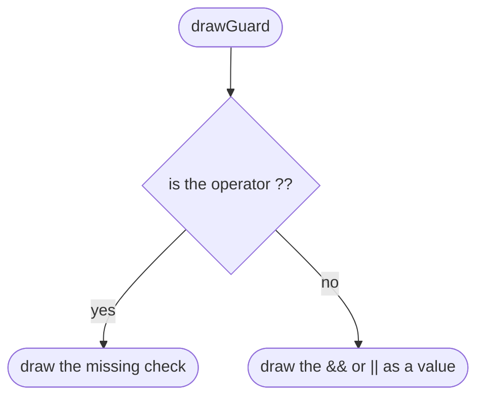

## drawInnerDecisions

Draws every decision hidden inside an expression, in the order the code runs them.

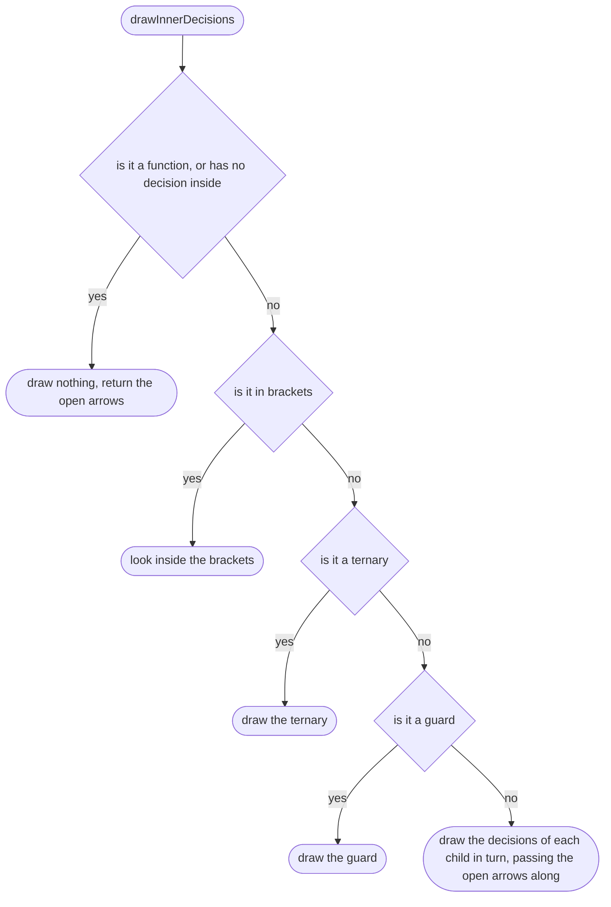

## drawInnerDecisions > inner function 1

Draws one child.

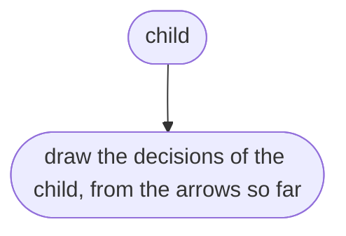
