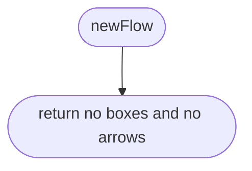
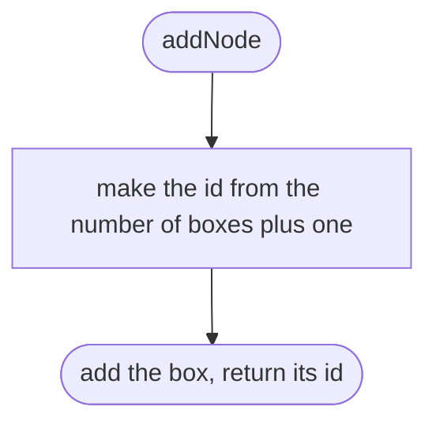
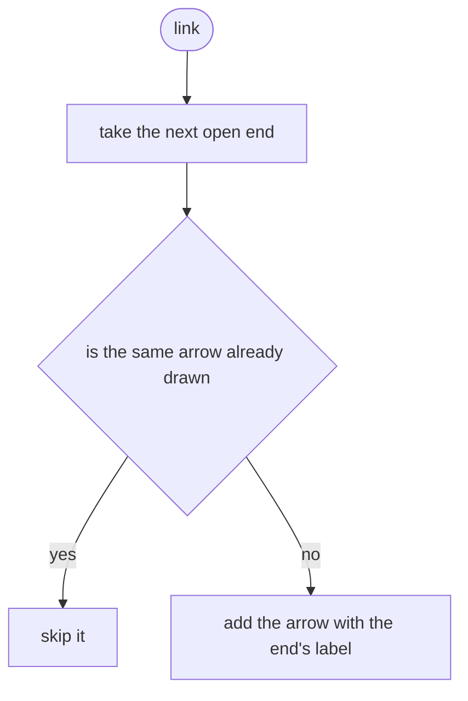
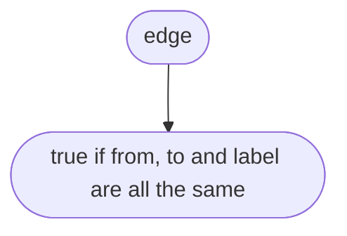
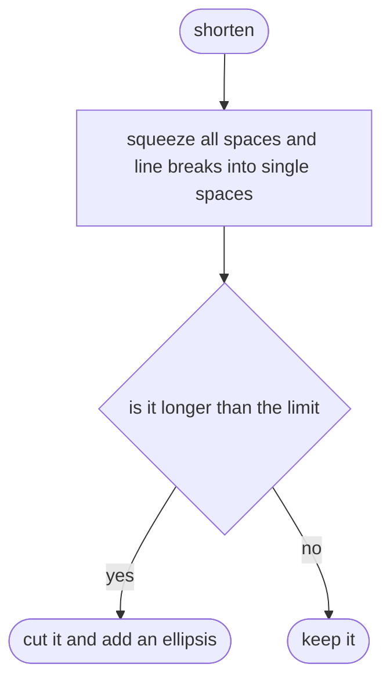
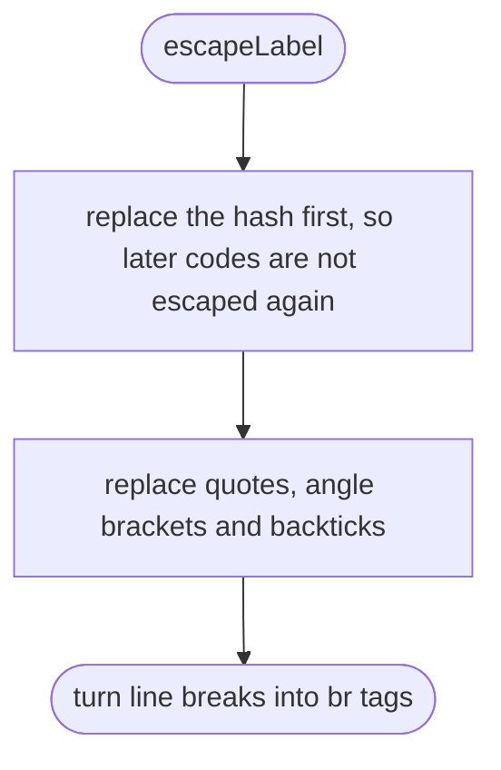
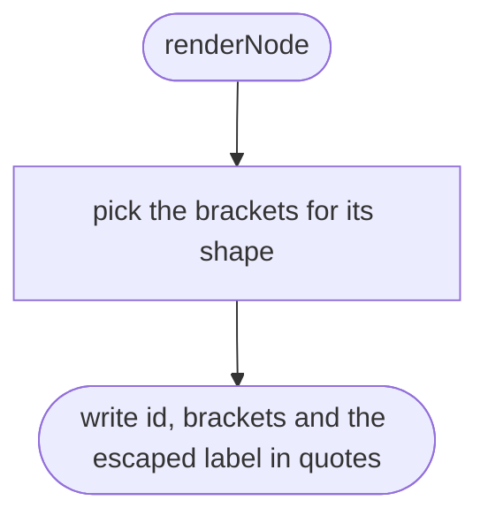
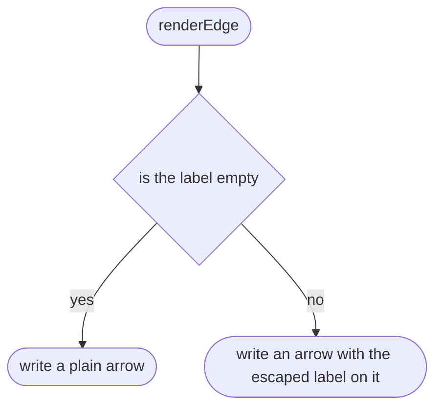
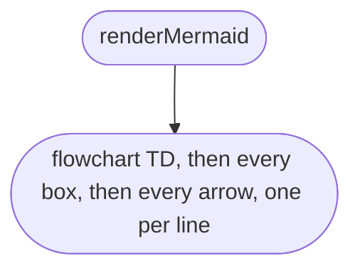

# tools/diagrams/flow-model.ts

Status: approved by Daramola in chat, 2026-10-10 (batch approval of the diagram tool's own designs; written after the code, see Scope 002).

The design for each function, written in plain words. The pictures drawn from the code are in `docs/flows/tools/diagrams/flow-model.md`.

## newFlow

An empty picture.

## addNode

Adds a box and gives it the next number.

## link

Draws an arrow from every open end to a box.

## link > inner function 1

Compares one drawn arrow with the new one.

## shorten

Code text on one line, cut short so a box stays readable.

## escapeLabel

Turns characters Mermaid would read as syntax into entity codes.

## renderNode

The Mermaid text for one box.

## renderEdge

The Mermaid text for one arrow.

## renderMermaid

The Mermaid text for a whole picture.

