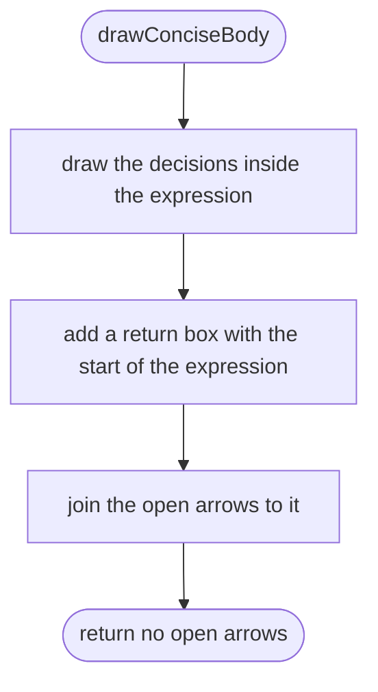
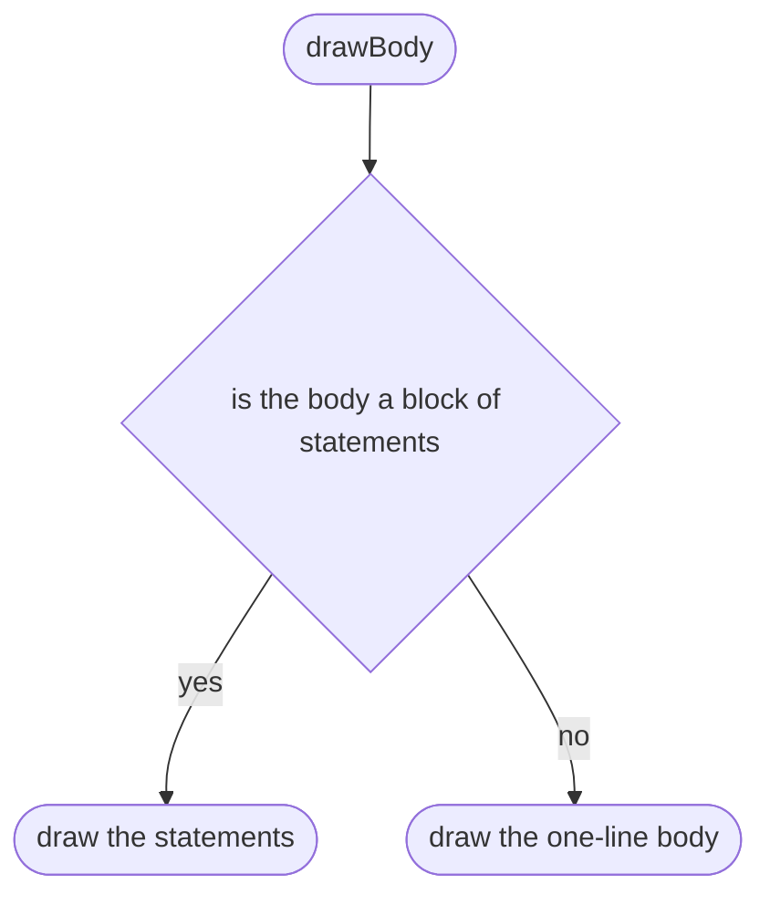
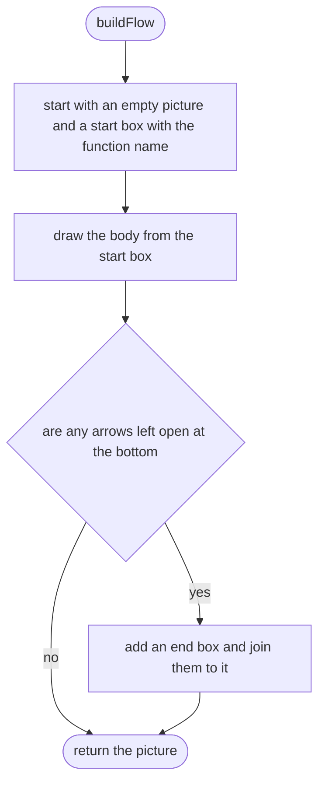

# tools/diagrams/flow.ts

Status: draft. Waiting for the owner's approval; the approval commit changes this line to `Status: approved`.

The design for each function, written in plain words. The pictures drawn from the code are in `docs/flows/tools/diagrams/flow.md`.

## drawConciseBody

Draws a one-line function that just returns an expression.

## drawBody

Draws a function body.

## buildFlow

Draws one whole function.

