# tools/diagrams/functions.ts

Status: approved by Daramola in chat, 2026-10-10 (batch approval of the diagram tool's own designs; written after the code, see Scope 002).

The design for each function, written in plain words. The pictures drawn from the code are in `docs/flows/tools/diagrams/functions.md`.

## isFunctionNode

Says whether a node is any kind of function.

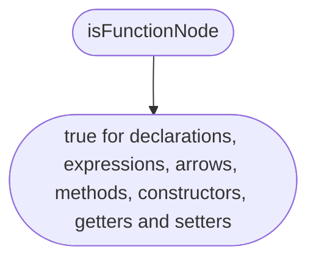

## propertyText

The text of a property name.

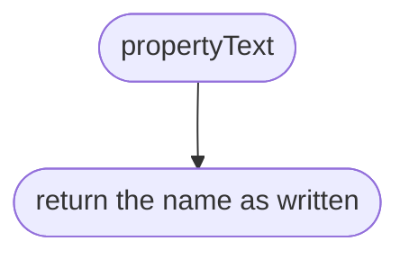

## ownerName

The name a function gets from where it is stored.

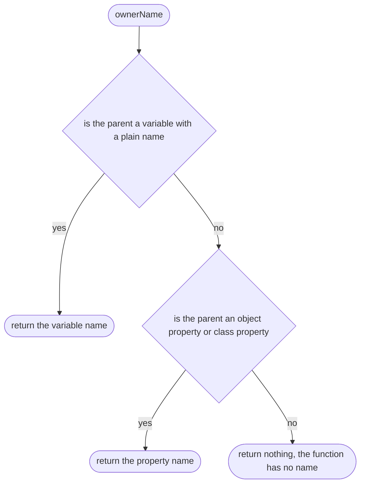

## classPrefix

The class name and a dot, for a member of a named class.

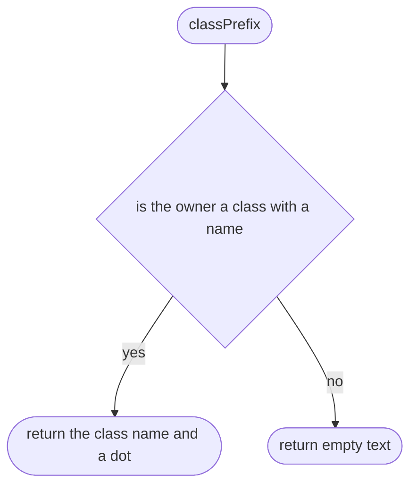

## memberName

The name of a method, getter or setter, with its class.

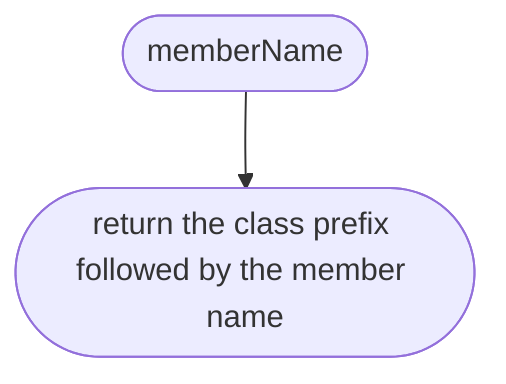

## expressionName

The name of a function expression or arrow.

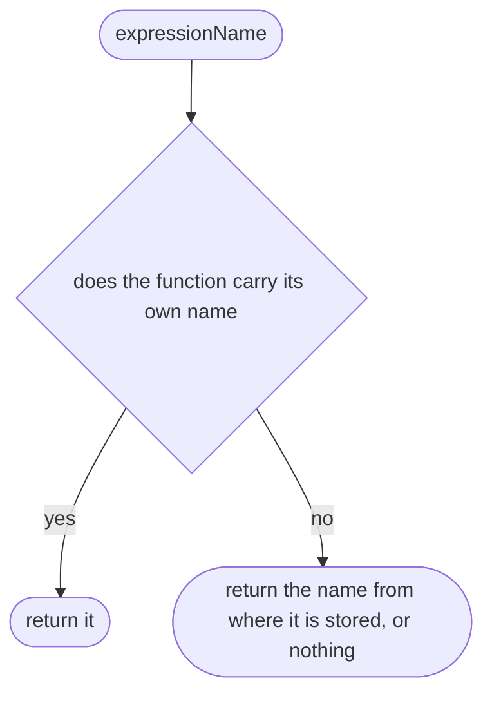

## declaredName

The name the code itself gives a function, if it gives one.

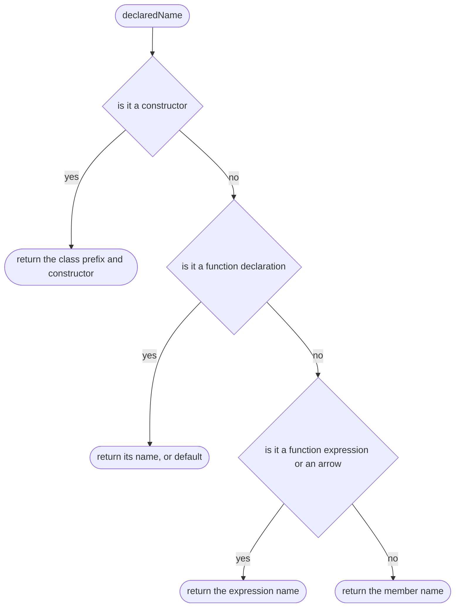

## anyInside

Asks whether any part of a piece of code passes a test, without going into functions.

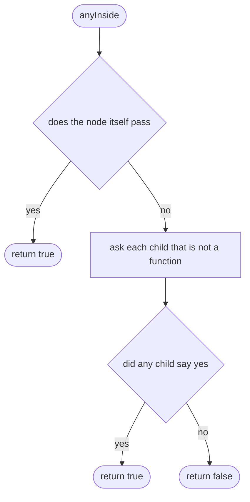

## anyInside > inner function 1

Asks one child.

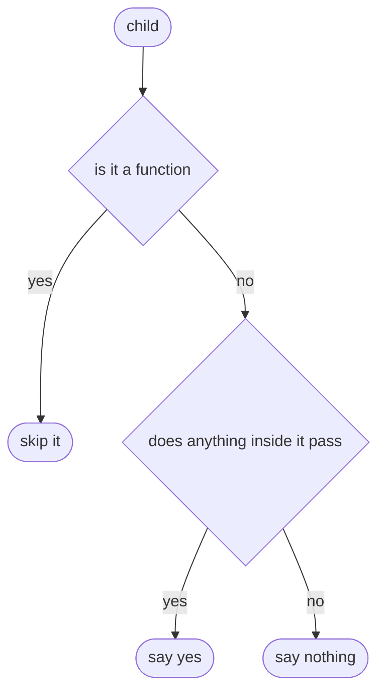

## containsDecision

Says whether a piece of code has a decision in it.

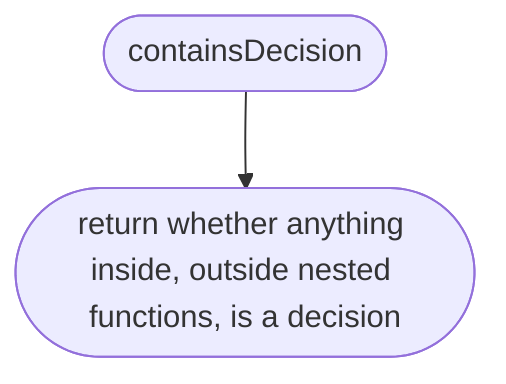

## isGuard

Says whether a node is a &&, || or ??.

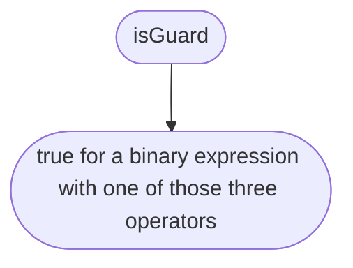

## isDecision

Says whether a node is a decision.

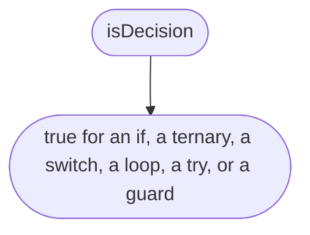

## hasOwnFlow

Says whether a function gets its own picture.

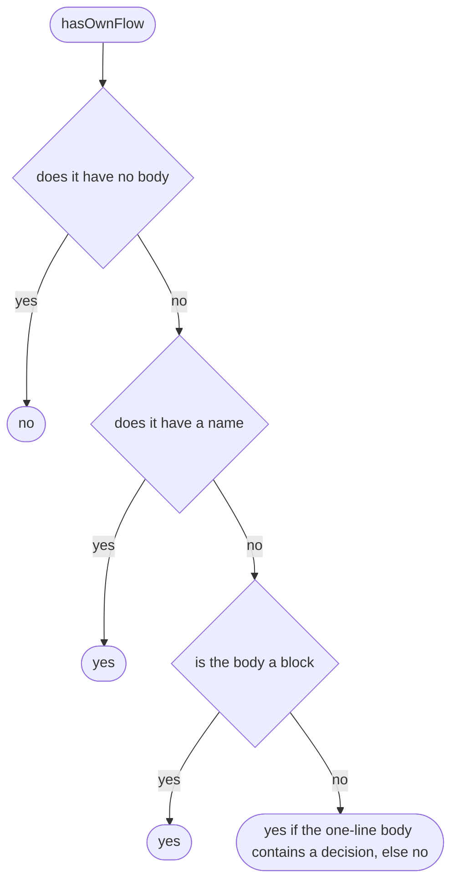

## uniqueName

Makes sure two functions never share a heading.

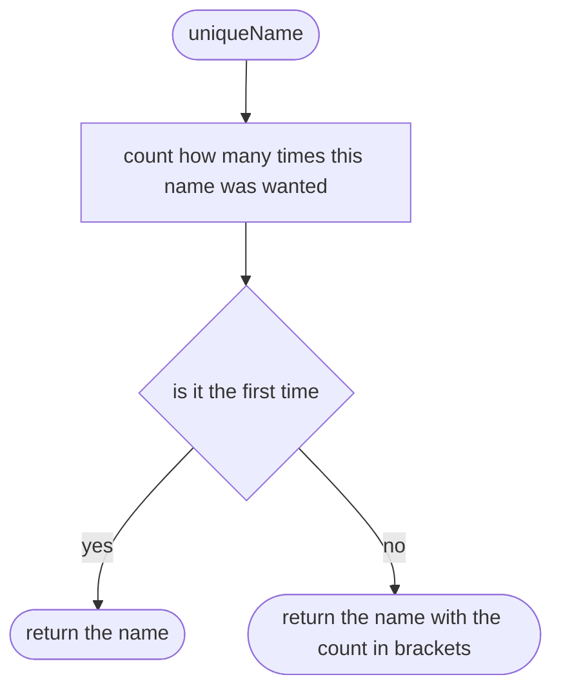

## entryName

Chooses the heading for a function.

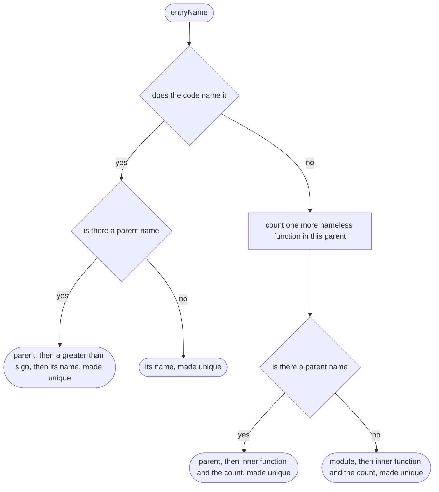

## visit

Walks the code looking for functions with their own picture.

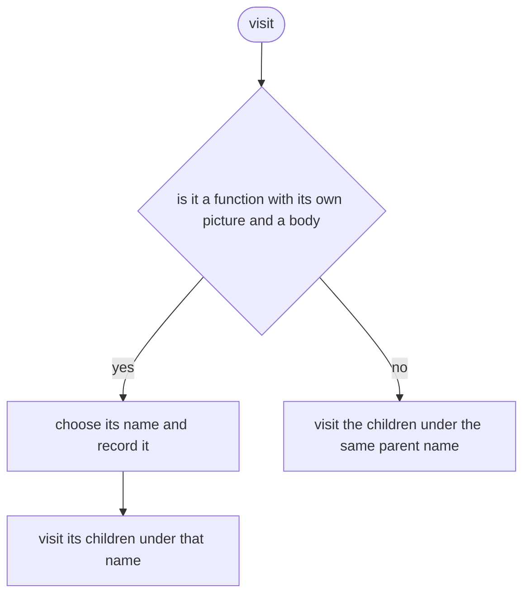

## listFunctions

Lists every function of a file in the order they appear.

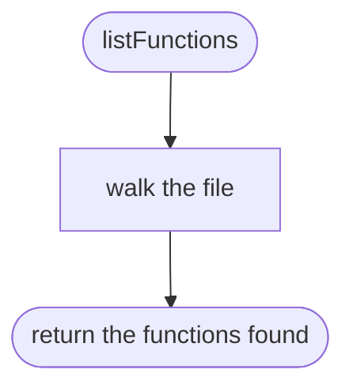
