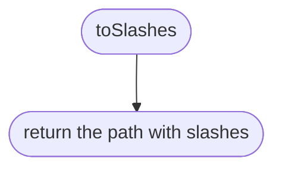
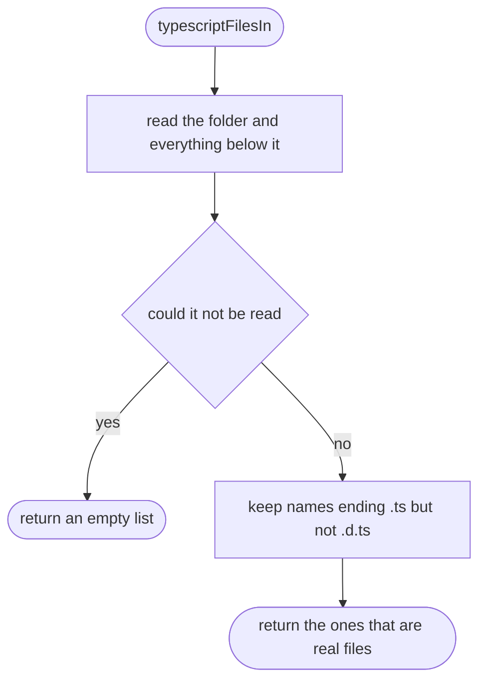
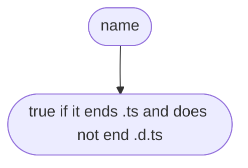
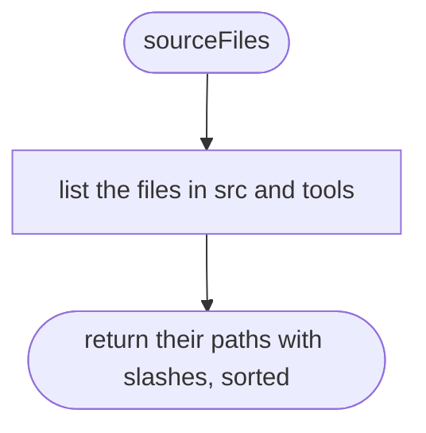
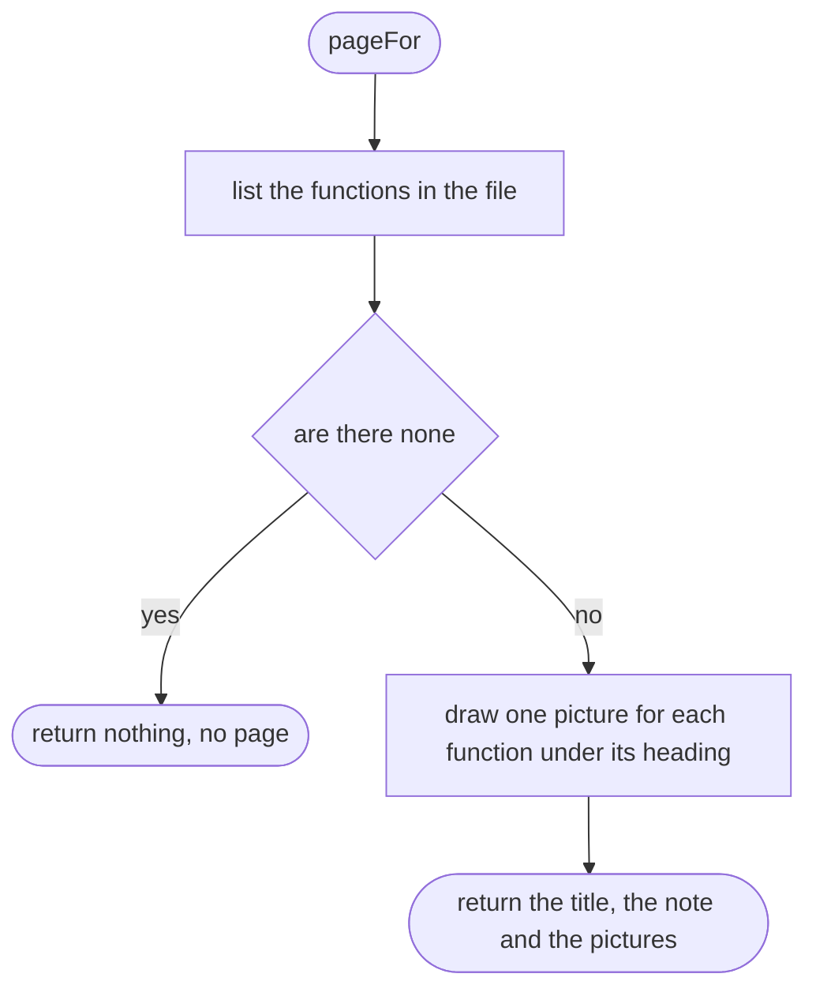
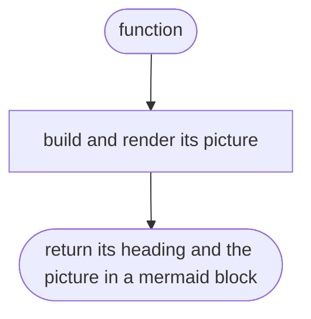
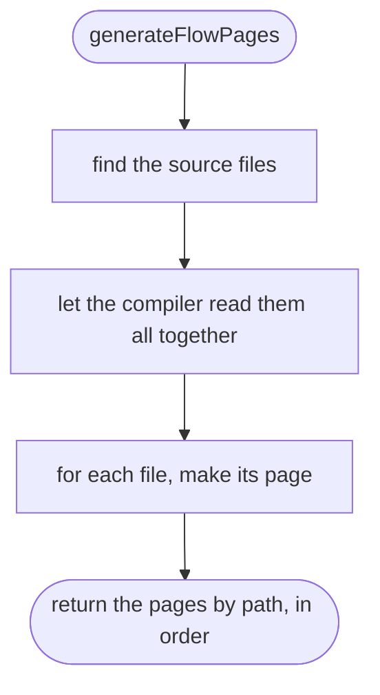
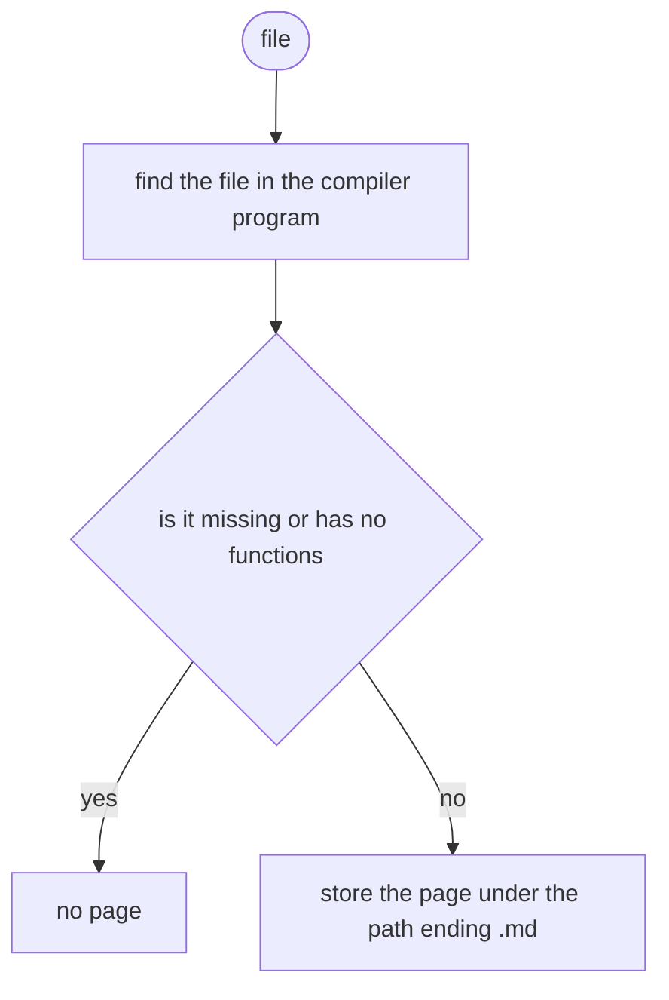

# tools/diagrams/generate.ts

Status: approved by Daramola in chat, 2026-10-10 (batch approval of the diagram tool's own designs; written after the code, see Scope 002).

The design for each function, written in plain words. The pictures drawn from the code are in `docs/flows/tools/diagrams/generate.md`.

## toSlashes

Writes a path with forward slashes whatever the machine.

## typescriptFilesIn

Lists the TypeScript files under a folder.

## typescriptFilesIn > inner function 1

Keeps one name.

## sourceFiles

Every source file of ours, relative to the root, sorted.

## pageFor

The page for one source file.

## pageFor > inner function 1

One function's section.

## generateFlowPages

Draws every page of the project.

## generateFlowPages > inner function 1

One file.

