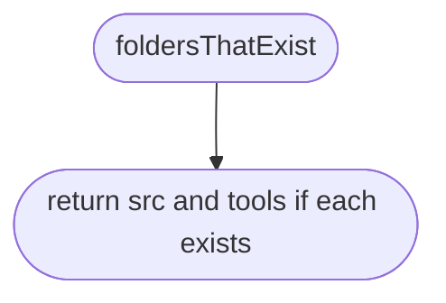
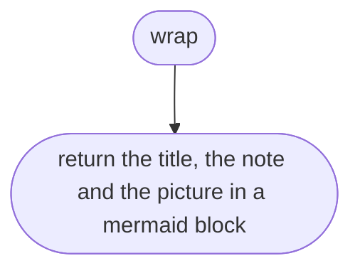
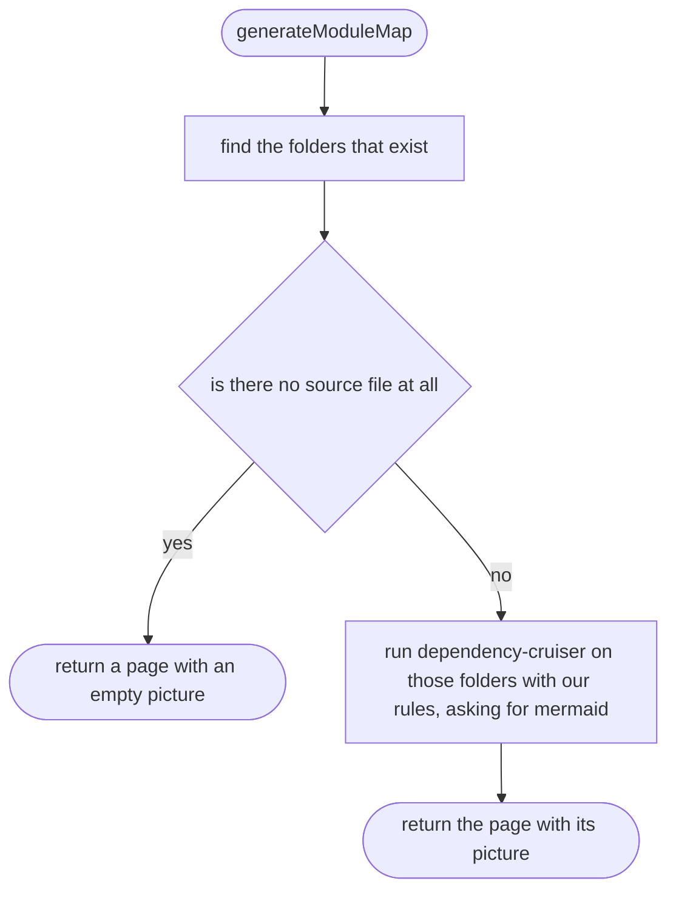

# tools/diagrams/modules.ts

Status: approved by Daramola in chat, 2026-10-10 (batch approval of the diagram tool's own designs; written after the code, see Scope 002).

The design for each function, written in plain words. The pictures drawn from the code are in `docs/flows/tools/diagrams/modules.md`.

## foldersThatExist

Keeps the source folders that are really there.

## wrap

Puts the module map picture into a Markdown page.

## generateModuleMap

Draws which file uses which.

