# tools/diagrams/statements.ts

Status: draft. Waiting for the owner's approval; the approval commit changes this line to `Status: approved`.

The design for each function, written in plain words. The pictures drawn from the code are in `docs/flows/tools/diagrams/statements.md`.

## typed

Lets a handler for one kind of statement be stored with the others.

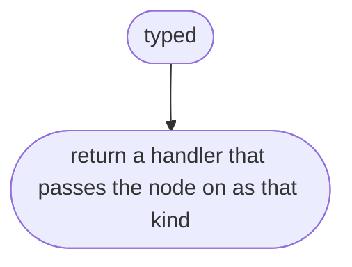

## drawStatements

Draws a list of statements one after another.

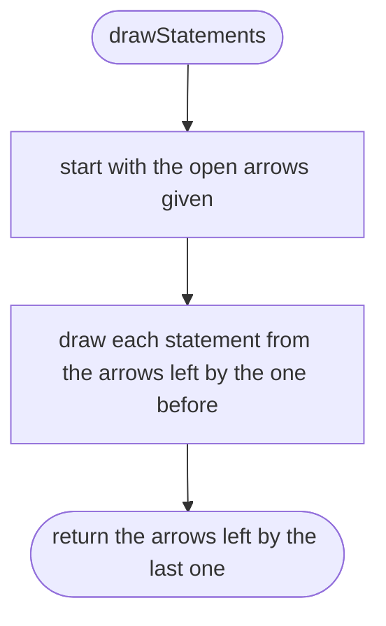

## drawStatement

Draws one statement by its kind.

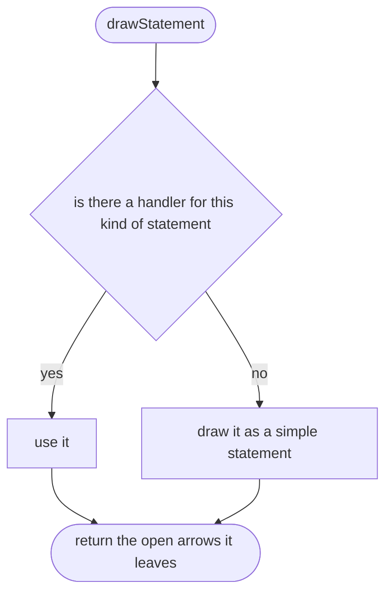

## drawSimple

Draws a statement that has no branch of its own.

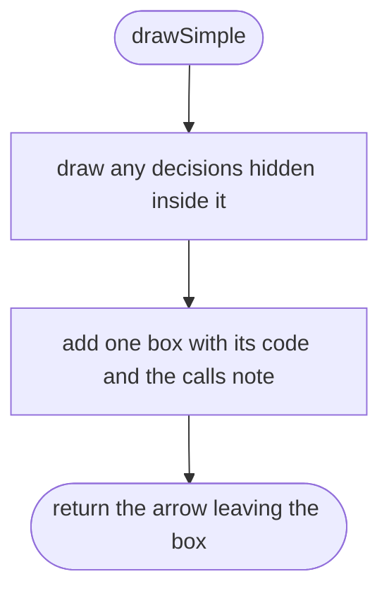

## drawNothing

Draws nothing for things that run no code here, such as a nested function declaration.

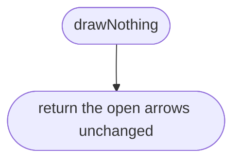

## drawBlock

Draws a block of statements.

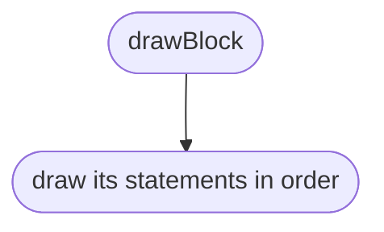

## drawIf

Draws an if.

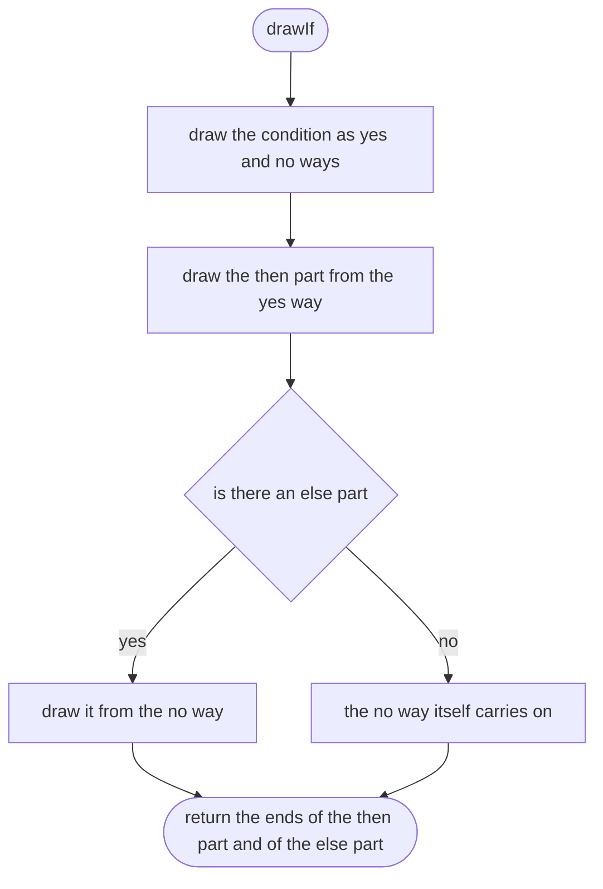

## drawExit

Draws a return or a throw.

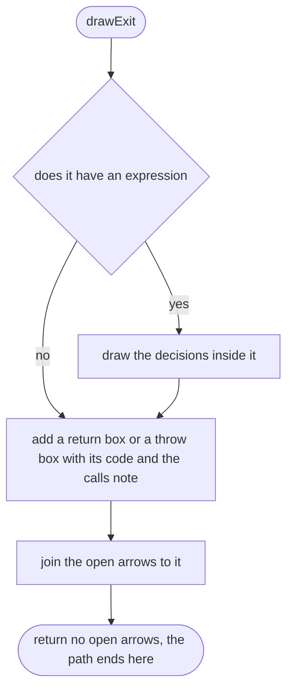

## openTarget

Opens a place that a break or continue can jump to.

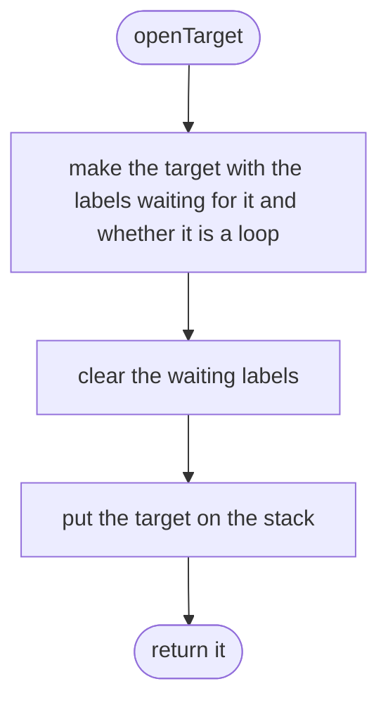

## findTarget

Finds where a break or continue jumps to.

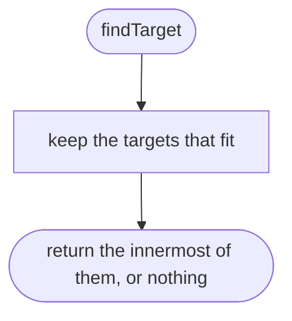

## findTarget > inner function 1

Whether one target fits.

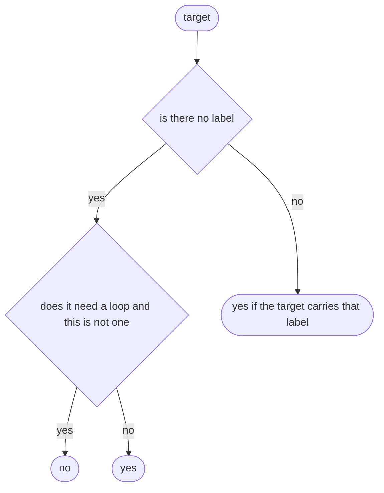

## drawJump

Draws a break or continue.

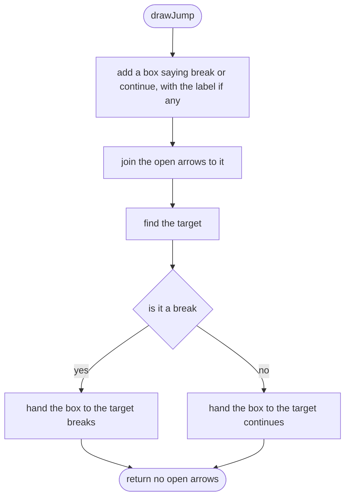

## drawLabeled

Draws a statement that has a label.

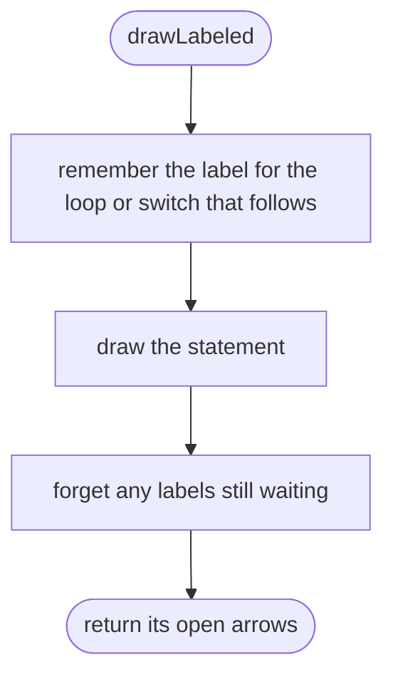

## drawLoopBody

Draws a loop body and sends its ends back to the top.

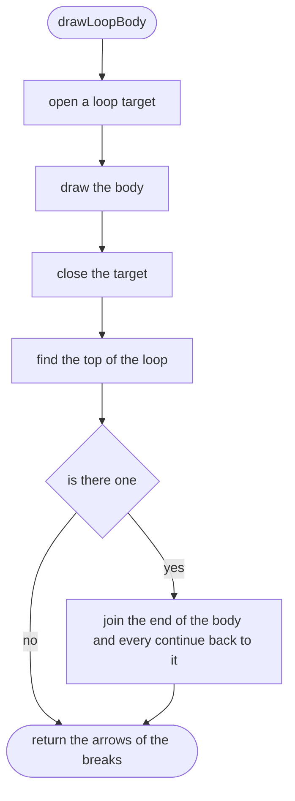

## firstNodeSince

The first box added since a mark.

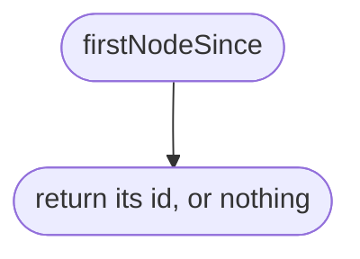

## drawWhile

Draws a while loop.

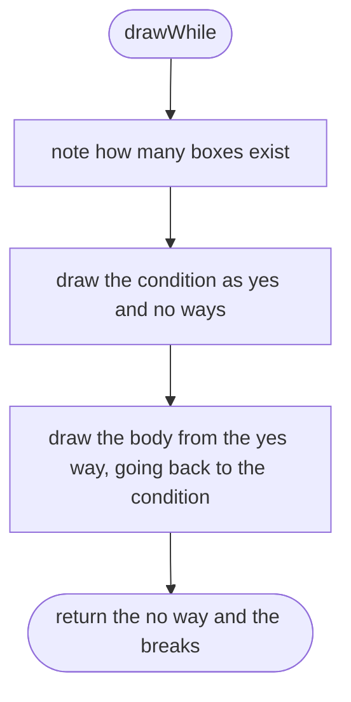

## drawDoWhile

Draws a do while loop.

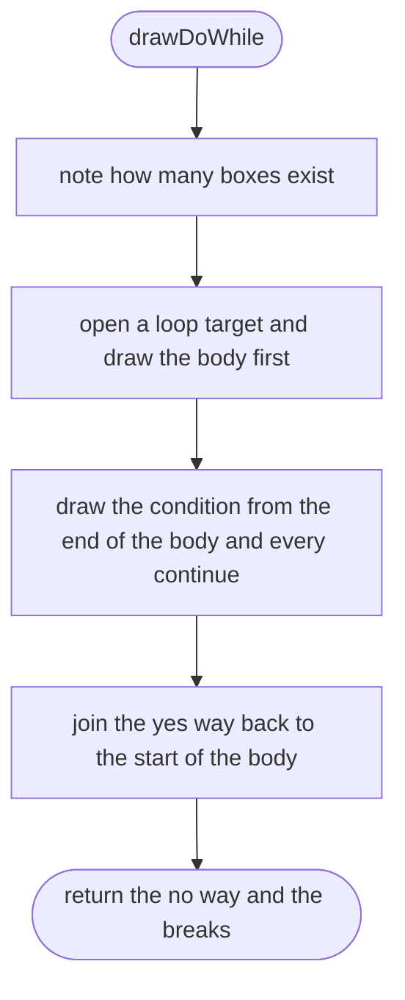

## drawForEach

Draws a for of or for in loop.

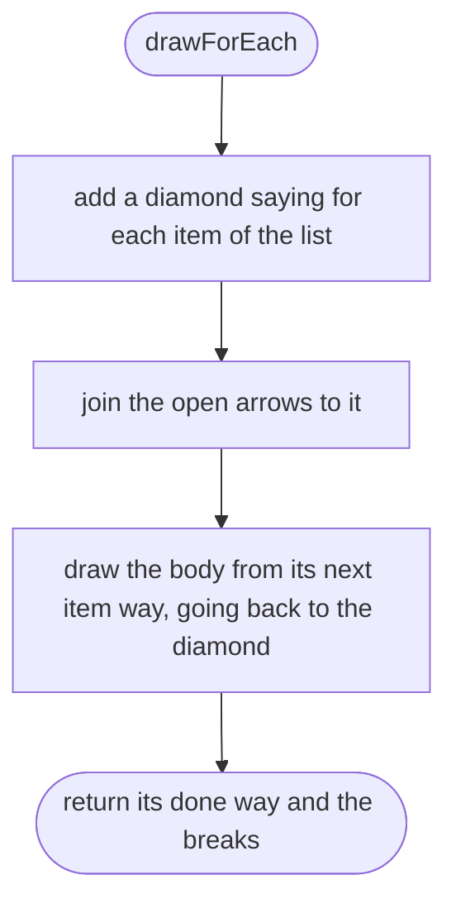

## drawForInit

Draws the first part of a for loop.

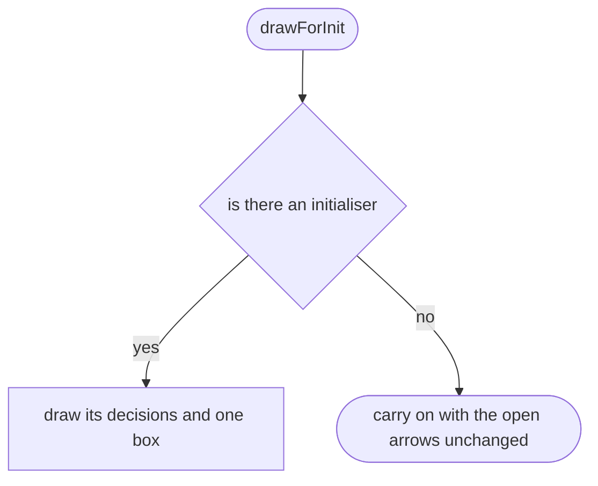

## drawFor

Draws a for loop.

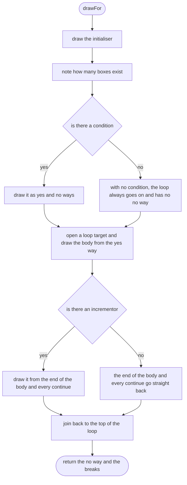

## caseLabel

The words on the arrow to one case of a switch.

```mermaid
flowchart TD
  s(["caseLabel"])
  a{"is it a case"}
  b(["return case and its value"])
  c(["return default"])
  s --> a
  a -->|"yes"| b
  a -->|"no"| c
```

## drawSwitch

Draws a switch.

```mermaid
flowchart TD
  s(["drawSwitch"])
  a["draw the decisions inside the switched value"]
  b["add a diamond for the switch"]
  c["open a switch target"]
  d["for each case, draw its statements from the diamond and from the case before it, which is how falling through works"]
  e["close the target"]
  f{"is there a default"}
  g["the end of the last case and every break leave the switch"]
  h["also add a way out saying no case matches"]
  i(["return the open arrows"])
  s --> a
  a --> b
  b --> c
  c --> d
  d --> e
  e --> f
  f -->|"yes"| g
  f -->|"no"| h
  g --> i
  h --> i
```

## drawTry

Draws a try with its catch and finally.

```mermaid
flowchart TD
  s(["drawTry"])
  a["add a box saying try"]
  b["draw the try block"]
  c{"is there a catch"}
  d["draw it from a throws arrow of the try box"]
  e["no catch"]
  f["join the ends of the try and of the catch"]
  g{"is there a finally"}
  h["draw the finally block from the joined ends"]
  i(["return the joined ends"])
  j(["return the ends of the finally"])
  s --> a
  a --> b
  b --> c
  c -->|"yes"| d
  c -->|"no"| e
  d --> f
  e --> f
  f --> g
  g -->|"yes"| h
  g -->|"no"| i
  h --> j
```

## drawCatch

Draws a catch.

```mermaid
flowchart TD
  s(["drawCatch"])
  a["add a box saying catch and the name of the error, if any"]
  b["join the open arrows to it"]
  c(["draw the catch block after it"])
  s --> a
  a --> b
  b --> c
```
