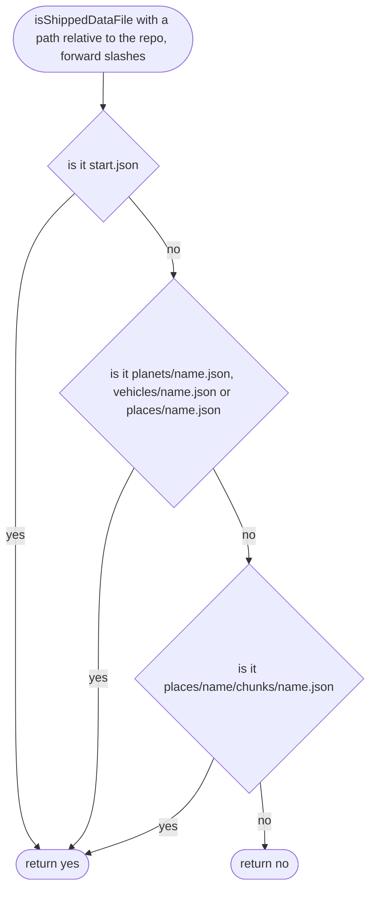

# tools/site/data-files.ts

Status: draft

New in scope 005 (item 4). The game fetches its data (place, planet, car,
map squares) as files at run time, so they are not baked into the
JavaScript. Vite serves the repo's files in development; for the built game,
`vite.config.ts` copies the files this function picks into the build (Vite
plugin API, `generateBundle` / `emitFile`; Vite docs `guide/build.md` opened,
research/36). The pictures drawn from the code will be in
`docs/flows/tools/site/data-files.md`.

## isShippedDataFile

Why the game needs it: the built game must carry every file the player needs and nothing private: never `raw-data/`, never research or source.

