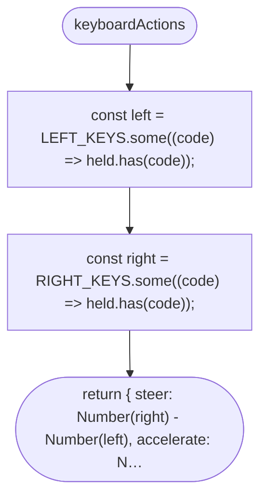
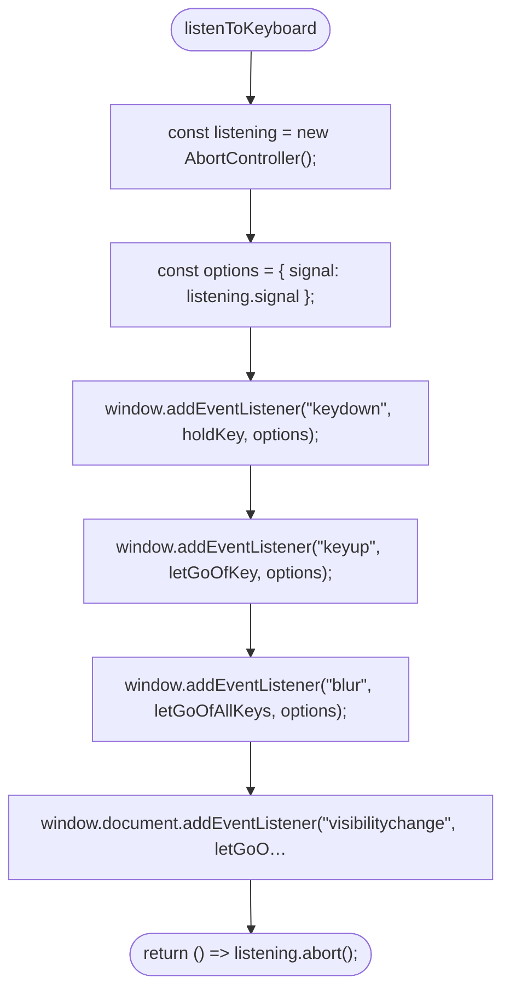
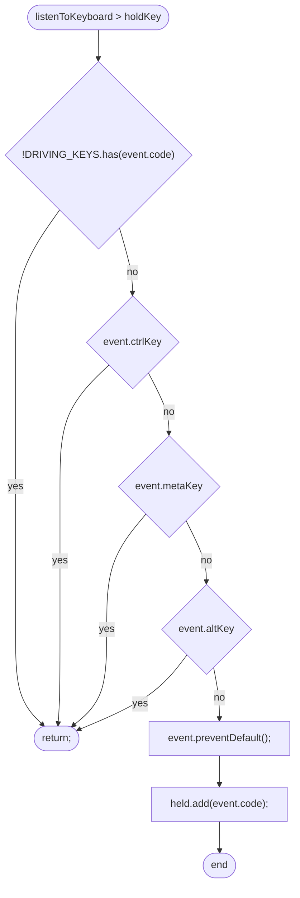
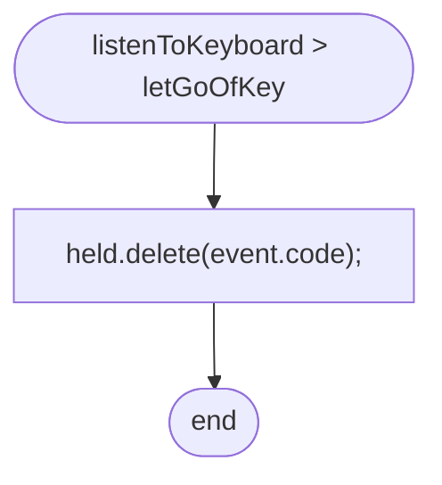
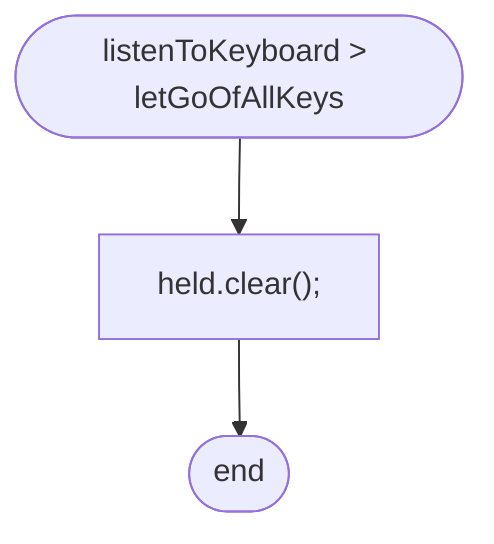

# src/controls/keyboard.ts

Drawn from the code by `npm run diagrams` (TypeScript compiler, no AI). Do not edit by hand: change the code, then run it again.

## keyboardActions

## listenToKeyboard

## listenToKeyboard > holdKey

## listenToKeyboard > letGoOfKey

## listenToKeyboard > letGoOfAllKeys

