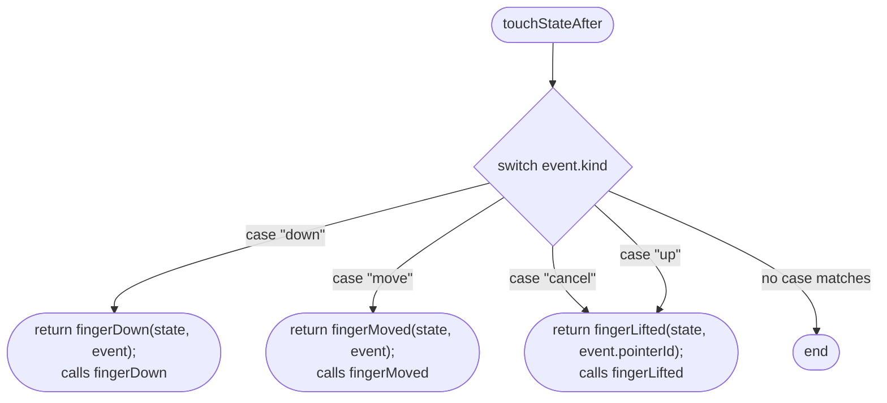
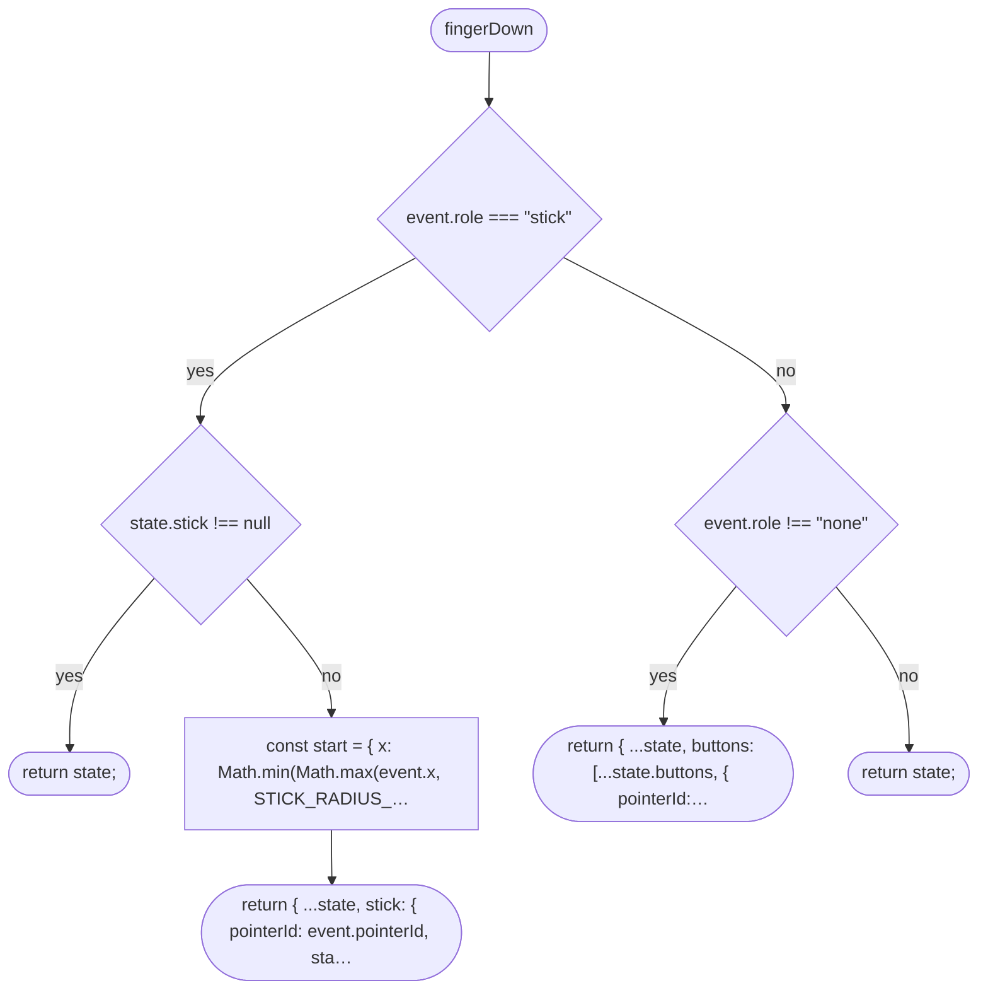
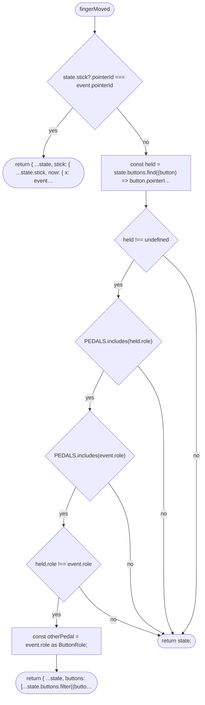
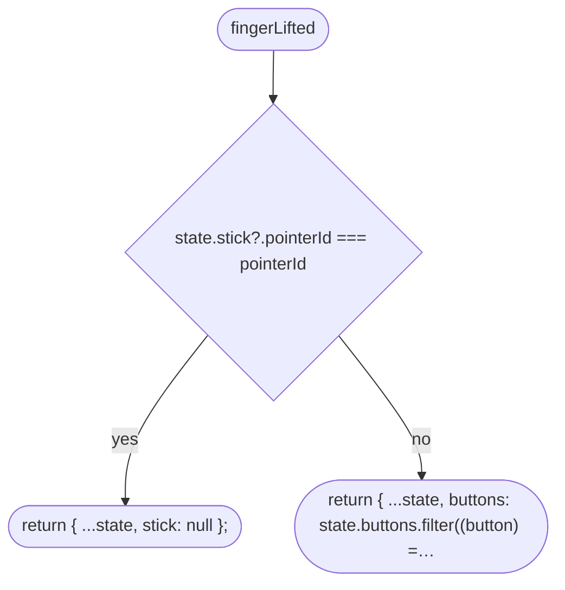
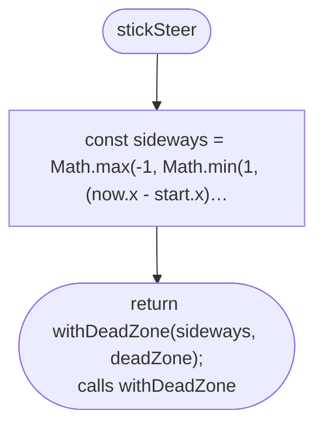
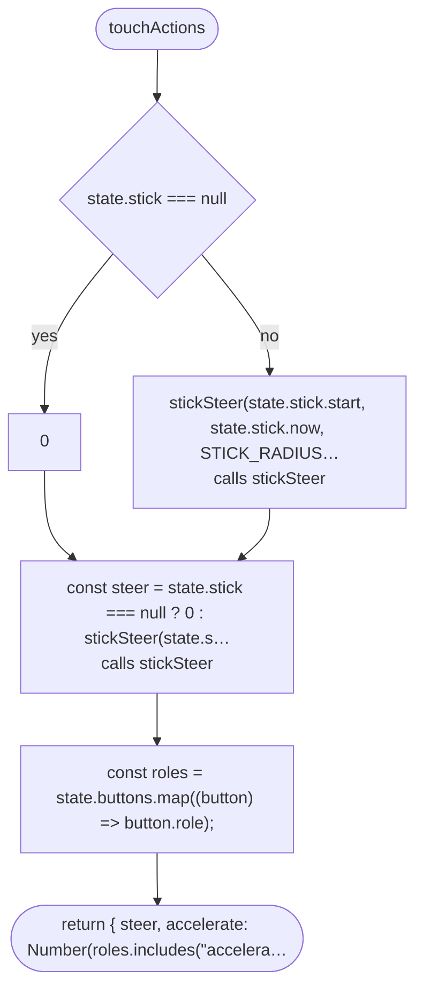
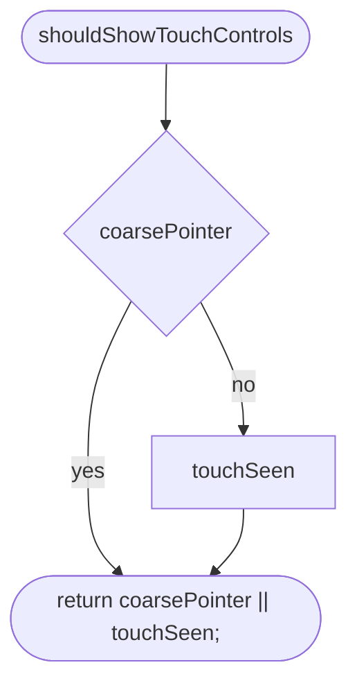
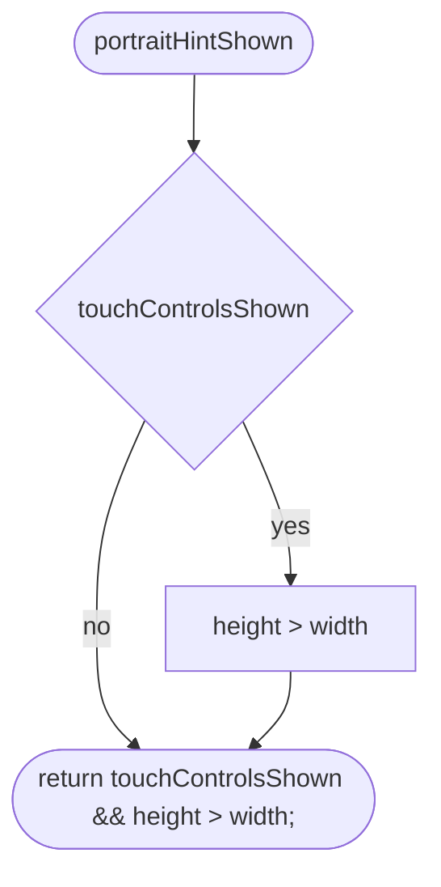
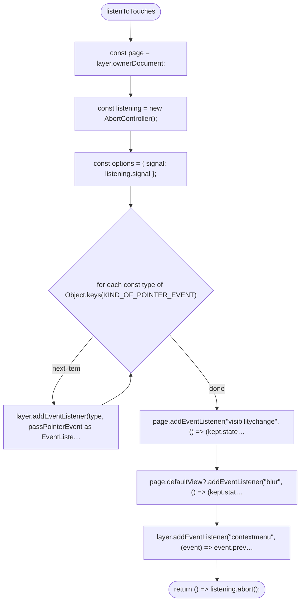
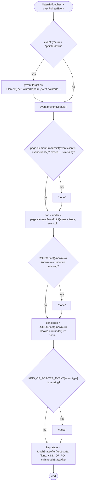

# src/controls/touch.ts

Drawn from the code by `npm run diagrams` (TypeScript compiler, no AI). Do not edit by hand: change the code, then run it again.

## touchStateAfter

## fingerDown

## fingerMoved

## fingerLifted

## stickSteer

## touchActions

## shouldShowTouchControls

## portraitHintShown

## listenToTouches

## listenToTouches > passPointerEvent

