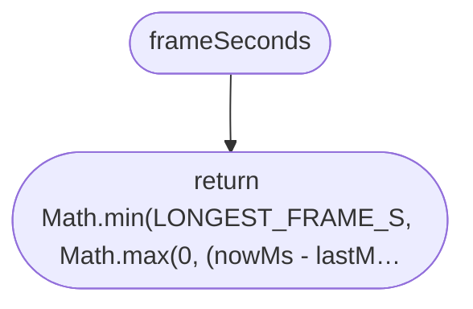
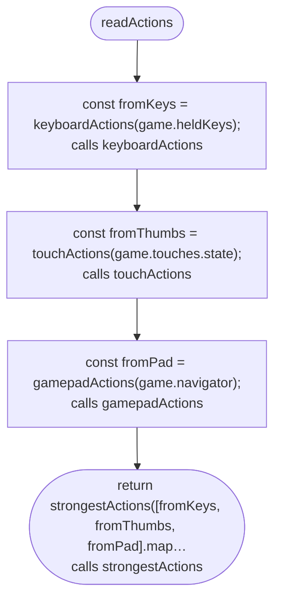
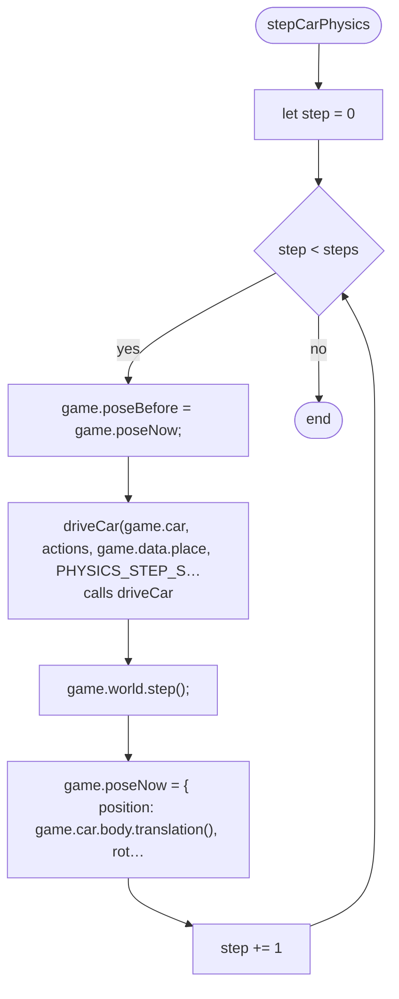
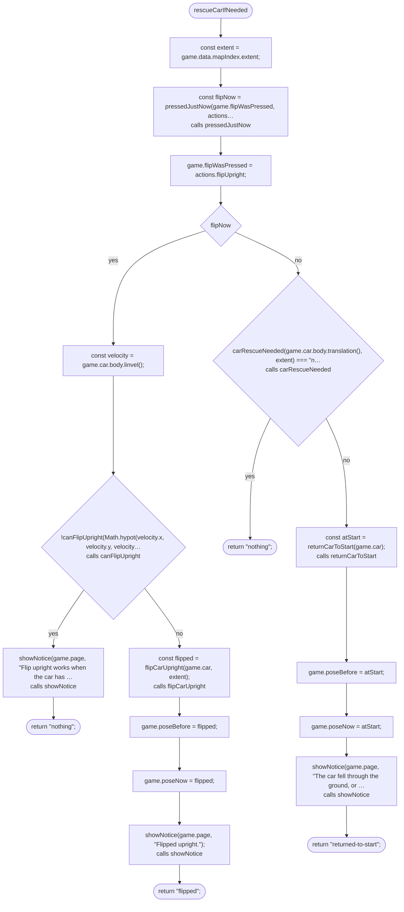
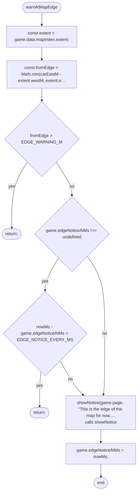
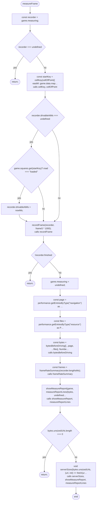
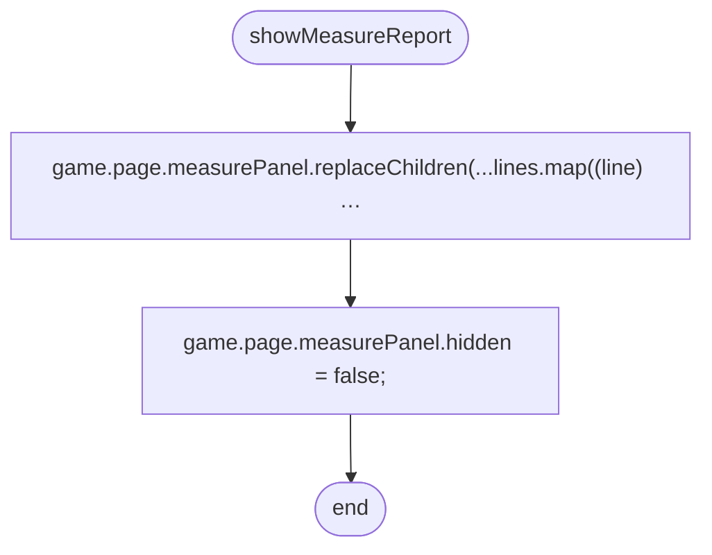
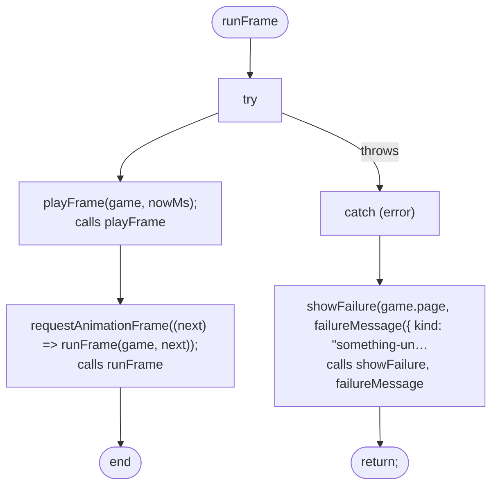

# src/game/loop.ts

Drawn from the code by `npm run diagrams` (TypeScript compiler, no AI). Do not edit by hand: change the code, then run it again.

## frameSeconds

## readActions

## stepCarPhysics

## rescueCarIfNeeded

## warnAtMapEdge

## measureFrame

## showMeasureReport

## playFrame

```mermaid
flowchart TD
  n1(["playFrame"])
  n2{"game.lastFrameMs is missing?"}
  n3["nowMs"]
  n4["const frameS = frameSeconds(game.lastFrameMs ?? nowMs, nowM…<br/>calls frameSeconds"]
  n5["game.lastFrameMs = nowMs;"]
  n6["const actions = readActions(game);<br/>calls readActions"]
  n7["const happened = rescueCarIfNeeded(game, actions);<br/>calls rescueCarIfNeeded"]
  n8{"happened === #quot;returned-to-start#quot;"}
  n9["updateStreaming(game, { eastM: game.poseNow.position.x, nor…<br/>calls updateStreaming"]
  n10["const frame = physicsStepsForFrame(game.leftOverS, frameS);<br/>calls physicsStepsForFrame"]
  n11["game.leftOverS = frame.leftOverS;"]
  n12["stepCarPhysics(game, actions, frame.steps);<br/>calls stepCarPhysics"]
  n13["const here = game.car.body.translation();"]
  n14["updateStreaming(game, { eastM: here.x, northM: -here.z }, n…<br/>calls updateStreaming"]
  n15["const drawn = blendPoses(game.poseBefore, game.poseNow, fra…<br/>calls blendPoses"]
  n16["updateCarModel(game.carDrawing, drawn, game.car.controller);<br/>calls updateCarModel"]
  n17["game.aim = moveChaseCamera(game.aim, chaseCameraGoal(drawn)…<br/>calls moveChaseCamera, chaseCameraGoal"]
  n18["game.camera.position.set(game.aim.cameraPoint.x, game.aim.c…"]
  n19["game.camera.lookAt(game.aim.lookPoint.x, game.aim.lookPoint…"]
  n20["warnAtMapEdge(game, here.x, -here.z, nowMs);<br/>calls warnAtMapEdge"]
  n21["updateHud(game, { eastM: here.x, northM: -here.z }, nowMs);<br/>calls updateHud"]
  n22["measureFrame(game, frameS, nowMs);<br/>calls measureFrame"]
  n23["game.renderer.render(game.parts.scene, game.camera);"]
  n24(["end"])
  n1 --> n2
  n2 -->|"yes"| n3
  n2 -->|"no"| n4
  n3 --> n4
  n4 --> n5
  n5 --> n6
  n6 --> n7
  n7 --> n8
  n8 -->|"yes"| n9
  n9 --> n10
  n8 -->|"no"| n10
  n10 --> n11
  n11 --> n12
  n12 --> n13
  n13 --> n14
  n14 --> n15
  n15 --> n16
  n16 --> n17
  n17 --> n18
  n18 --> n19
  n19 --> n20
  n20 --> n21
  n21 --> n22
  n22 --> n23
  n23 --> n24
```

## runFrame

