# src/game/minimap.ts

Drawn from the code by `npm run diagrams` (TypeScript compiler, no AI). Do not edit by hand: change the code, then run it again.

## mapView

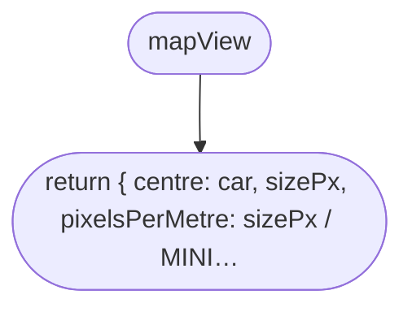

## toScreen

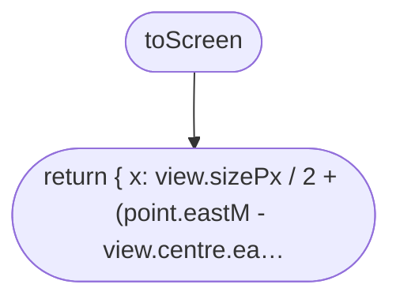

## lineInView

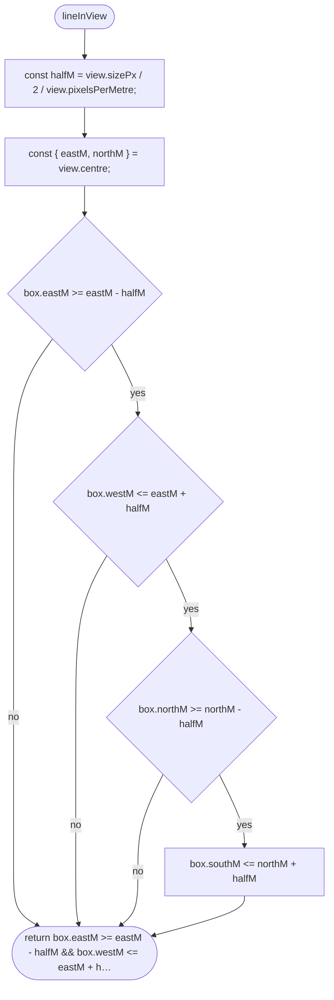

## headingFromFlat

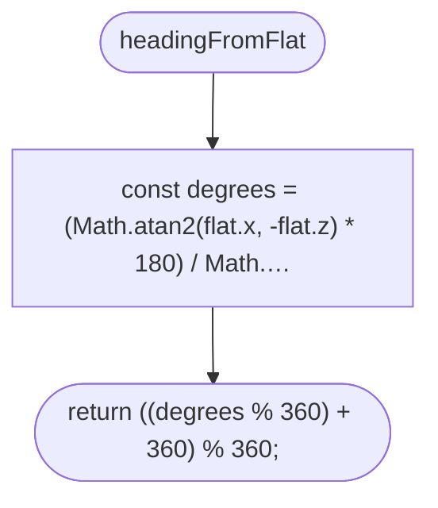

## labelSpots

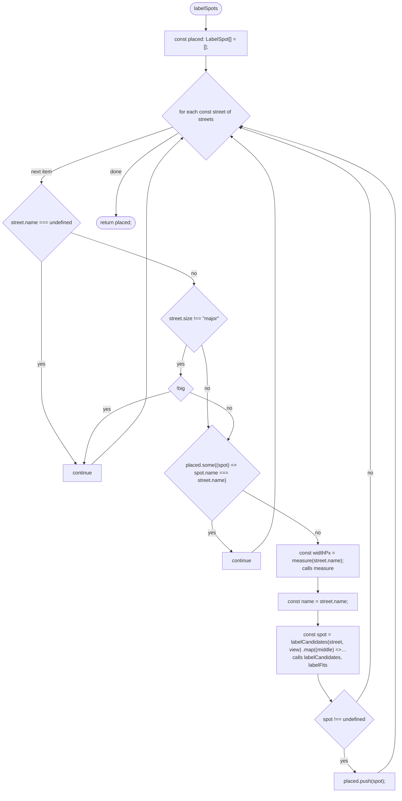

## labelCandidates

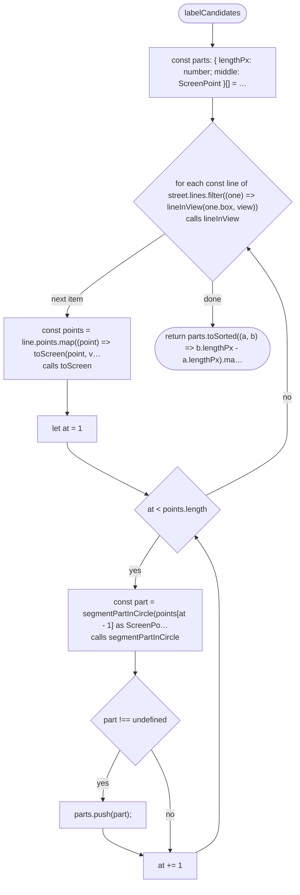

## segmentPartInCircle

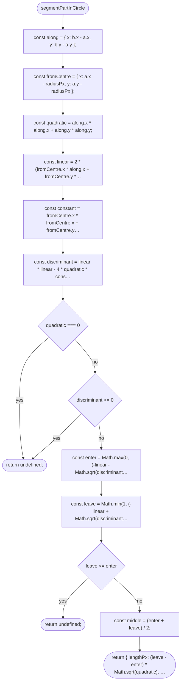

## labelFits

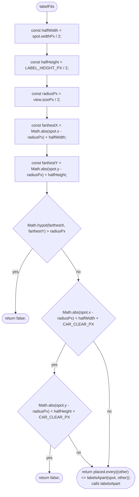

## labelsApart

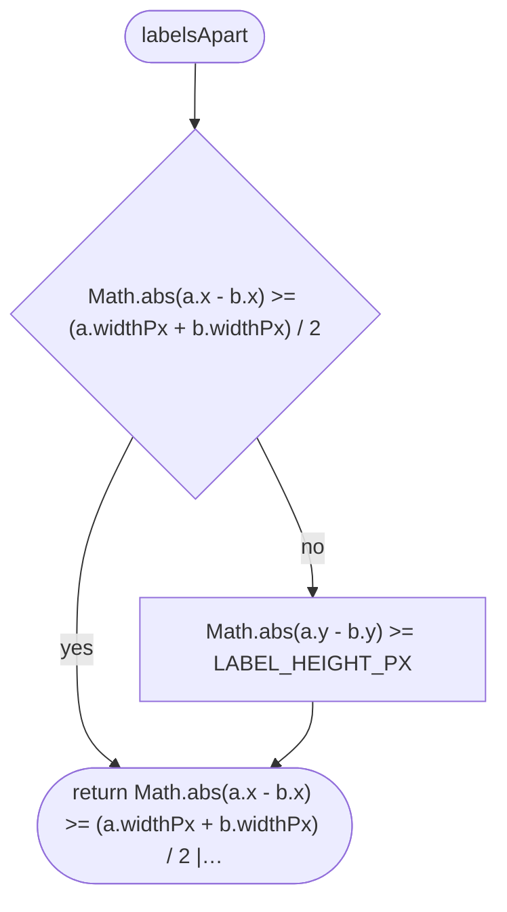

## drawMiniMap

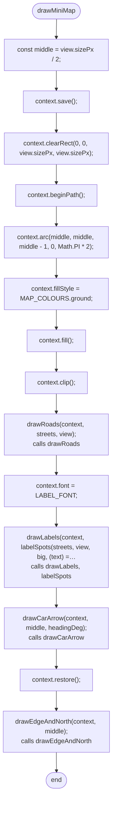

## drawRoads

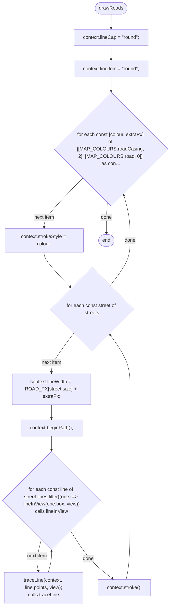

## traceLine

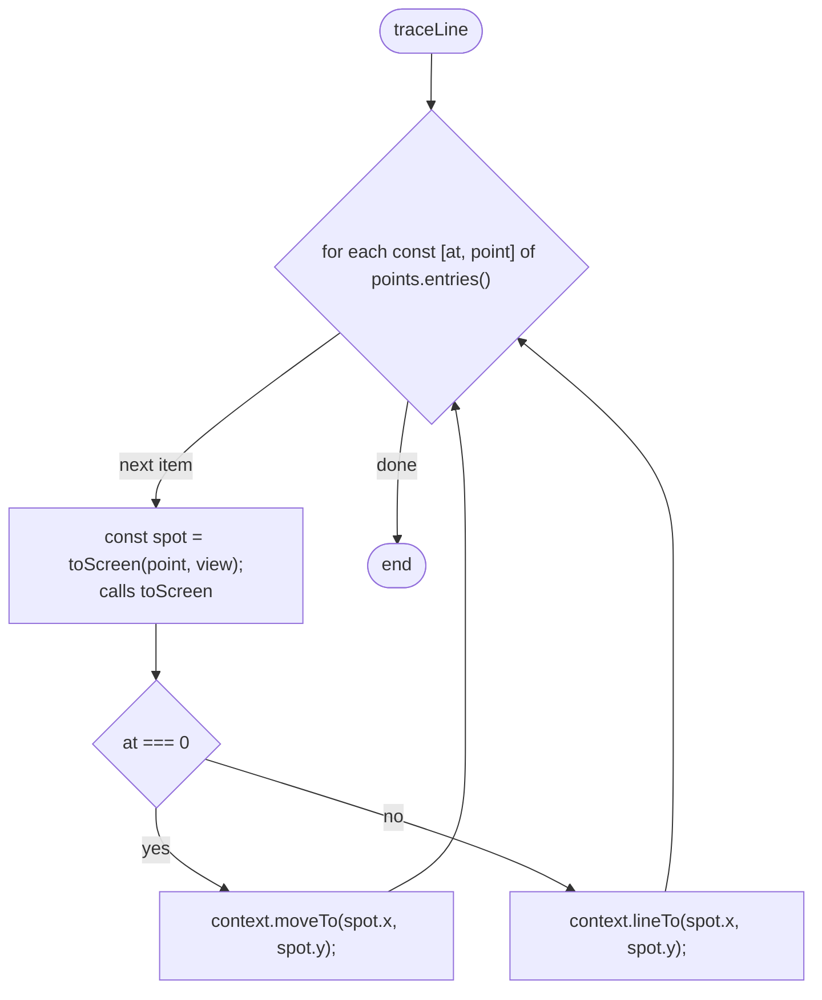

## drawLabels

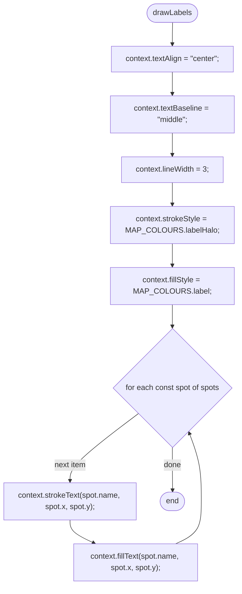

## drawCarArrow

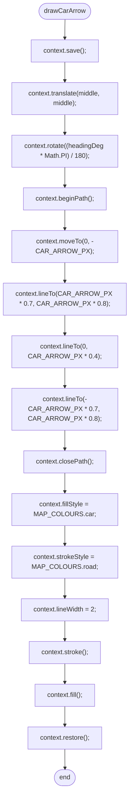

## drawEdgeAndNorth

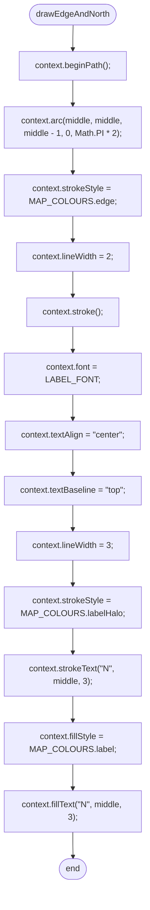
