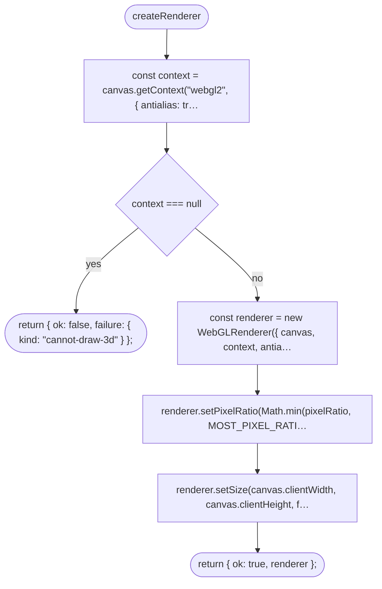
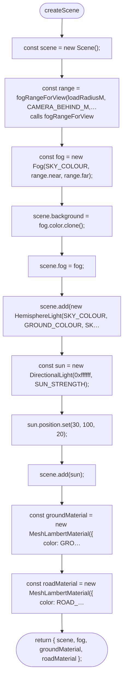
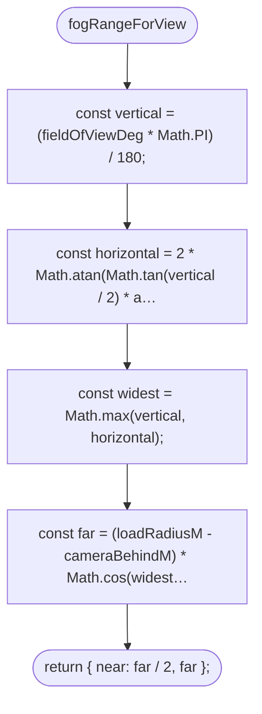
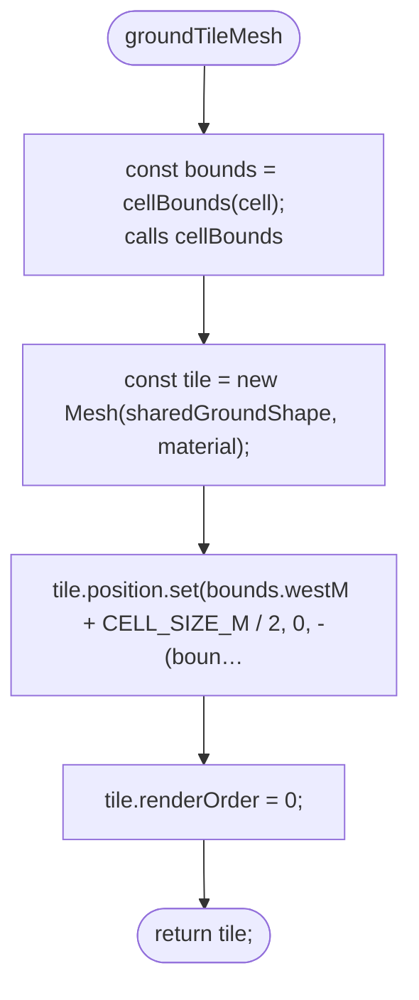
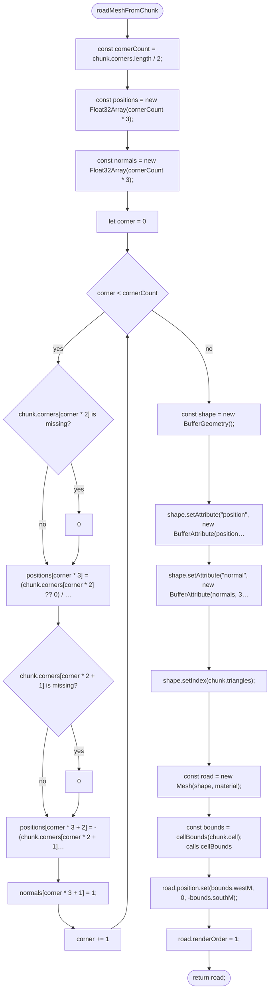
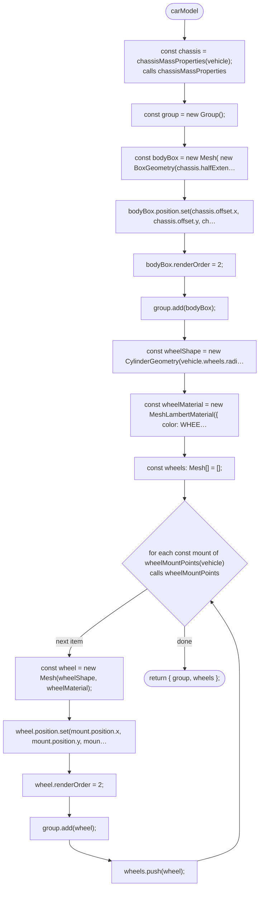
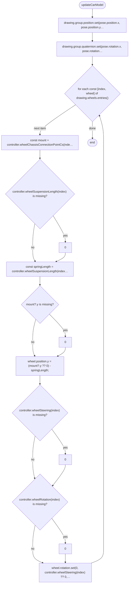
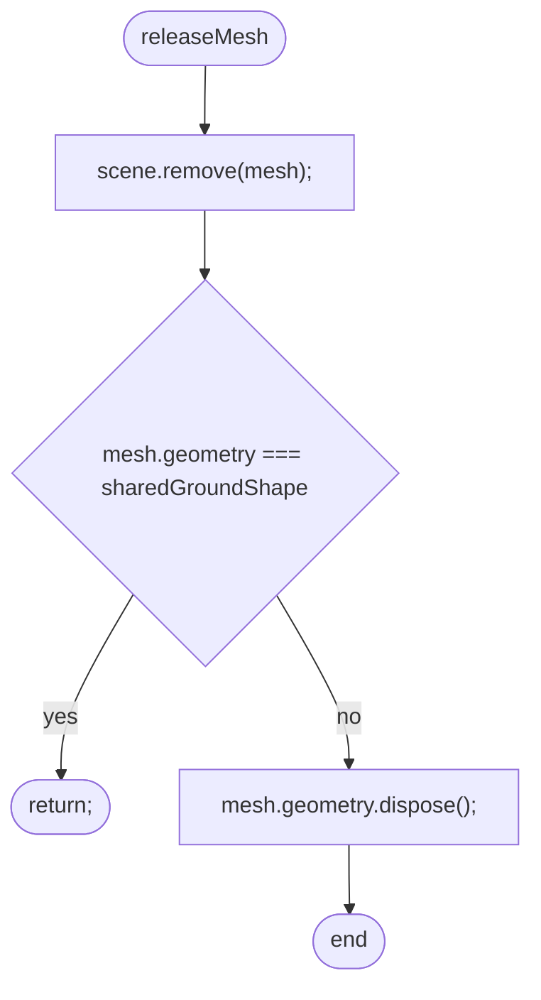

# src/game/scene.ts

Drawn from the code by `npm run diagrams` (TypeScript compiler, no AI). Do not edit by hand: change the code, then run it again.

## createRenderer

## createScene

## fogRangeForView

## groundTileMesh

## roadMeshFromChunk

## carModel

## updateCarModel

## releaseMesh

