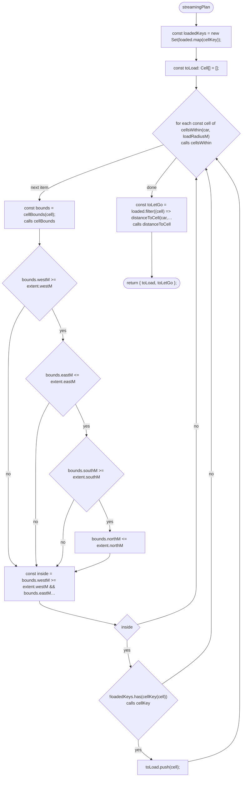
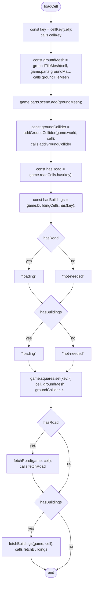
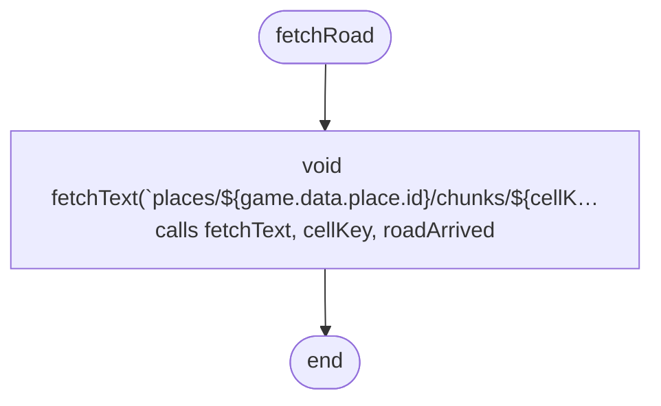
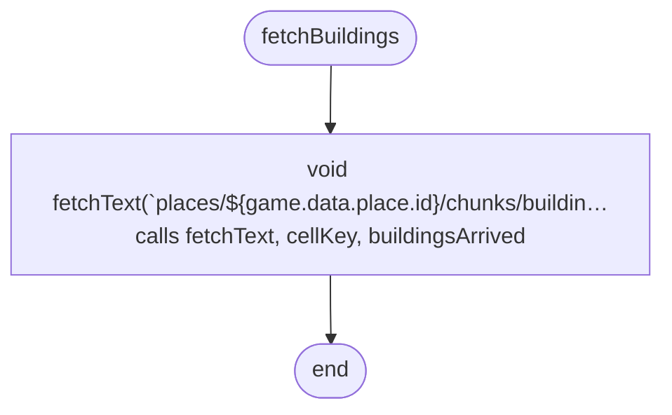
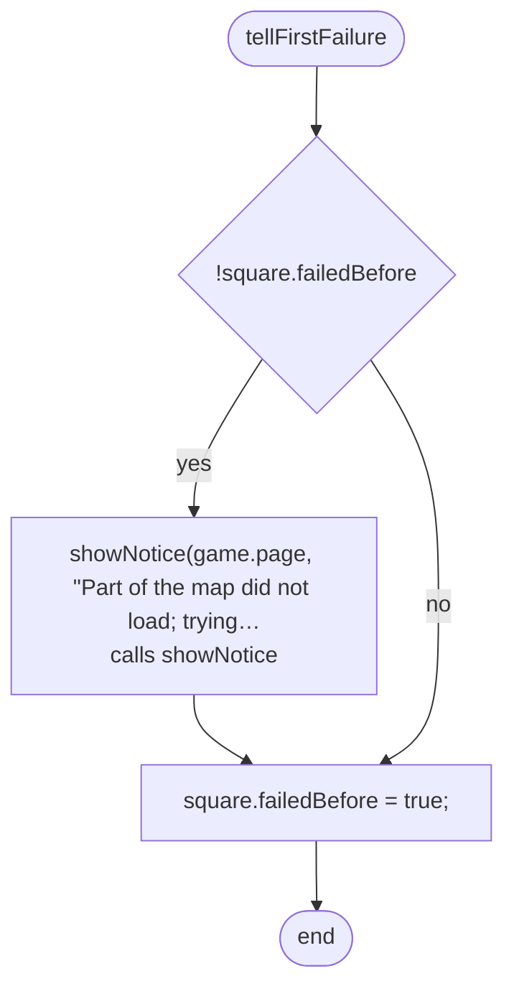
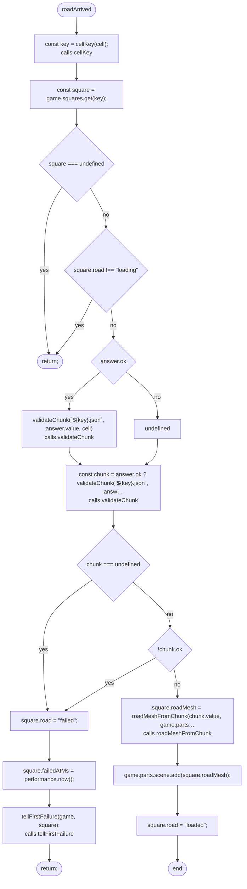
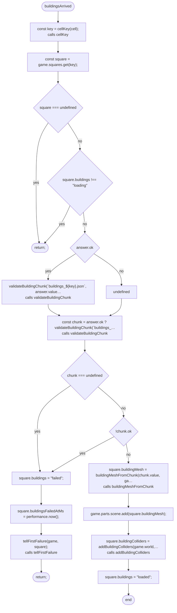
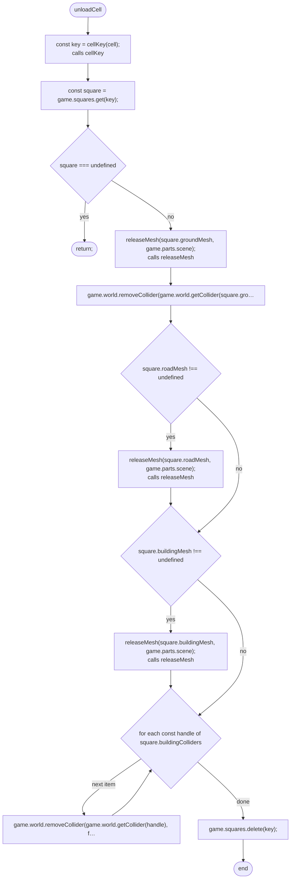
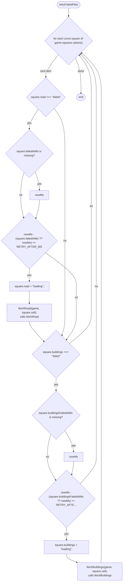
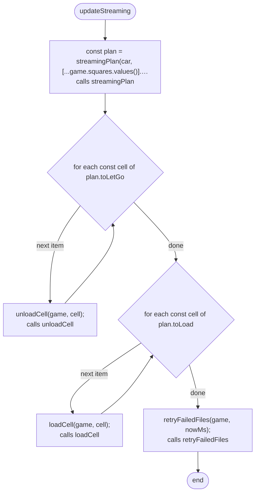

# src/game/streaming.ts

Drawn from the code by `npm run diagrams` (TypeScript compiler, no AI). Do not edit by hand: change the code, then run it again.

## streamingPlan

## loadCell

## fetchRoad

## fetchBuildings

## tellFirstFailure

## roadArrived

## buildingsArrived

## unloadCell

## retryFailedFiles

## updateStreaming

