# src/measure/measure.ts

Drawn from the code by `npm run diagrams` (TypeScript compiler, no AI). Do not edit by hand: change the code, then run it again.

## bytesBeforeDriving

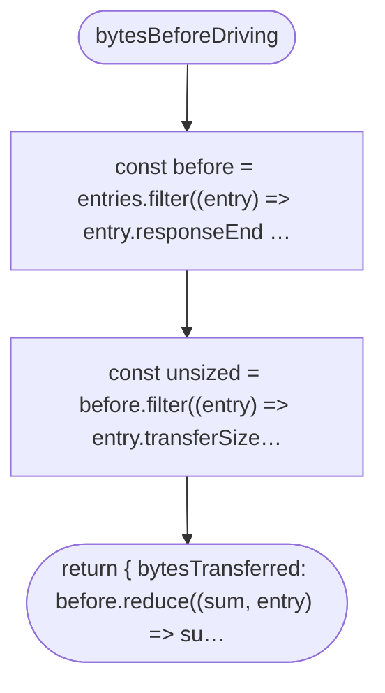

## askedSize

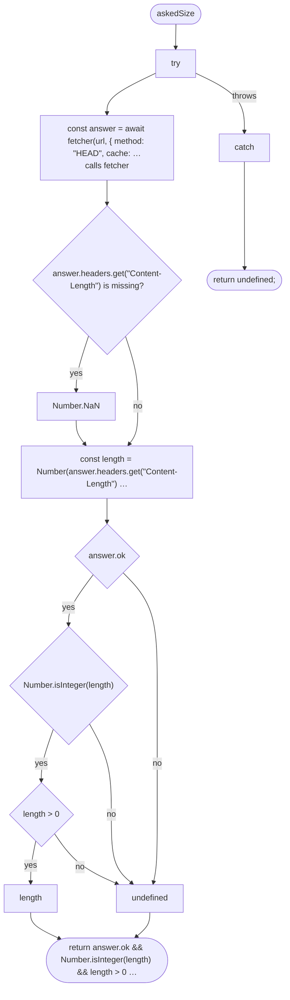

## countedSize

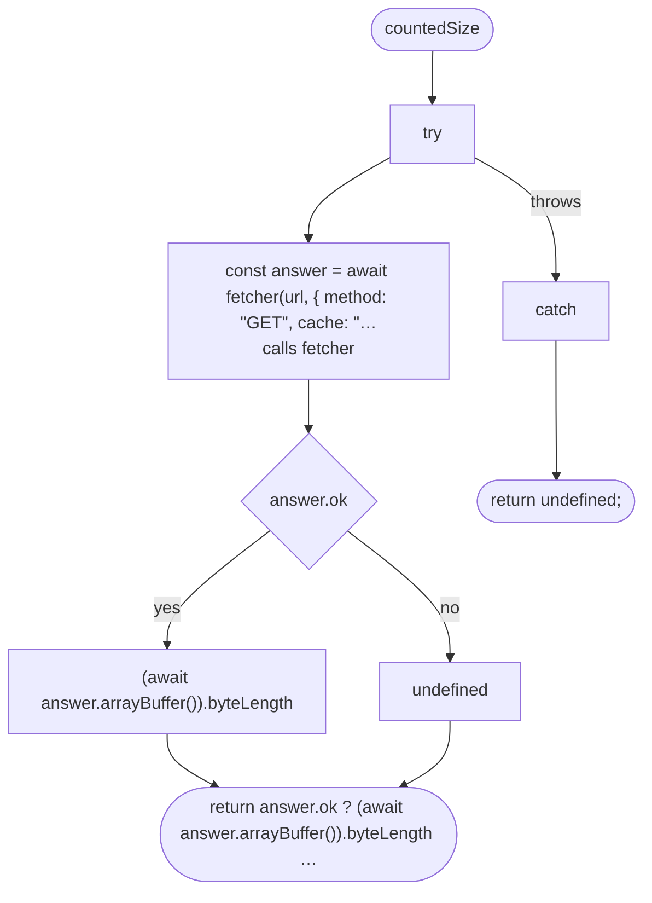

## serverSizeOf

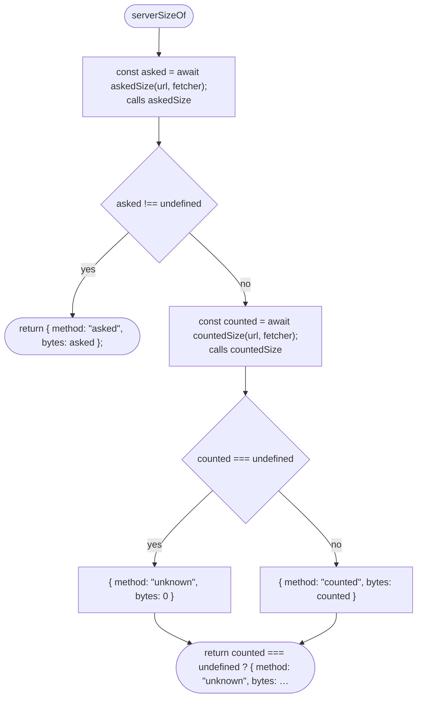

## serverSizes

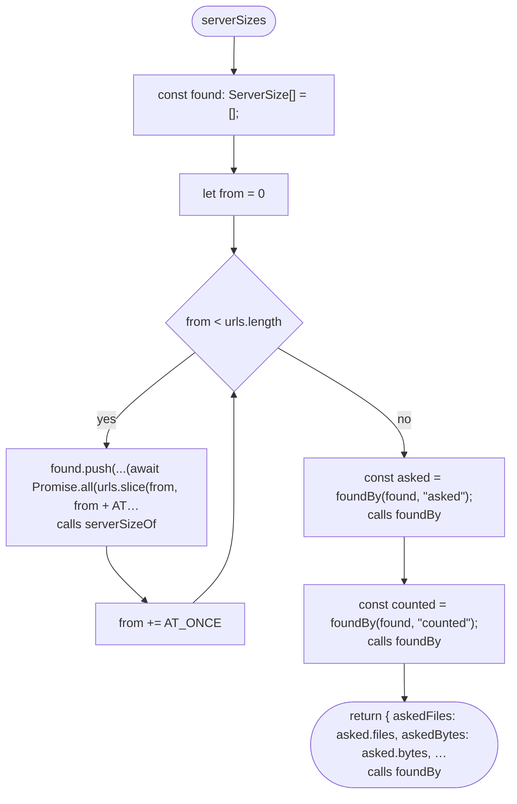

## foundBy

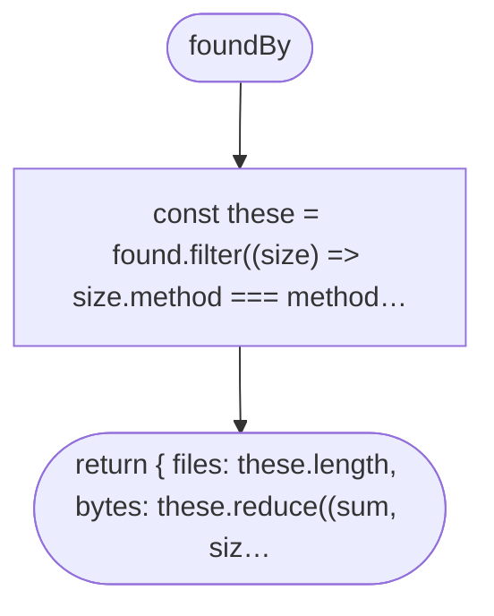

## percentileOf

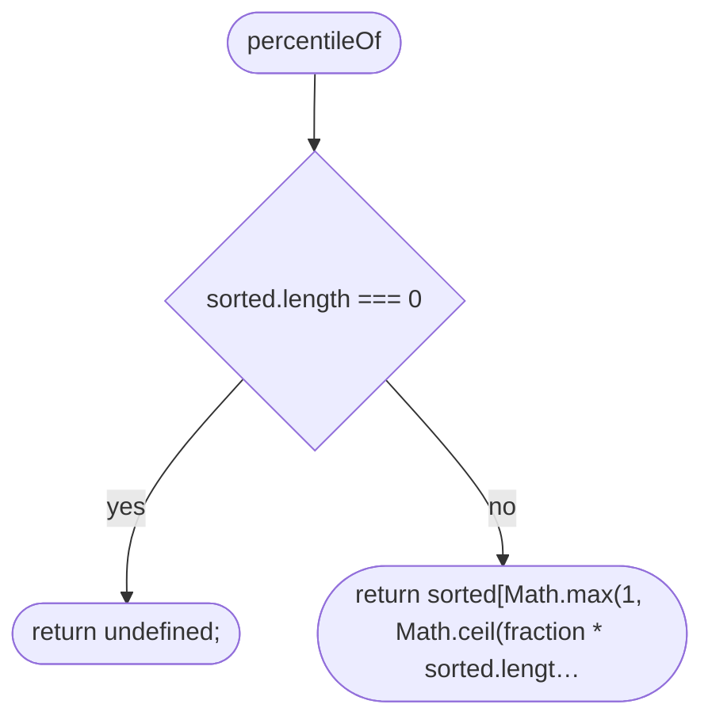

## frameRateSummary

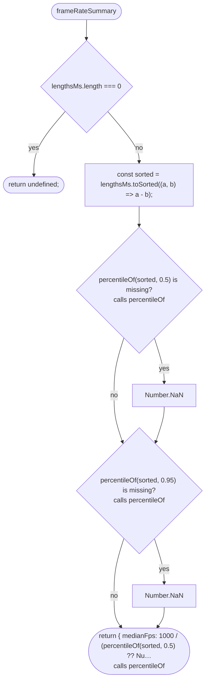

## recordFrame

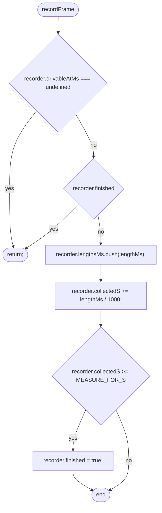

## megabytes

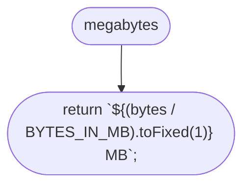

## downloadLines

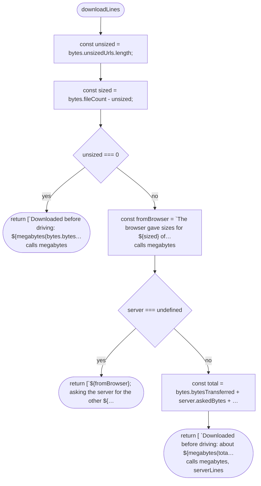

## serverLines

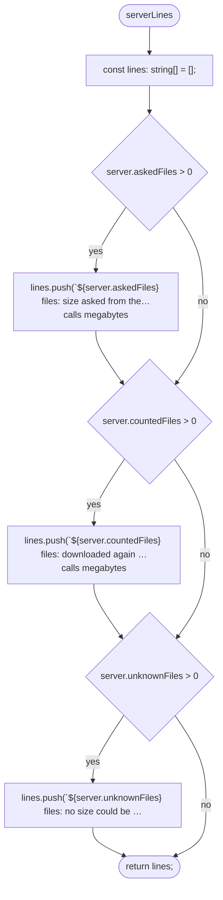

## measureReportLines

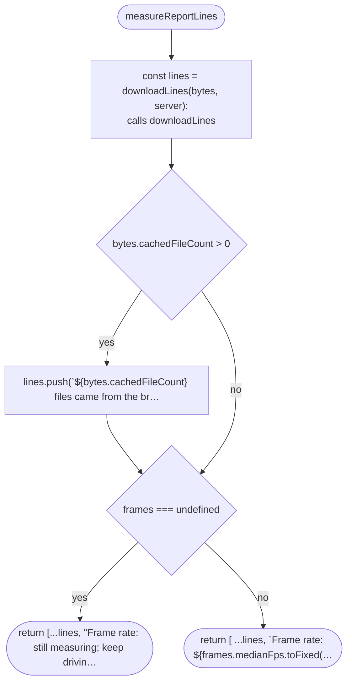
