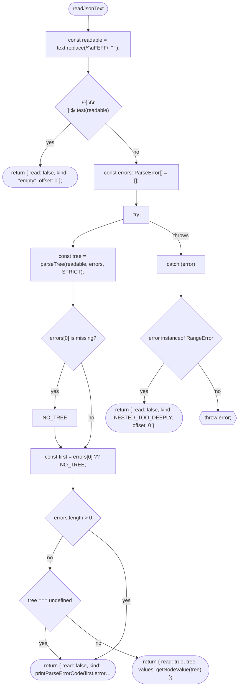
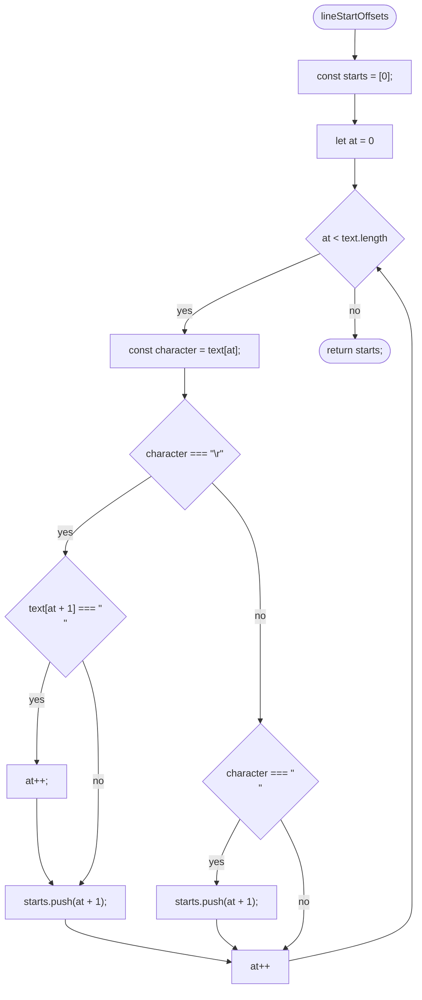
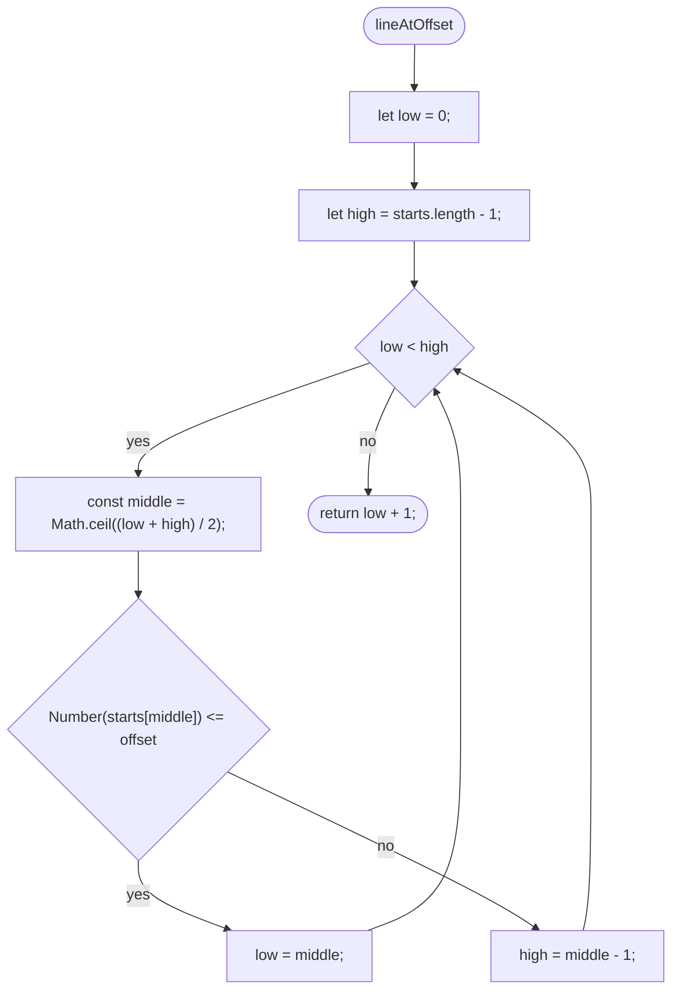
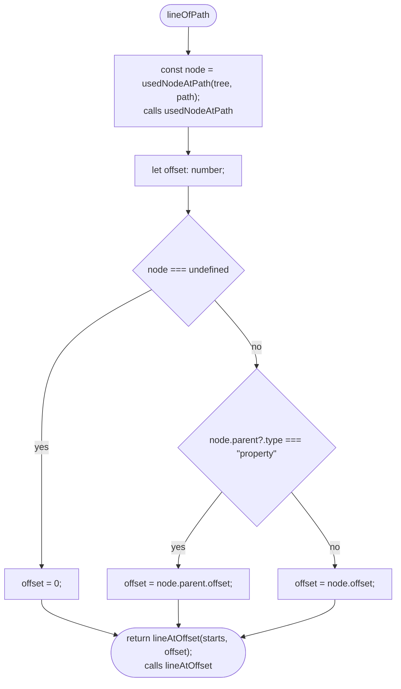
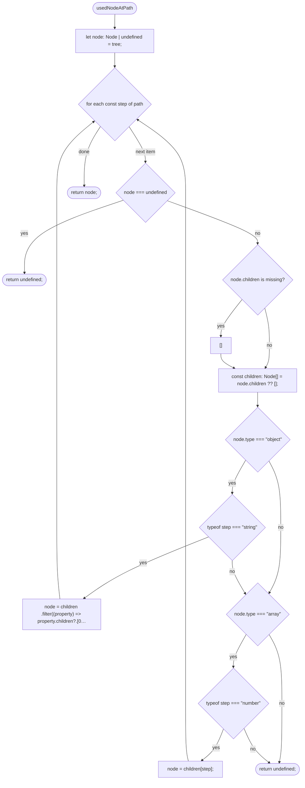
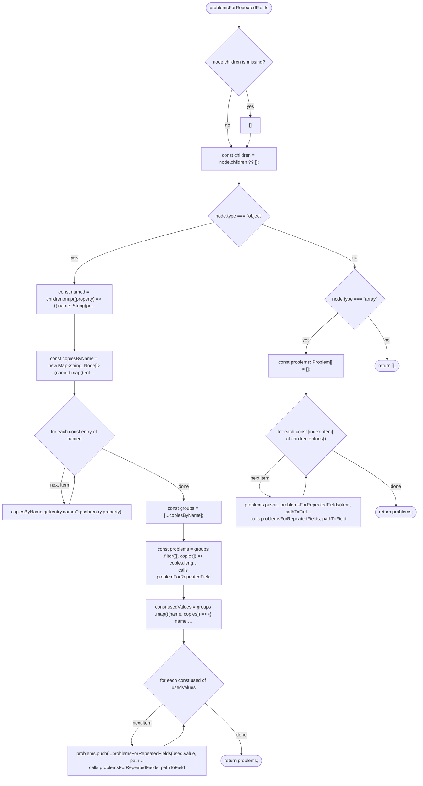
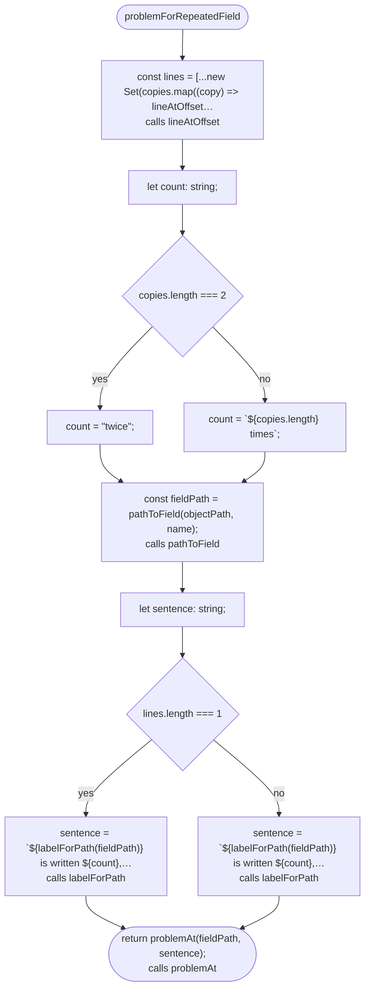
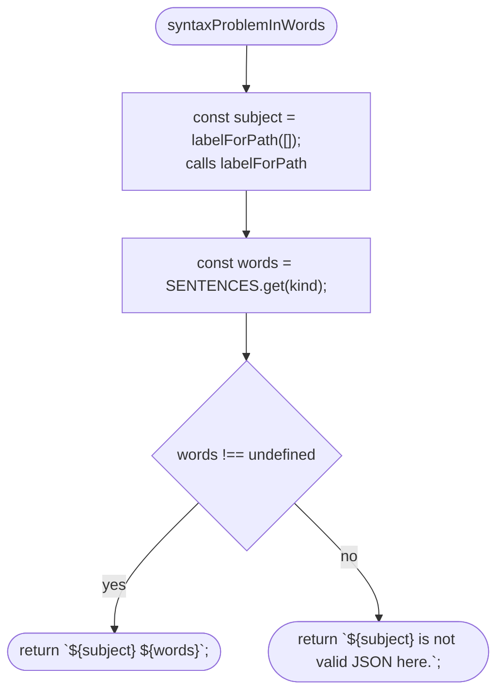

# src/place/json-text.ts

Drawn from the code by `npm run diagrams` (TypeScript compiler, no AI). Do not edit by hand: change the code, then run it again.

## readJsonText

## lineStartOffsets

## lineAtOffset

## lineOfPath

## usedNodeAtPath

## problemsForRepeatedFields

## problemForRepeatedField

## syntaxProblemInWords

