# src/place/parse.ts

Drawn from the code by `npm run diagrams` (TypeScript compiler, no AI). Do not edit by hand: change the code, then run it again.

## previewForError

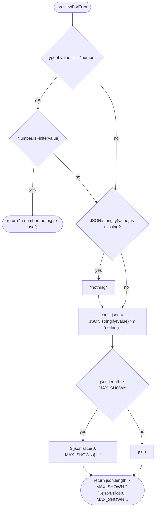

## accept

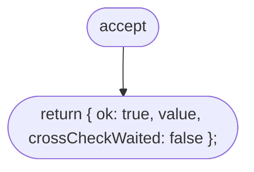

## problemAt

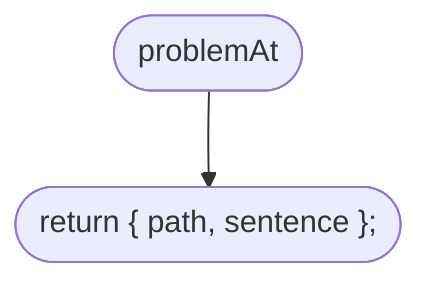

## reject

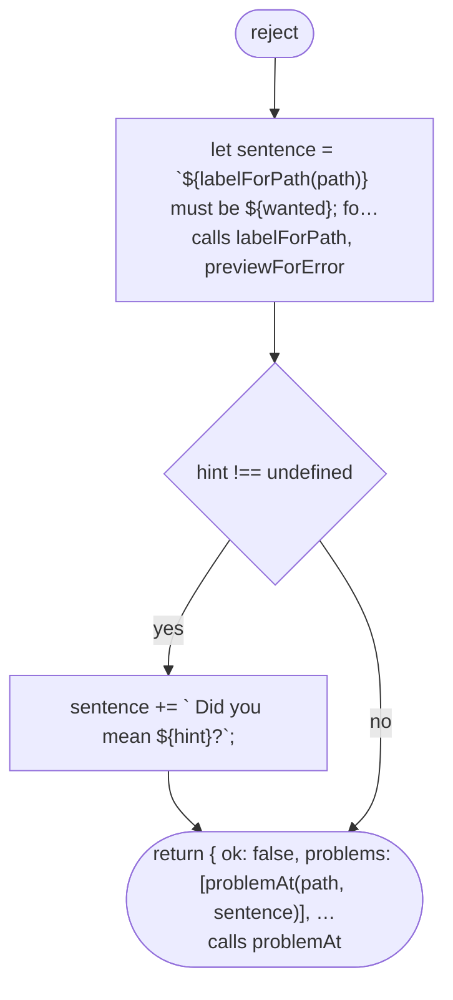

## labelForPath

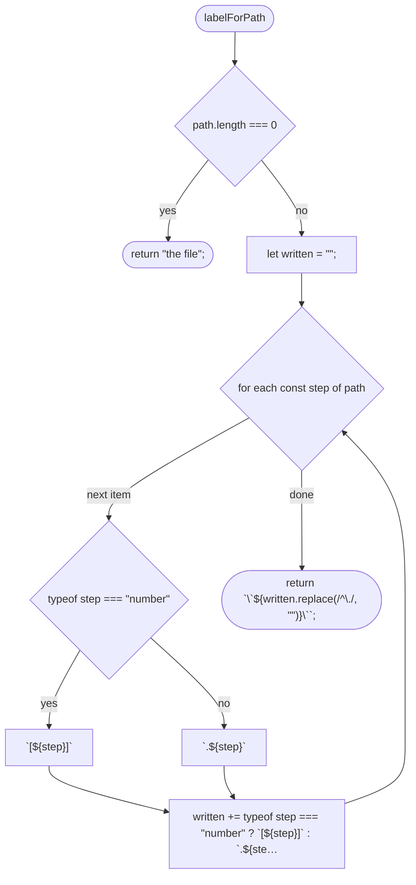

## pathToField

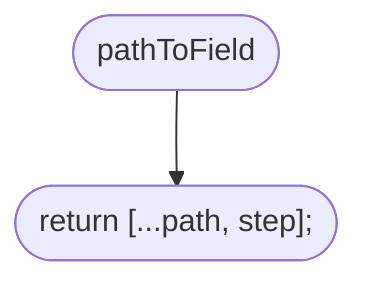

## requireText

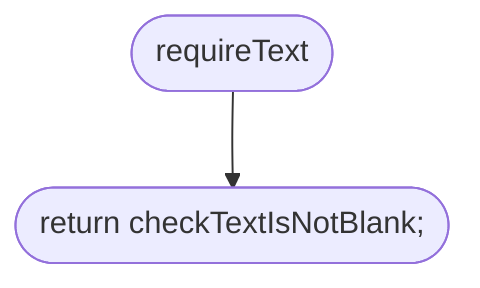

## checkTextIsNotBlank

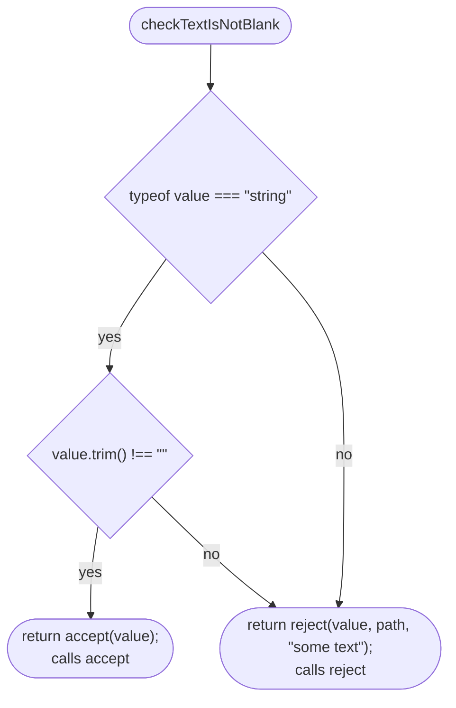

## requireTextMatching

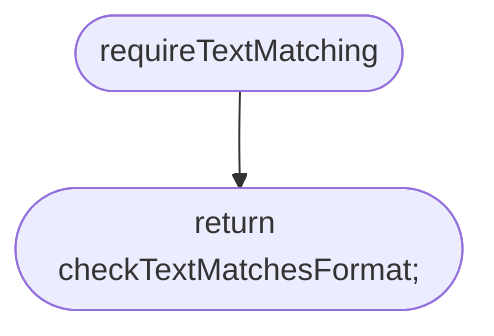

## requireTextMatching > checkTextMatchesFormat

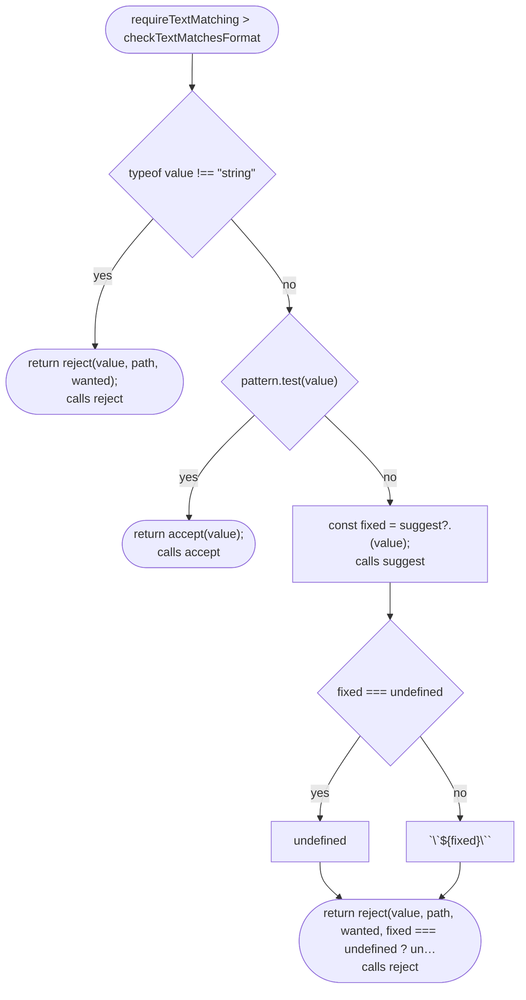

## requireNumberBetween

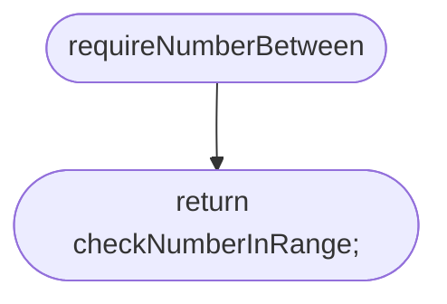

## requireNumberBetween > checkNumberInRange

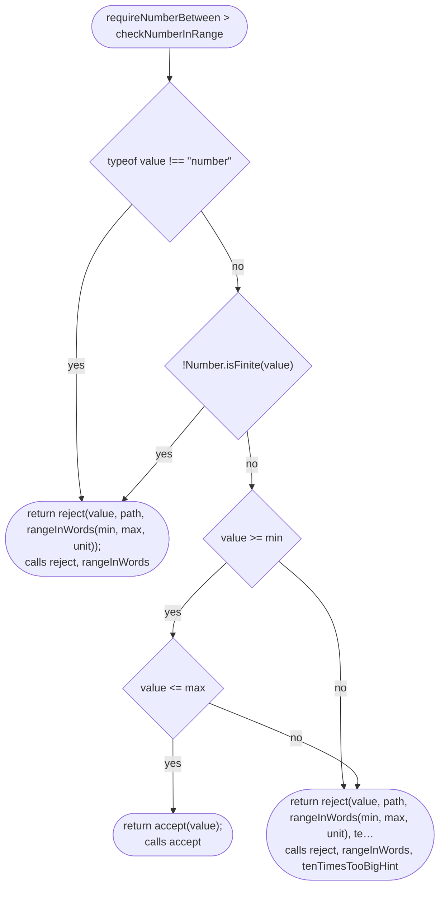

## rangeInWords

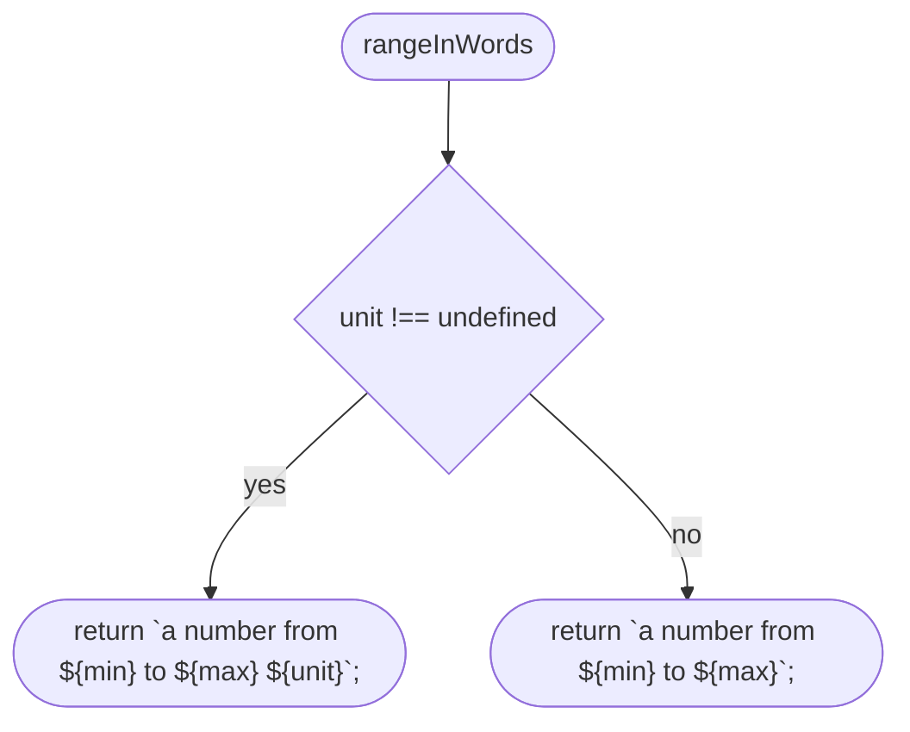

## tenTimesTooBigHint

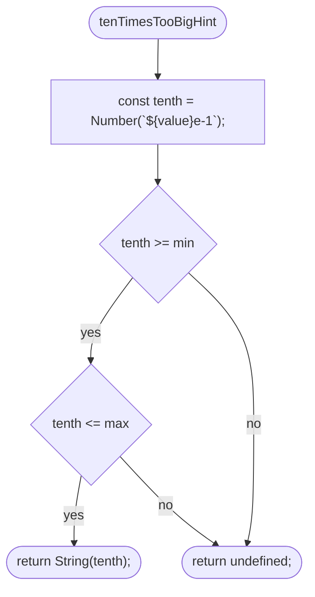

## requireOneOf

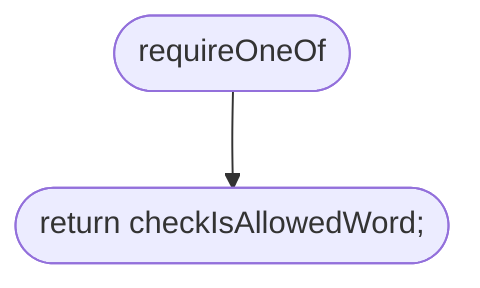

## requireOneOf > isAllowedWord

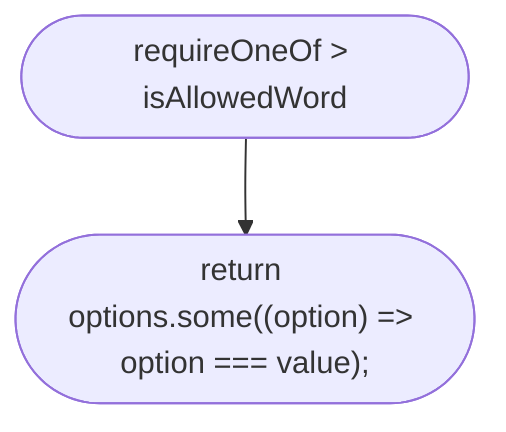

## requireOneOf > checkIsAllowedWord

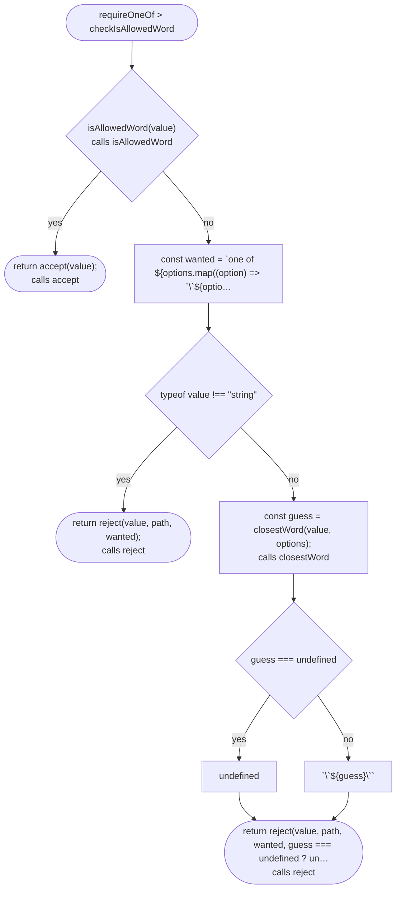

## requireListOf

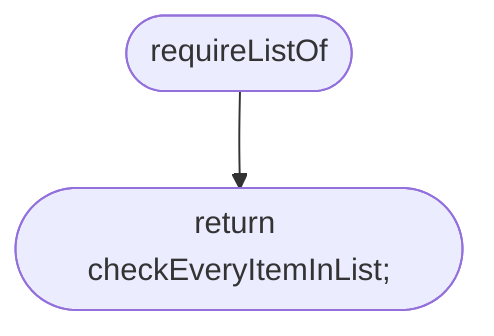

## requireListOf > checkEveryItemInList

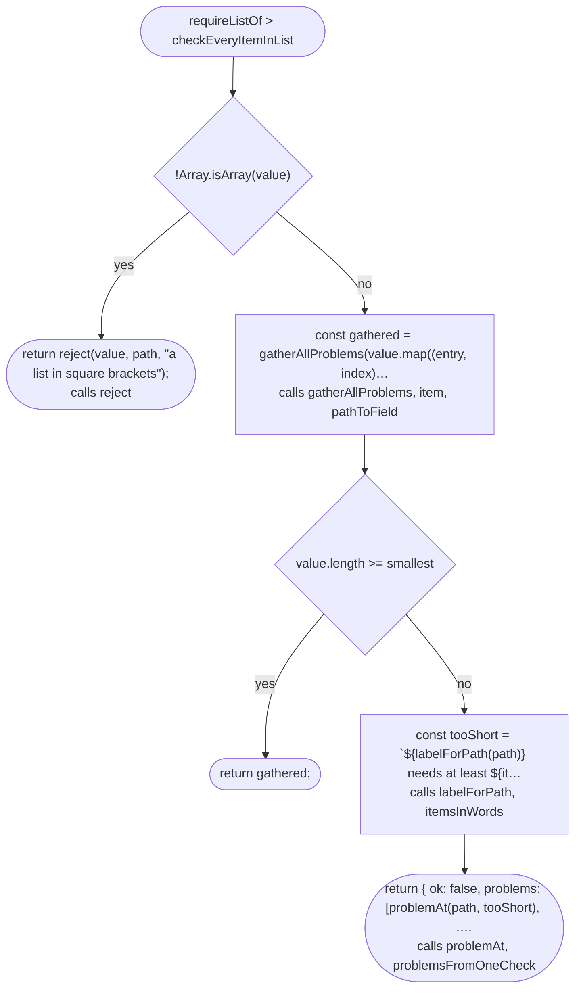

## itemsInWords

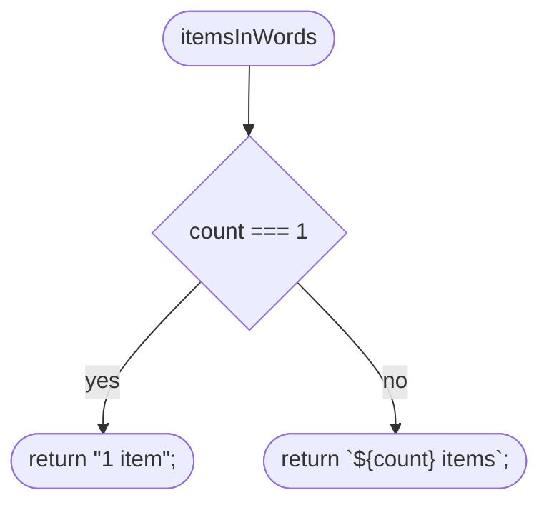

## gatherAllProblems

```mermaid
flowchart TD
  n1(["gatherAllProblems"])
  n2["const problems = results.flatMap(problemsFromOneCheck);"]
  n3{"problems.length #gt; 0"}
  n4(["return { ok: false, problems, crossCheckWaited: results.som…"])
  n5(["return accept(results.flatMap(valueFromOneCheck));<br/>calls accept"])
  n1 --> n2
  n2 --> n3
  n3 -->|"yes"| n4
  n3 -->|"no"| n5
```

## problemsFromOneCheck

```mermaid
flowchart TD
  n1(["problemsFromOneCheck"])
  n2{"result.ok"}
  n3["[]"]
  n4["result.problems"]
  n5(["return result.ok ? [] : result.problems;"])
  n1 --> n2
  n2 -->|"yes"| n3
  n2 -->|"no"| n4
  n3 --> n5
  n4 --> n5
```

## valueFromOneCheck

```mermaid
flowchart TD
  n1(["valueFromOneCheck"])
  n2{"result.ok"}
  n3["[result.value]"]
  n4["[]"]
  n5(["return result.ok ? [result.value] : [];"])
  n1 --> n2
  n2 -->|"yes"| n3
  n2 -->|"no"| n4
  n3 --> n5
  n4 --> n5
```

## isRecord

```mermaid
flowchart TD
  n1(["isRecord"])
  n2{"typeof value === #quot;object#quot;"}
  n3{"value !== null"}
  n4["!Array.isArray(value)"]
  n5(["return typeof value === #quot;object#quot; && value !== null && !Arra…"])
  n1 --> n2
  n2 -->|"yes"| n3
  n3 -->|"yes"| n4
  n2 -->|"no"| n5
  n3 -->|"no"| n5
  n4 --> n5
```

## missingFields

```mermaid
flowchart TD
  n1(["missingFields"])
  n2(["return Object.keys(shape).filter((name) =#gt; !Object.hasOwn(r…"])
  n1 --> n2
```

## unknownFieldsWithGuesses

```mermaid
flowchart TD
  n1(["unknownFieldsWithGuesses"])
  n2(["return Object.keys(record) .filter((name) =#gt; !Object.hasOwn…<br/>calls closestWord"])
  n1 --> n2
```

## problemsForUnknownFields

```mermaid
flowchart TD
  n1(["problemsForUnknownFields"])
  n2["const fields = Object.keys(shape).map((name) =#gt; #96;\#96;${name}\…"]
  n3["const problems: Problem[] = [];"]
  n4{"for each const unknown of unknowns"}
  n5["const fieldPath = pathToField(path, unknown.name);<br/>calls pathToField"]
  n6["const label = labelForPath(fieldPath);<br/>calls labelForPath"]
  n7{"unknown.guess !== undefined"}
  n8["problems.push(problemAt(fieldPath, #96;${label} is not a field…<br/>calls problemAt"]
  n9["problems.push(problemAt(fieldPath, #96;${label} is not a field…<br/>calls problemAt"]
  n10(["return problems;"])
  n1 --> n2
  n2 --> n3
  n3 --> n4
  n4 -->|"next item"| n5
  n5 --> n6
  n6 --> n7
  n7 -->|"yes"| n8
  n7 -->|"no"| n9
  n8 --> n4
  n9 --> n4
  n4 -->|"done"| n10
```

## problemsForMissingFields

```mermaid
flowchart TD
  n1(["problemsForMissingFields"])
  n2["const guessed = new Set(unknowns.map((unknown) =#gt; unknown.g…"]
  n3(["return missing .filter((name) =#gt; !guessed.has(name)) .map((…<br/>calls problemAt, labelForPath, pathToField"])
  n1 --> n2
  n2 --> n3
```

## requireRecord

```mermaid
flowchart TD
  n1(["requireRecord"])
  n2(["return checkRecord;"])
  n1 --> n2
```

## requireRecord > checkRecord

```mermaid
flowchart TD
  n1(["requireRecord #gt; checkRecord"])
  n2{"!isRecord(value)<br/>calls isRecord"}
  n3(["return reject(value, path, #quot;an object in curly brackets#quot;);<br/>calls reject"])
  n4["const missing = missingFields(value, shape);<br/>calls missingFields"]
  n5["const unknowns = unknownFieldsWithGuesses(value, shape, mis…<br/>calls unknownFieldsWithGuesses"]
  n6["const checked: FieldResult[] = Object.entries(shape) .filte…<br/>calls checker, pathToField"]
  n7["const problems = [ ...problemsForUnknownFields(unknowns, sh…<br/>calls problemsForUnknownFields, problemsForMissingFields"]
  n8{"problems.length #gt; 0"}
  n9(["return { ok: false, problems, crossCheckWaited: checked.som…"])
  n10(["return accept(Object.fromEntries(checked.flatMap(nameAndVal…<br/>calls accept"])
  n1 --> n2
  n2 -->|"yes"| n3
  n2 -->|"no"| n4
  n4 --> n5
  n5 --> n6
  n6 --> n7
  n7 --> n8
  n8 -->|"yes"| n9
  n8 -->|"no"| n10
```

## problemsFromOneField

```mermaid
flowchart TD
  n1(["problemsFromOneField"])
  n2{"field.result.ok"}
  n3["[]"]
  n4["field.result.problems"]
  n5(["return field.result.ok ? [] : field.result.problems;"])
  n1 --> n2
  n2 -->|"yes"| n3
  n2 -->|"no"| n4
  n3 --> n5
  n4 --> n5
```

## nameAndValueFromOneField

```mermaid
flowchart TD
  n1(["nameAndValueFromOneField"])
  n2{"field.result.ok"}
  n3["[[field.name, field.result.value]]"]
  n4["[]"]
  n5(["return field.result.ok ? [[field.name, field.result.value]]…"])
  n1 --> n2
  n2 -->|"yes"| n3
  n2 -->|"no"| n4
  n3 --> n5
  n4 --> n5
```

## addCrossFieldRules

```mermaid
flowchart TD
  n1(["addCrossFieldRules"])
  n2["const checkPlainRecord = requireRecord(shape);<br/>calls requireRecord"]
  n3(["return checkFieldsThenRules;"])
  n1 --> n2
  n2 --> n3
```

## addCrossFieldRules > checkFieldsThenRules

```mermaid
flowchart TD
  n1(["addCrossFieldRules #gt; checkFieldsThenRules"])
  n2["const plain = checkPlainRecord(value, path);<br/>calls checkPlainRecord"]
  n3["const outcomes = rules.map((rule) =#gt; problemsFromOneRule(ru…<br/>calls problemsFromOneRule"]
  n4["const problems = [...problemsFromOneCheck(plain), ...outcom…<br/>calls problemsFromOneCheck"]
  n5{"problems.length === 0"}
  n6(["return plain;"])
  n7{"plain.crossCheckWaited"}
  n8["outcomes.some((outcome) =#gt; outcome.waited)"]
  n9(["return { ok: false, problems, crossCheckWaited: plain.cross…"])
  n1 --> n2
  n2 --> n3
  n3 --> n4
  n4 --> n5
  n5 -->|"yes"| n6
  n5 -->|"no"| n7
  n7 -->|"no"| n8
  n7 -->|"yes"| n9
  n8 --> n9
```

## addCrossFieldRules > problemsFromOneRule

```mermaid
flowchart TD
  n1(["addCrossFieldRules #gt; problemsFromOneRule"])
  n2{"plain.ok"}
  n3["const found = rule.problems(plain.value);<br/>calls problems"]
  n4(["return { problems: found.map((problem) =#gt; problemAt([...pat…<br/>calls problemAt"])
  n5["const fields = valuesReadByRule(value, shape, rule.reads, p…<br/>calls valuesReadByRule"]
  n6{"fields === undefined"}
  n7(["return { problems: [], waited: true };"])
  n8["const found = rule.problems(fields as Fields#lt;S#gt;);<br/>calls problems"]
  n9(["return { problems: found.map((problem) =#gt; problemAt([...pat…<br/>calls problemAt"])
  n1 --> n2
  n2 -->|"yes"| n3
  n3 --> n4
  n2 -->|"no"| n5
  n5 --> n6
  n6 -->|"yes"| n7
  n6 -->|"no"| n8
  n8 --> n9
```

## valuesReadByRule

```mermaid
flowchart TD
  n1(["valuesReadByRule"])
  n2{"!isRecord(value)<br/>calls isRecord"}
  n3(["return undefined;"])
  n4["const checked: FieldResult[] = Object.entries(shape) .filte…<br/>calls checker, pathToField"]
  n5["const good = checked.flatMap(nameAndValueFromOneField);"]
  n6{"good.length !== reads.length"}
  n7(["return undefined;"])
  n8(["return Object.fromEntries(good);"])
  n1 --> n2
  n2 -->|"yes"| n3
  n2 -->|"no"| n4
  n4 --> n5
  n5 --> n6
  n6 -->|"yes"| n7
  n6 -->|"no"| n8
```

## requireShortId

```mermaid
flowchart TD
  n1(["requireShortId"])
  n2(["return requireTextMatching( SHORT_ID, #quot;an id: letters a to …<br/>calls requireTextMatching"])
  n1 --> n2
```

## shortIdSuggestion

```mermaid
flowchart TD
  n1(["shortIdSuggestion"])
  n2["const plain = text.toLowerCase().normalize(#quot;NFD#quot;).replace(/…"]
  n3{"/(?![a-z0-9])[\p{L}\p{N}]/u.test(plain)"}
  n4(["return undefined;"])
  n5["const dashed = plain.replace(/[^a-z0-9]+/g, #quot;-#quot;).replace(/^…"]
  n6{"SHORT_ID.test(dashed)"}
  n7{"dashed !== text"}
  n8(["return dashed;"])
  n9(["return undefined;"])
  n1 --> n2
  n2 --> n3
  n3 -->|"yes"| n4
  n3 -->|"no"| n5
  n5 --> n6
  n6 -->|"yes"| n7
  n7 -->|"yes"| n8
  n6 -->|"no"| n9
  n7 -->|"no"| n9
```
