# src/place/parse.ts

Drawn from the code by `npm run diagrams` (TypeScript compiler, no AI). Do not edit by hand: change the code, then run it again.

## show

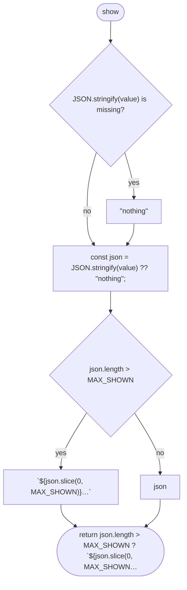

## good

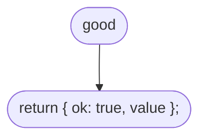

## bad

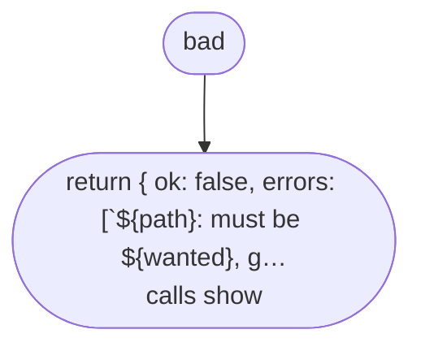

## someText

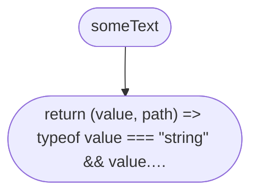

## someText > inner function 1

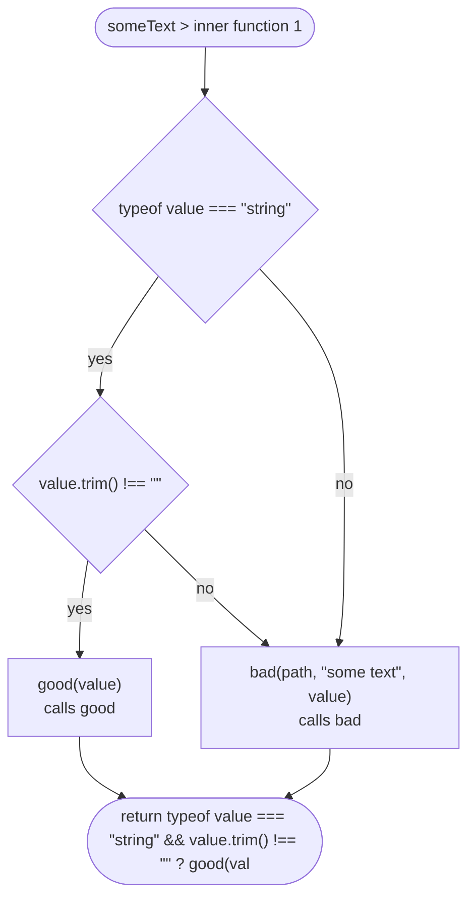

## textMatching

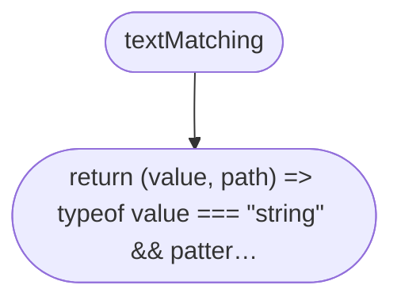

## textMatching > inner function 1

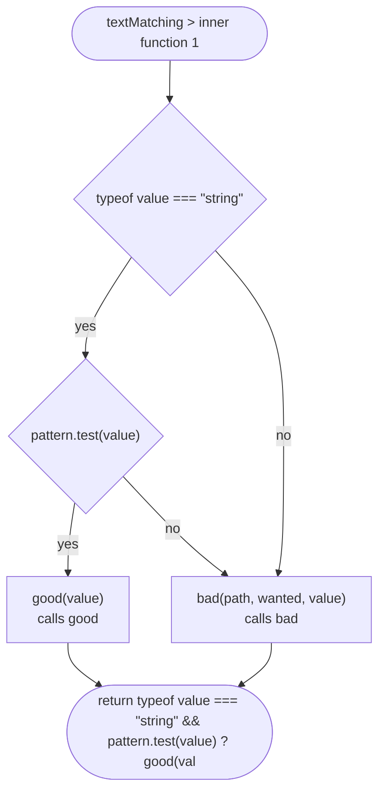

## numberBetween

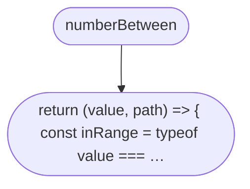

## numberBetween > inner function 1

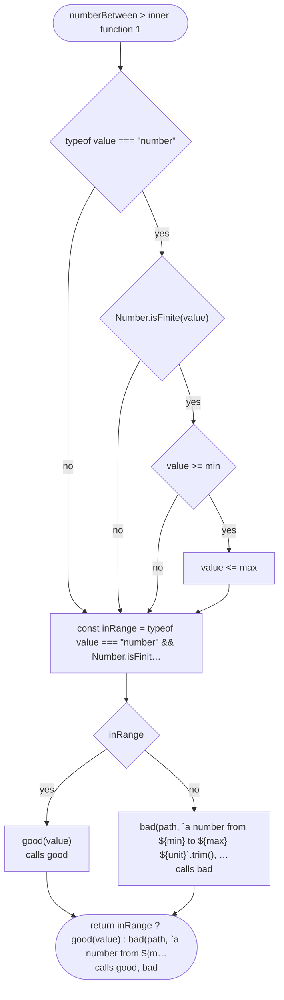

## oneOf

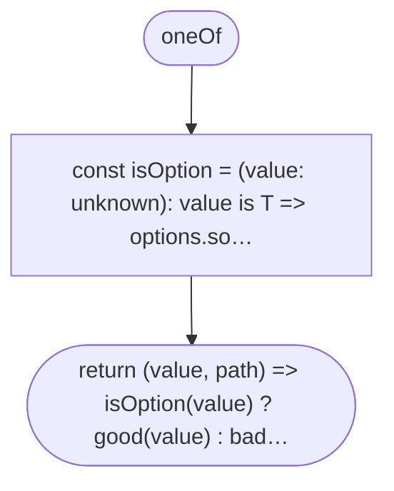

## oneOf > isOption

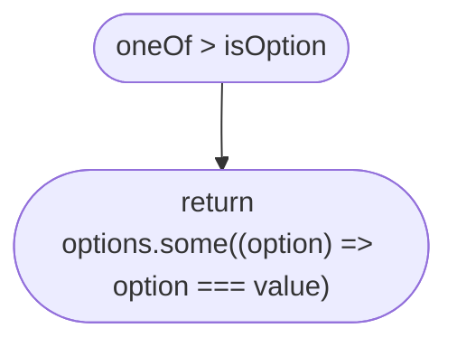

## oneOf > inner function 1

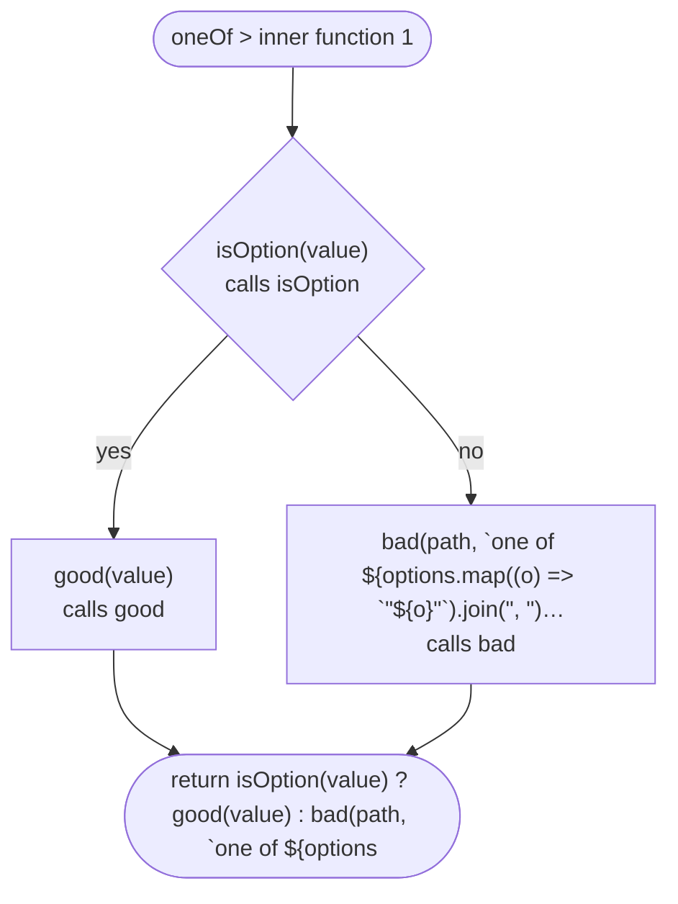

## listOf

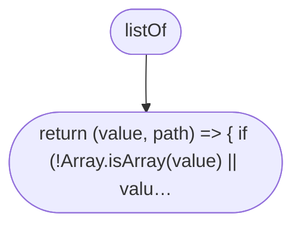

## listOf > inner function 1

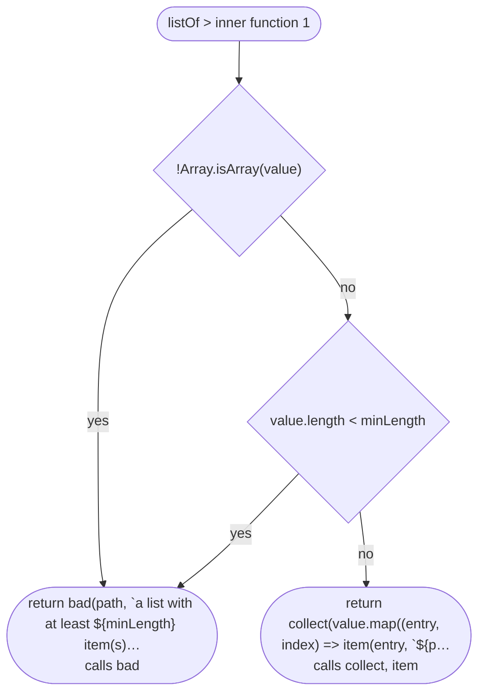

## collect

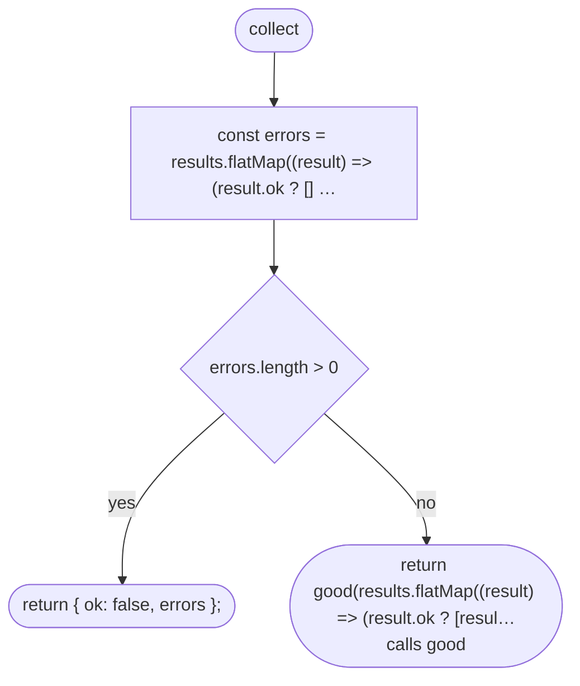

## collect > inner function 1

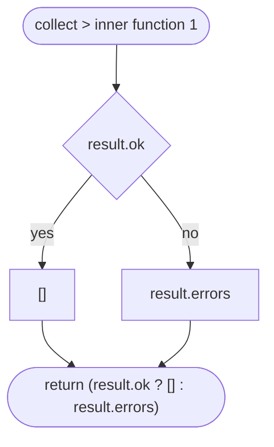

## collect > inner function 2

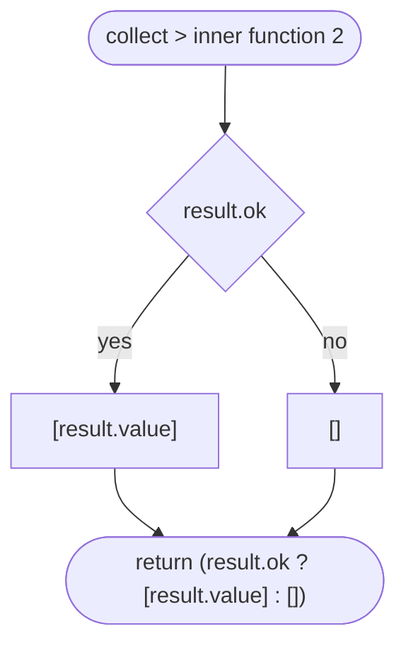

## isPlainObject

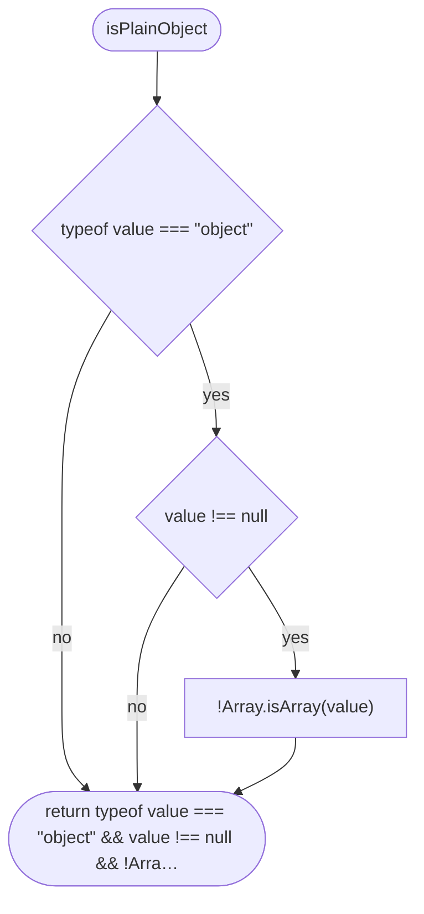

## unknownKeyErrors

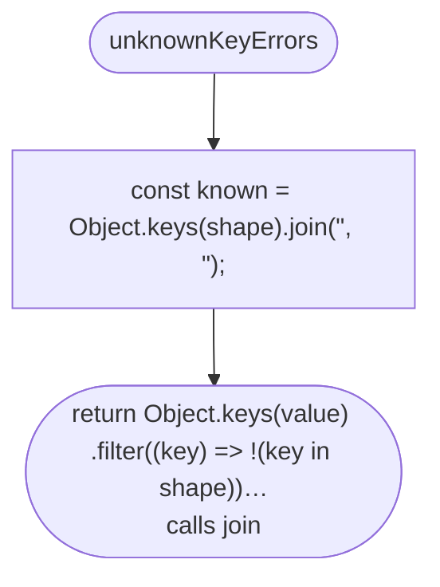

## join

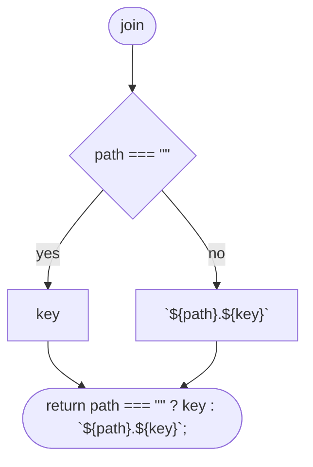

## object

```mermaid
flowchart TD
  n1(["object"])
  n2(["return (value, path) =#gt; { if (!isPlainObject(value)) return…"])
  n1 --> n2
```

## object > inner function 1

```mermaid
flowchart TD
  n1(["object #gt; inner function 1"])
  n2{"!isPlainObject(value)<br/>calls isPlainObject"}
  n3{"path === #quot;#quot;"}
  n4["#quot;the file#quot;"]
  n5["path"]
  n6(["return bad(path === #quot;#quot; ? #quot;the file#quot; : path, #quot;an object { … …<br/>calls bad"])
  n7["const results = Object.entries(shape).map(([key, parser]) =…<br/>calls parser, join"]
  n8["const errors = [ ...unknownKeyErrors(value, shape, path), .…<br/>calls unknownKeyErrors"]
  n9{"errors.length #gt; 0"}
  n10(["return { ok: false, errors };"])
  n11["const entries = results.flatMap(({ key, result }) =#gt; (resul…"]
  n12(["return good(Object.fromEntries(entries) as Fields#lt;S#gt;);<br/>calls good"])
  n1 --> n2
  n2 -->|"yes"| n3
  n3 -->|"yes"| n4
  n3 -->|"no"| n5
  n4 --> n6
  n5 --> n6
  n2 -->|"no"| n7
  n7 --> n8
  n8 --> n9
  n9 -->|"yes"| n10
  n9 -->|"no"| n11
  n11 --> n12
```

## object > inner function 1 > inner function 1

```mermaid
flowchart TD
  n1(["object #gt; inner function 1 #gt; inner function 1"])
  n2{"result.ok"}
  n3["[]"]
  n4["result.errors"]
  n5(["return (result.ok ? [] : result.errors)"])
  n1 --> n2
  n2 -->|"yes"| n3
  n2 -->|"no"| n4
  n3 --> n5
  n4 --> n5
```

## object > inner function 1 > inner function 2

```mermaid
flowchart TD
  n1(["object #gt; inner function 1 #gt; inner function 2"])
  n2{"result.ok"}
  n3["[[key, result.value]]"]
  n4["[]"]
  n5(["return (result.ok ? [[key, result.value]] : [])"])
  n1 --> n2
  n2 -->|"yes"| n3
  n2 -->|"no"| n4
  n3 --> n5
  n4 --> n5
```

## refine

```mermaid
flowchart TD
  n1(["refine"])
  n2(["return (value, path) =#gt; { const parsed = parser(value, path…"])
  n1 --> n2
```

## refine > inner function 1

```mermaid
flowchart TD
  n1(["refine #gt; inner function 1"])
  n2["const parsed = parser(value, path);<br/>calls parser"]
  n3{"!parsed.ok"}
  n4(["return parsed;"])
  n5["const found = problem(parsed.value);<br/>calls problem"]
  n6{"found === undefined"}
  n7["parsed"]
  n8{"path === #quot;#quot;"}
  n9["#quot;the file#quot;"]
  n10["path"]
  n11(["return found === undefined ? parsed : { ok: false, errors: …"])
  n1 --> n2
  n2 --> n3
  n3 -->|"yes"| n4
  n3 -->|"no"| n5
  n5 --> n6
  n6 -->|"yes"| n7
  n6 -->|"no"| n8
  n8 -->|"yes"| n9
  n8 -->|"no"| n10
  n7 --> n11
  n9 --> n11
  n10 --> n11
```

## shortId

```mermaid
flowchart TD
  n1(["shortId"])
  n2(["return textMatching(/^[a-z][a-z0-9-]*$/, #quot;a short lower-cas…<br/>calls textMatching"])
  n1 --> n2
```
