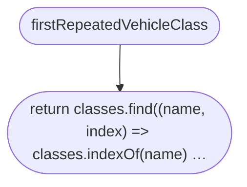
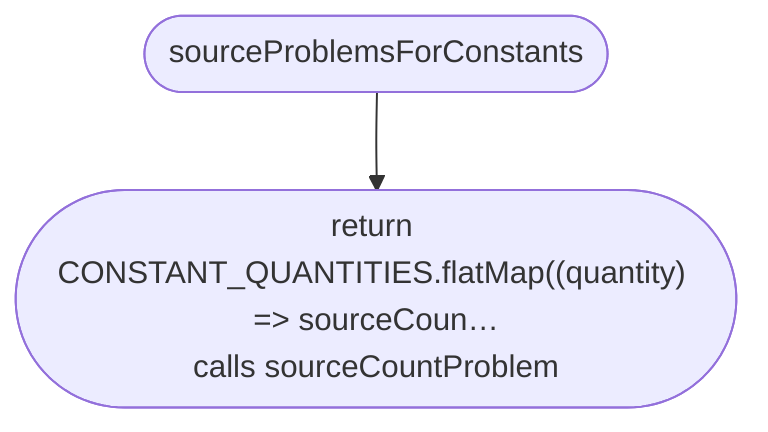
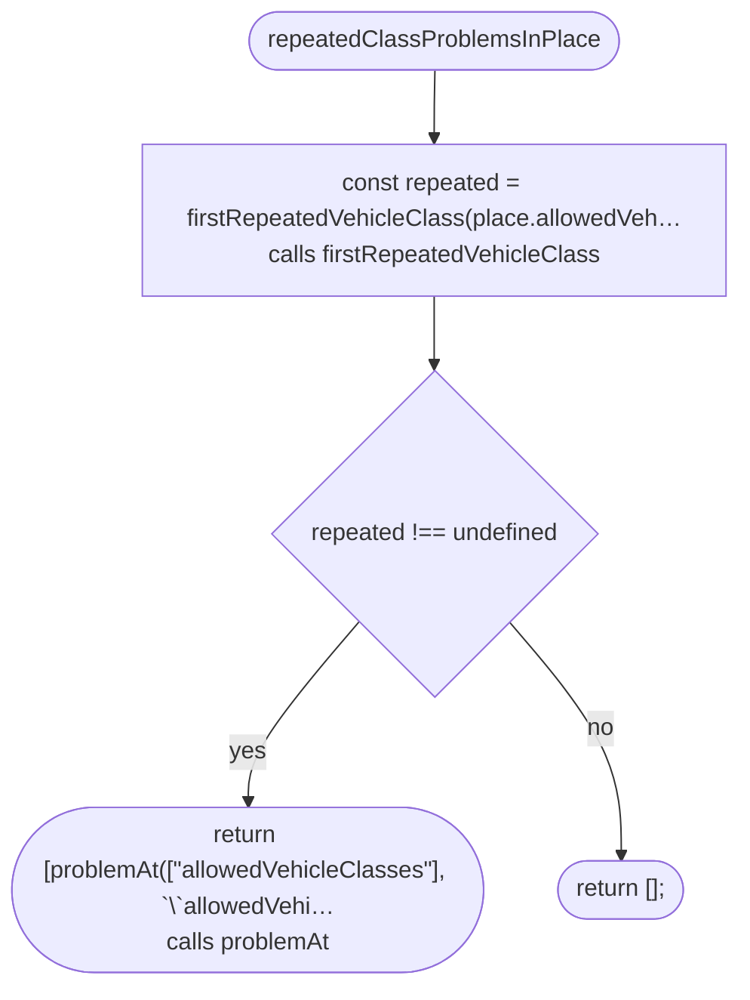
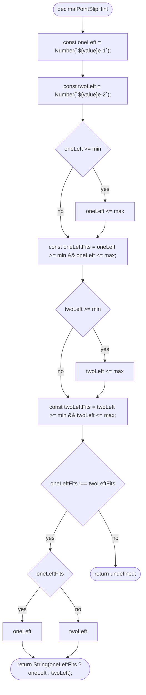
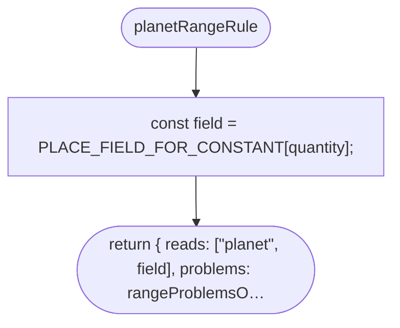
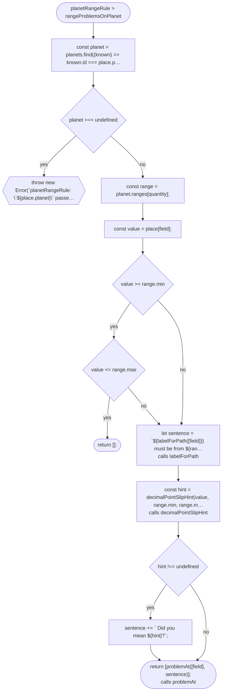
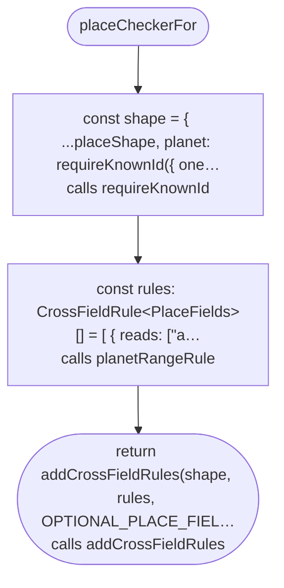
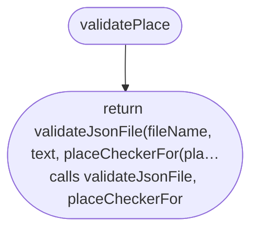

# src/place/place.ts

Drawn from the code by `npm run diagrams` (TypeScript compiler, no AI). Do not edit by hand: change the code, then run it again.

## firstRepeatedVehicleClass

## sourceProblemsForConstants

## repeatedClassProblemsInPlace

## decimalPointSlipHint

## planetRangeRule

## planetRangeRule > rangeProblemsOnPlanet

## placeCheckerFor

## validatePlace

