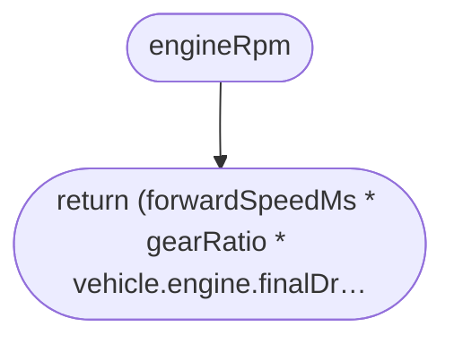
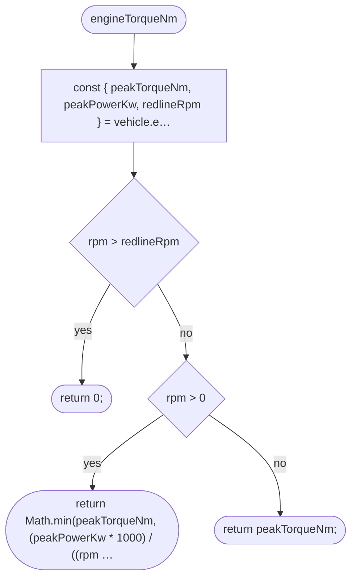
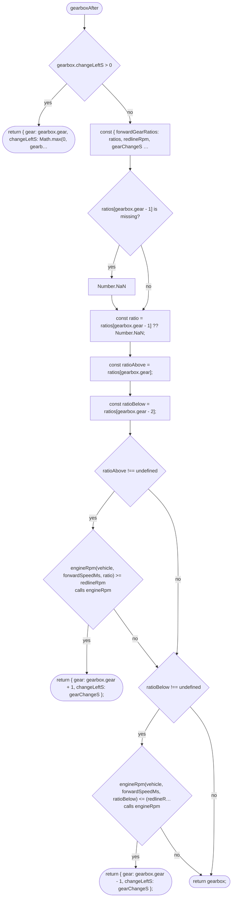
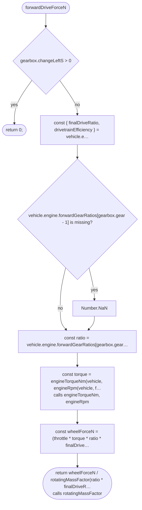
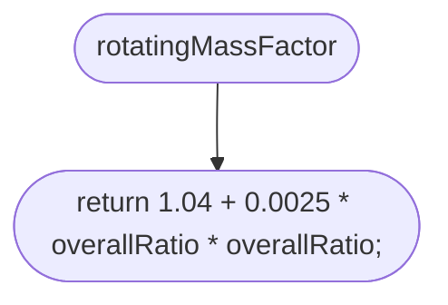
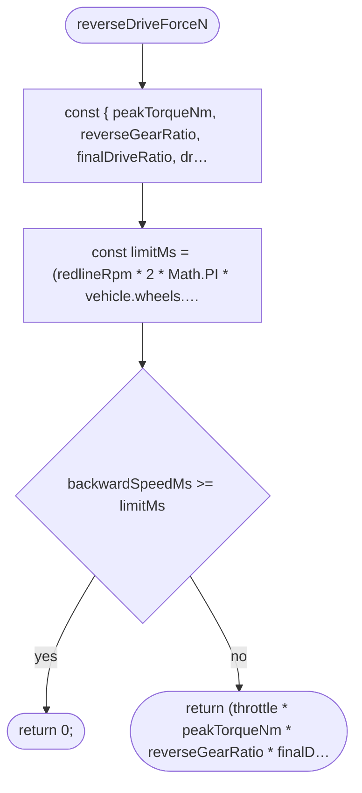
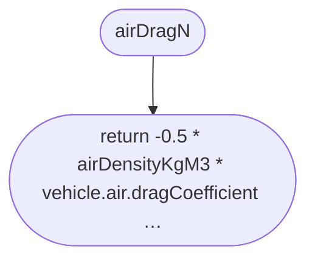
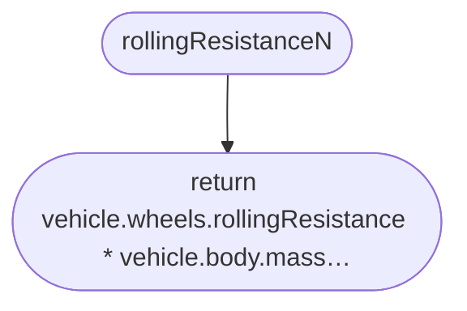

# src/vehicle/drive-force.ts

Drawn from the code by `npm run diagrams` (TypeScript compiler, no AI). Do not edit by hand: change the code, then run it again.

## engineRpm

## engineTorqueNm

## gearboxAfter

## forwardDriveForceN

## rotatingMassFactor

## reverseDriveForceN

## airDragN

## rollingResistanceN

