# src/world/buildings.ts

Drawn from the code by `npm run diagrams` (TypeScript compiler, no AI). Do not edit by hand: change the code, then run it again.

## validateBuildingChunk

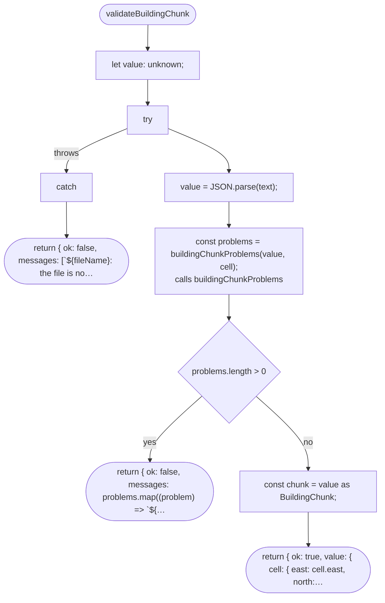

## buildingChunkProblems

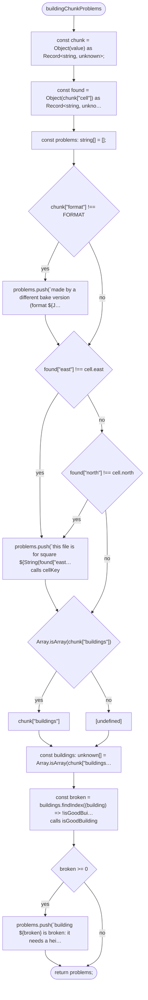

## isGoodBuilding

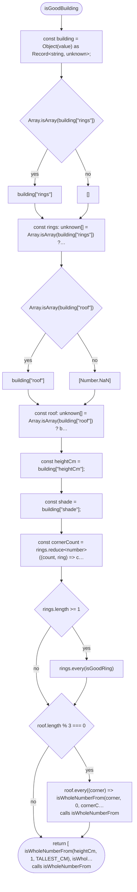

## isGoodBuilding > inner function 1

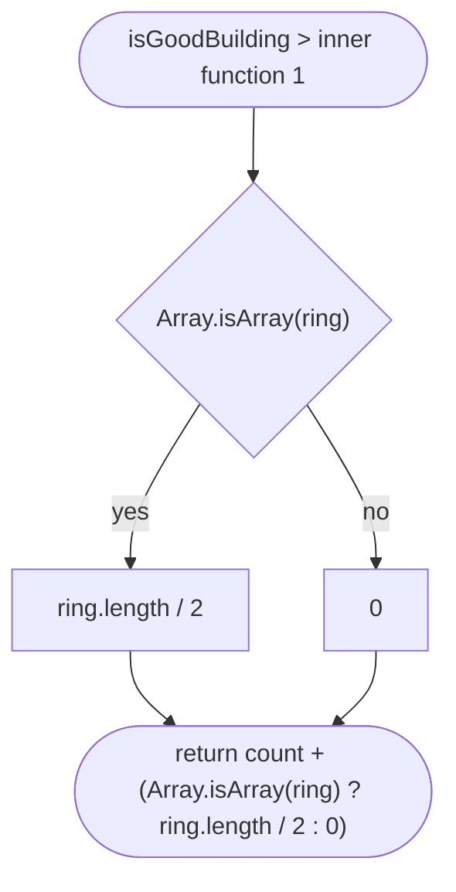

## isWholeNumberFrom

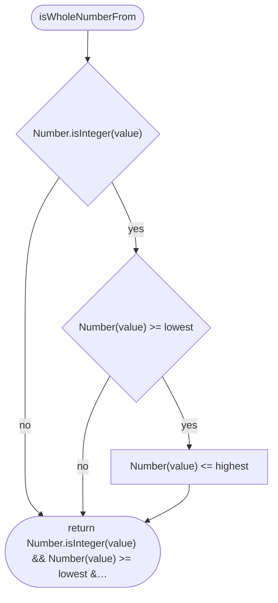

## isGoodRing

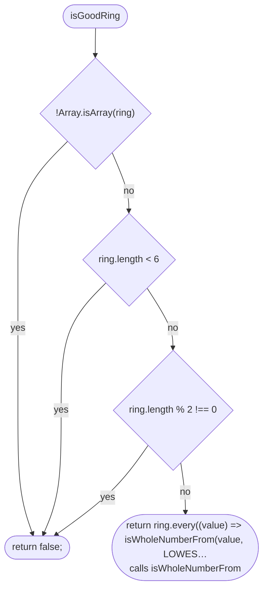

## surfaceSizes

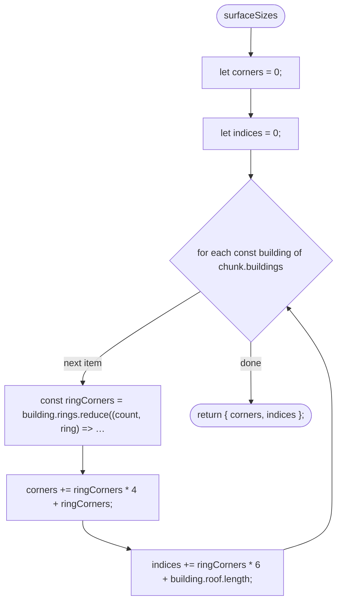

## buildingSurfaces

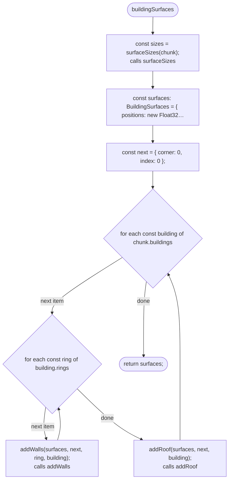

## addWalls

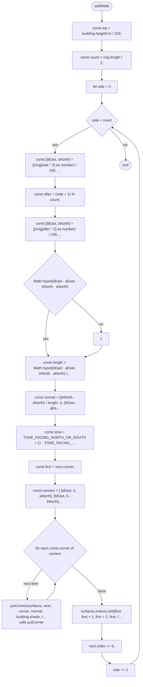

## addRoof

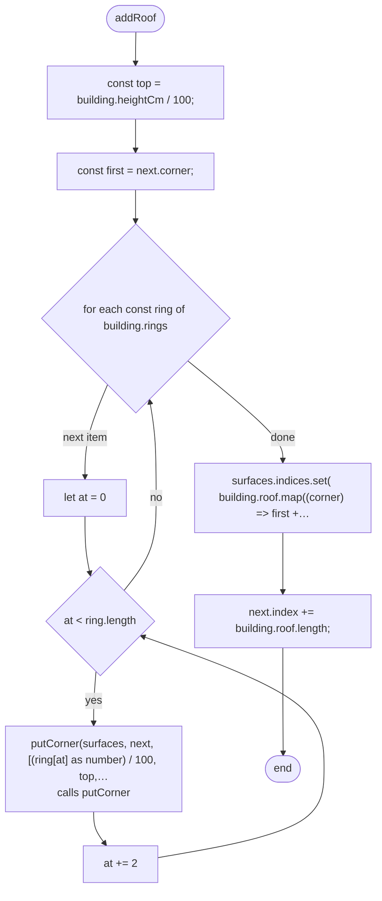

## putCorner

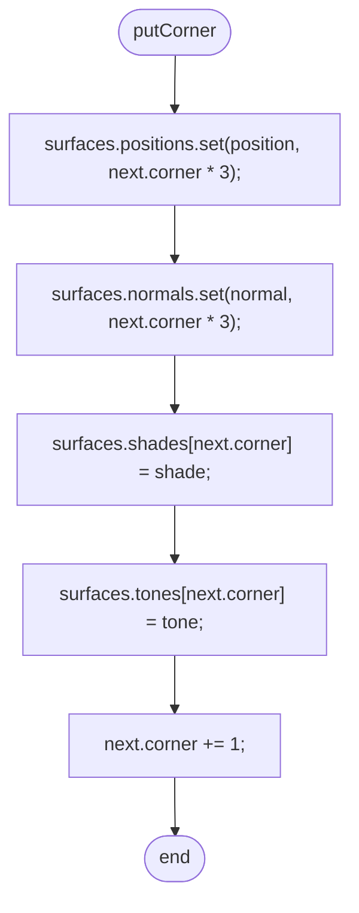

## buildingOutlinesInMetres

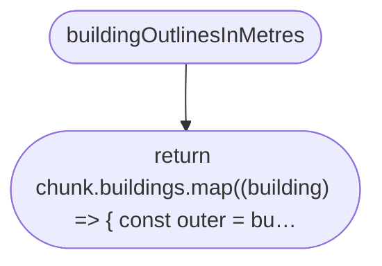

## buildingOutlinesInMetres > inner function 1

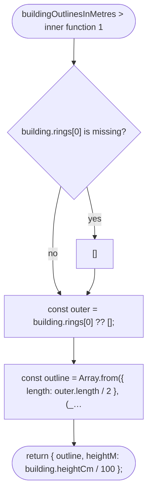
