# tools/bake/buildings.ts

Drawn from the code by `npm run diagrams` (TypeScript compiler, no AI). Do not edit by hand: change the code, then run it again.

## isBuilding

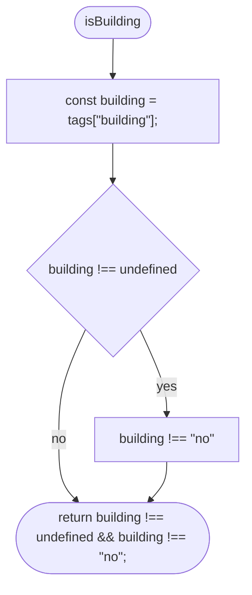

## readOplBuildings

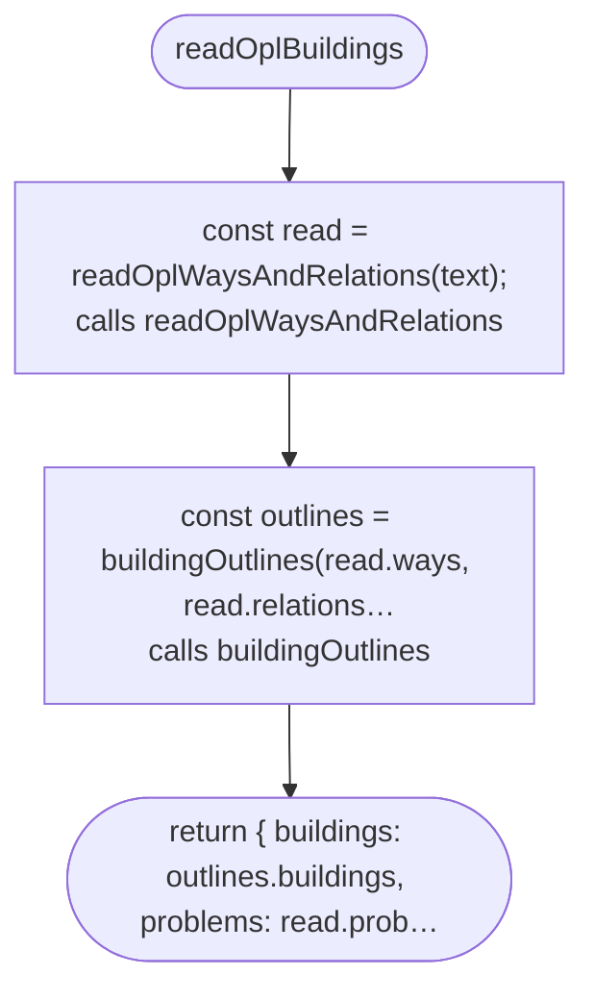

## readOplWaysAndRelations

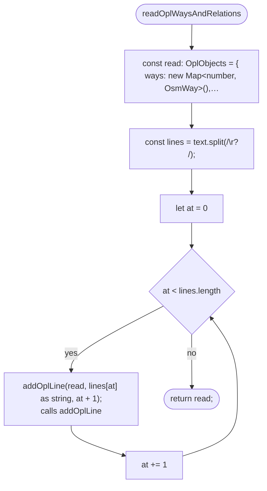

## addOplLine

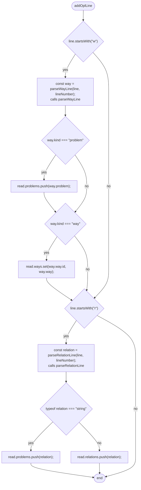

## buildingOutlines

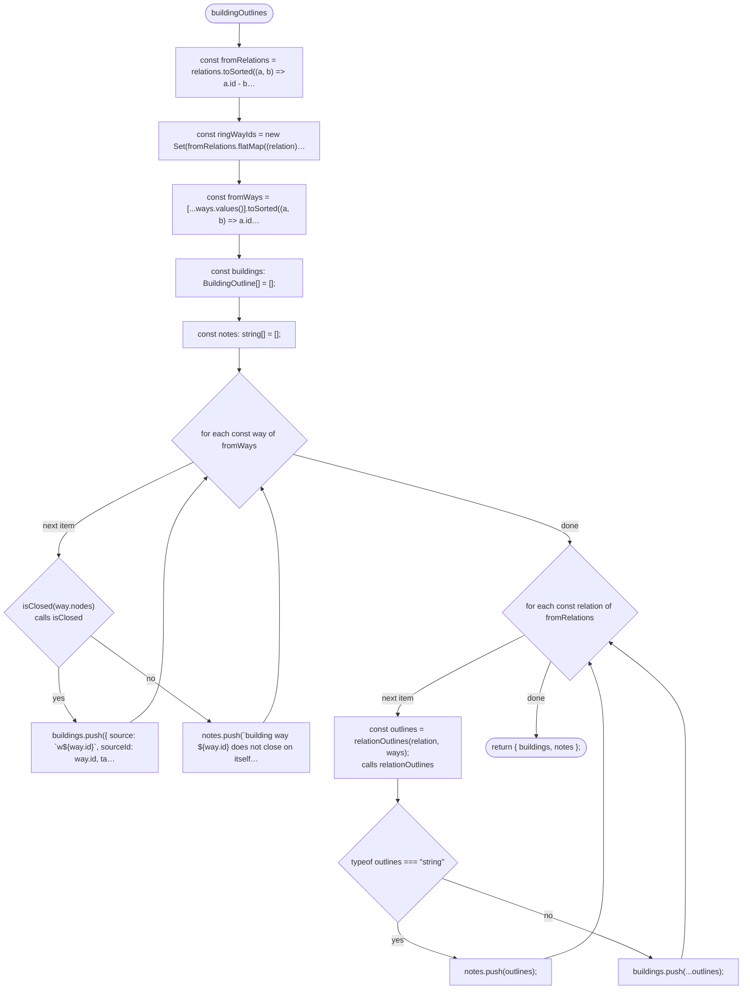

## buildingOutlines > inner function 1

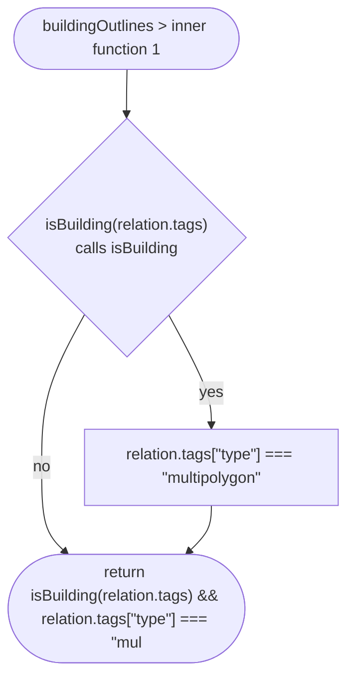

## buildingOutlines > inner function 2

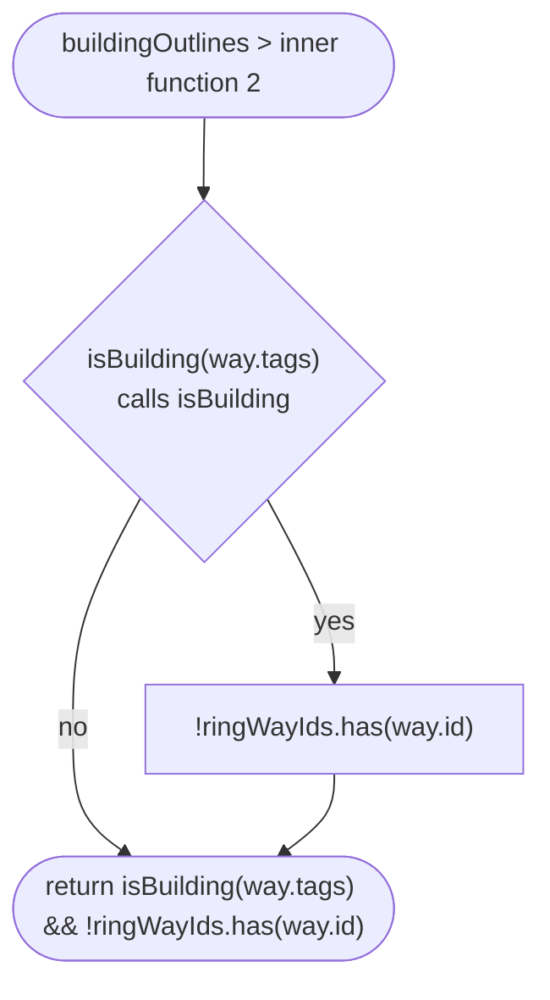

## parseRelationLine

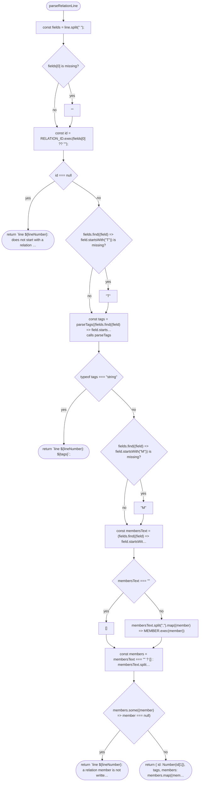

## parseRelationLine > inner function 1

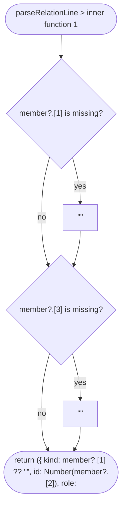

## isClosed

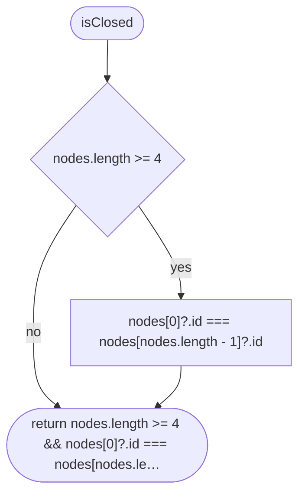

## relationOutlines

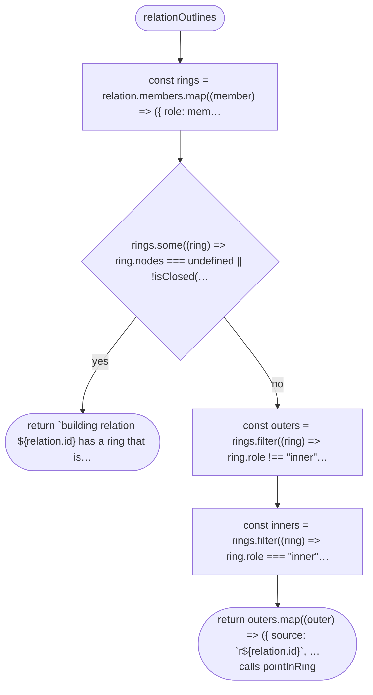

## relationOutlines > inner function 1

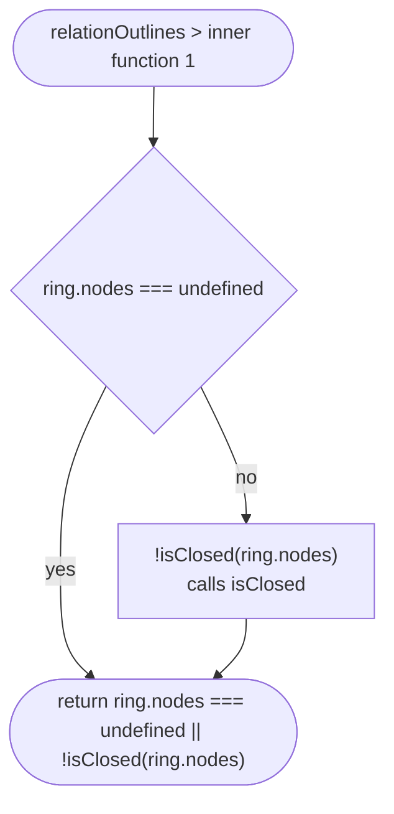

## pointInRing

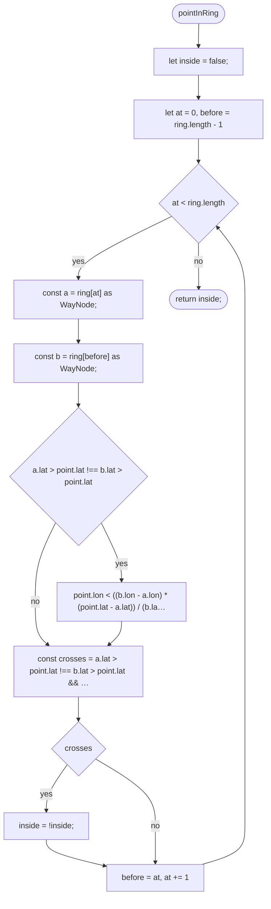

## buildingHeightM

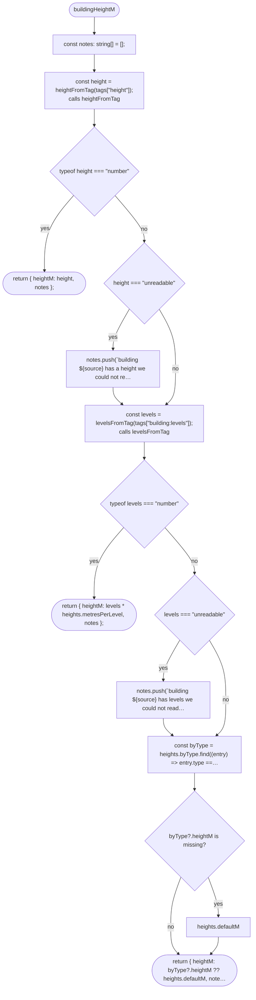

## heightFromTag

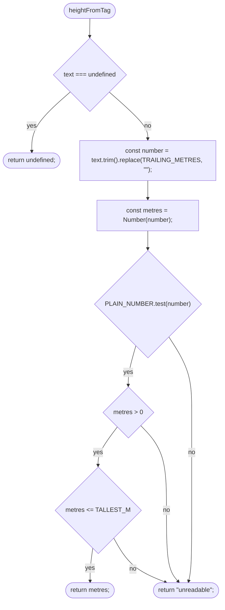

## levelsFromTag

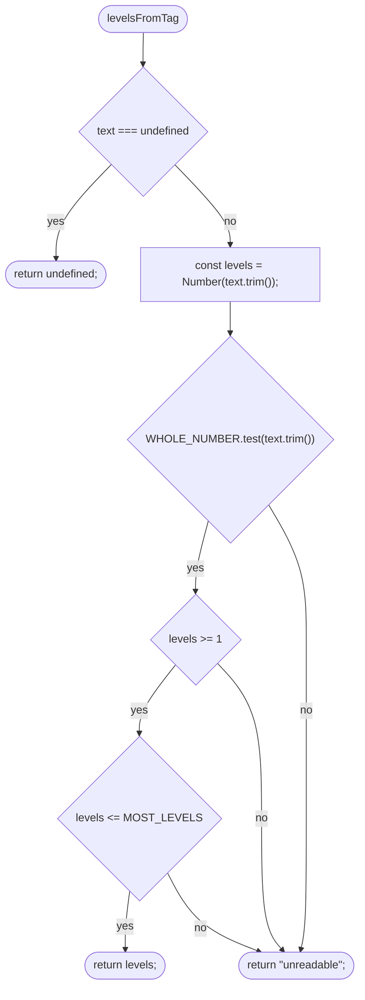

## ringInCentimetres

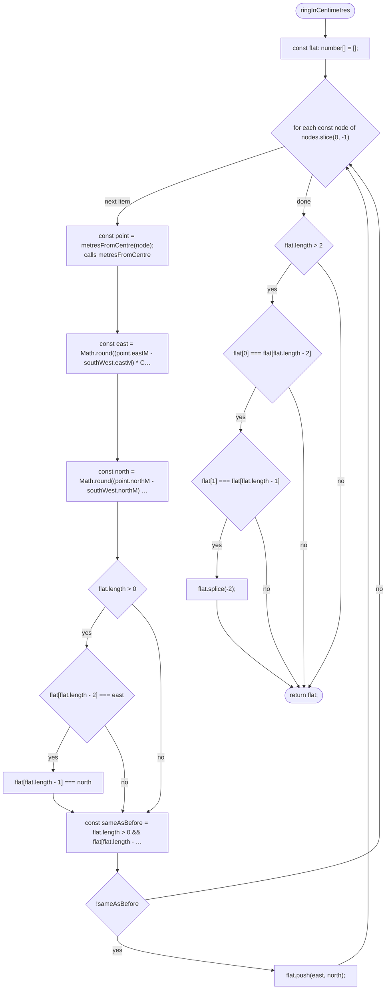

## twiceSignedArea

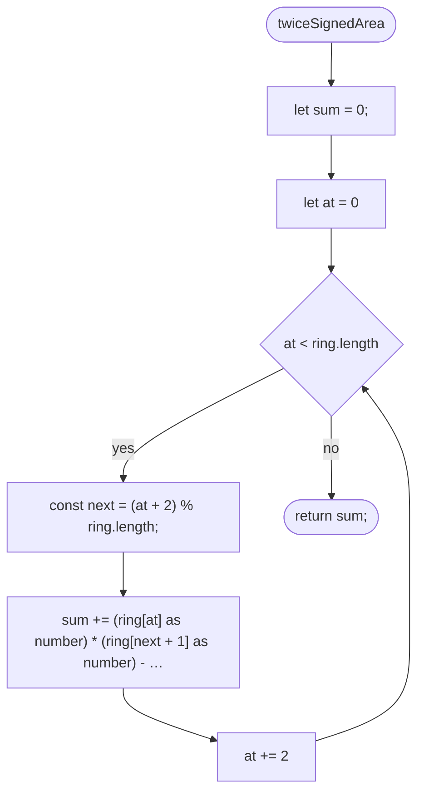

## reversedRing

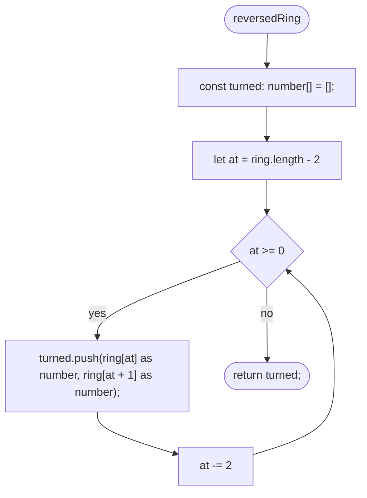

## roofTriangles

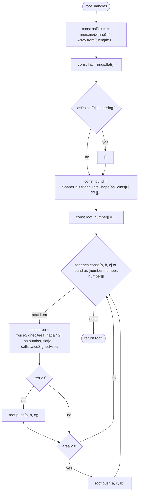

## cellForOutline

```mermaid
flowchart TD
  n1(["cellForOutline"])
  n2["const easts = outer.map((point) =#gt; point.eastM);"]
  n3["const norths = outer.map((point) =#gt; point.northM);"]
  n4(["return cellOfPoint({ eastM: (Math.min(...easts) + Math.max(…<br/>calls cellOfPoint"])
  n1 --> n2
  n2 --> n3
  n3 --> n4
```

## ringsFitTheirSquare

```mermaid
flowchart TD
  n1(["ringsFitTheirSquare"])
  n2["const largest = 10_000 + REACH_OUTSIDE_SQUARE_CM;"]
  n3(["return rings.every((ring) =#gt; ring.every((value) =#gt; value #gt;=…"])
  n1 --> n2
  n2 --> n3
```

## ringsFitTheirSquare > inner function 1

```mermaid
flowchart TD
  n1(["ringsFitTheirSquare #gt; inner function 1"])
  n2{"value #gt;= -REACH_OUTSIDE_SQUARE_CM"}
  n3["value #lt;= largest"]
  n4(["return value #gt;= -REACH_OUTSIDE_SQUARE_CM && value #lt;= largest"])
  n1 --> n2
  n2 -->|"yes"| n3
  n2 -->|"no"| n4
  n3 --> n4
```

## bakeBuilding

```mermaid
flowchart TD
  n1(["bakeBuilding"])
  n2["const cell = cellForOutline(outline.outer.map(metresFromCen…<br/>calls cellForOutline"]
  n3["const bounds = cellBounds(cell);<br/>calls cellBounds"]
  n4["const southWest = { eastM: bounds.westM, northM: bounds.sou…"]
  n5["const outer = ringInCentimetres(outline.outer, metresFromCe…<br/>calls ringInCentimetres"]
  n6{"outer.length #lt; 6"}
  n7{"twiceSignedArea(outer) === 0<br/>calls twiceSignedArea"}
  n8(["return #96;building ${outline.source} has no area once rounded…"])
  n9["const holes = outline.holes.map((hole) =#gt; ringInCentimetres…<br/>calls ringInCentimetres"]
  n10{"twiceSignedArea(outer) #gt; 0<br/>calls twiceSignedArea"}
  n11["outer"]
  n12["reversedRing(outer)<br/>calls reversedRing"]
  n13["const rings = [twiceSignedArea(outer) #gt; 0 ? outer : reverse…<br/>calls twiceSignedArea, reversedRing"]
  n14{"!ringsFitTheirSquare(rings)<br/>calls ringsFitTheirSquare"}
  n15(["return #96;building ${outline.source} reaches more than ${REAC…"])
  n16["const height = buildingHeightM(outline.source, outline.tags…<br/>calls buildingHeightM"]
  n17["const building = { heightCm: Math.round(height.heightM * CE…<br/>calls roofTriangles"]
  n18(["return { cell, building, notes: height.notes };"])
  n1 --> n2
  n2 --> n3
  n3 --> n4
  n4 --> n5
  n5 --> n6
  n6 -->|"no"| n7
  n6 -->|"yes"| n8
  n7 -->|"yes"| n8
  n7 -->|"no"| n9
  n9 --> n10
  n10 -->|"yes"| n11
  n10 -->|"no"| n12
  n11 --> n13
  n12 --> n13
  n13 --> n14
  n14 -->|"yes"| n15
  n14 -->|"no"| n16
  n16 --> n17
  n17 --> n18
```

## bakeBuilding > inner function 1

```mermaid
flowchart TD
  n1(["bakeBuilding #gt; inner function 1"])
  n2{"hole.length #gt;= 6"}
  n3["twiceSignedArea(hole) !== 0<br/>calls twiceSignedArea"]
  n4(["return hole.length #gt;= 6 && twiceSignedArea(hole) !== 0"])
  n1 --> n2
  n2 -->|"yes"| n3
  n2 -->|"no"| n4
  n3 --> n4
```

## bakeBuilding > inner function 2

```mermaid
flowchart TD
  n1(["bakeBuilding #gt; inner function 2"])
  n2{"twiceSignedArea(hole) #lt; 0<br/>calls twiceSignedArea"}
  n3["hole"]
  n4["reversedRing(hole)<br/>calls reversedRing"]
  n5(["return (twiceSignedArea(hole) #lt; 0 ? hole : reversedRing(hole))"])
  n1 --> n2
  n2 -->|"yes"| n3
  n2 -->|"no"| n4
  n3 --> n5
  n4 --> n5
```

## buildingsByCell

```mermaid
flowchart TD
  n1(["buildingsByCell"])
  n2["const metresFromCentre = localProjection(centre);<br/>calls localProjection"]
  n3["const byCell = new Map#lt;string, { cell: Cell; buildings: Bak…"]
  n4["const notes: string[] = [];"]
  n5{"for each const outline of outlines"}
  n6["const first = metresFromCentre(outline.outer[0] as WayNode);<br/>calls metresFromCentre"]
  n7{"!isInsideMap(first)<br/>calls isInsideMap"}
  n8["continue"]
  n9["const baked = bakeBuilding(outline, metresFromCentre, heigh…<br/>calls bakeBuilding"]
  n10{"typeof baked === #quot;string#quot;"}
  n11["notes.push(baked);"]
  n12["continue"]
  n13["notes.push(...baked.notes);"]
  n14["const key = cellKey(baked.cell);<br/>calls cellKey"]
  n15{"byCell.get(key) is missing?"}
  n16["{ cell: baked.cell, buildings: [] }"]
  n17["const square = byCell.get(key) ?? { cell: baked.cell, build…"]
  n18["square.buildings.push(baked.building);"]
  n19["byCell.set(key, square);"]
  n20(["return { byCell, notes };"])
  n1 --> n2
  n2 --> n3
  n3 --> n4
  n4 --> n5
  n5 -->|"next item"| n6
  n6 --> n7
  n7 -->|"yes"| n8
  n7 -->|"no"| n9
  n9 --> n10
  n10 -->|"yes"| n11
  n11 --> n12
  n10 -->|"no"| n13
  n13 --> n14
  n14 --> n15
  n15 -->|"yes"| n16
  n15 -->|"no"| n17
  n16 --> n17
  n17 --> n18
  n18 --> n19
  n19 --> n5
  n8 --> n5
  n12 --> n5
  n5 -->|"done"| n20
```

## buildingFileText

```mermaid
flowchart TD
  n1(["buildingFileText"])
  n2["const written = buildings.map((building) =#gt; ({ heightCm: bu…"]
  n3(["return #96;${JSON.stringify({ format: BUILDINGS_FORMAT, cell: …"])
  n1 --> n2
  n2 --> n3
```

## buildingFileName

```mermaid
flowchart TD
  n1(["buildingFileName"])
  n2(["return #96;buildings_${cellKey(cell)}.json#96;;<br/>calls cellKey"])
  n1 --> n2
```
