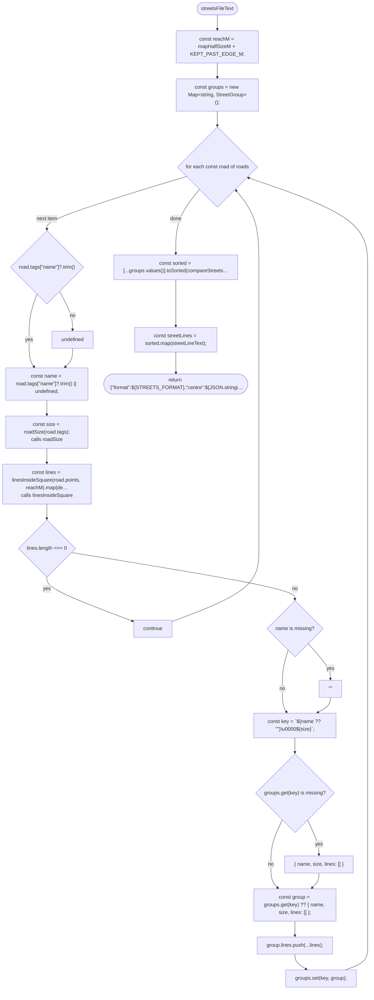
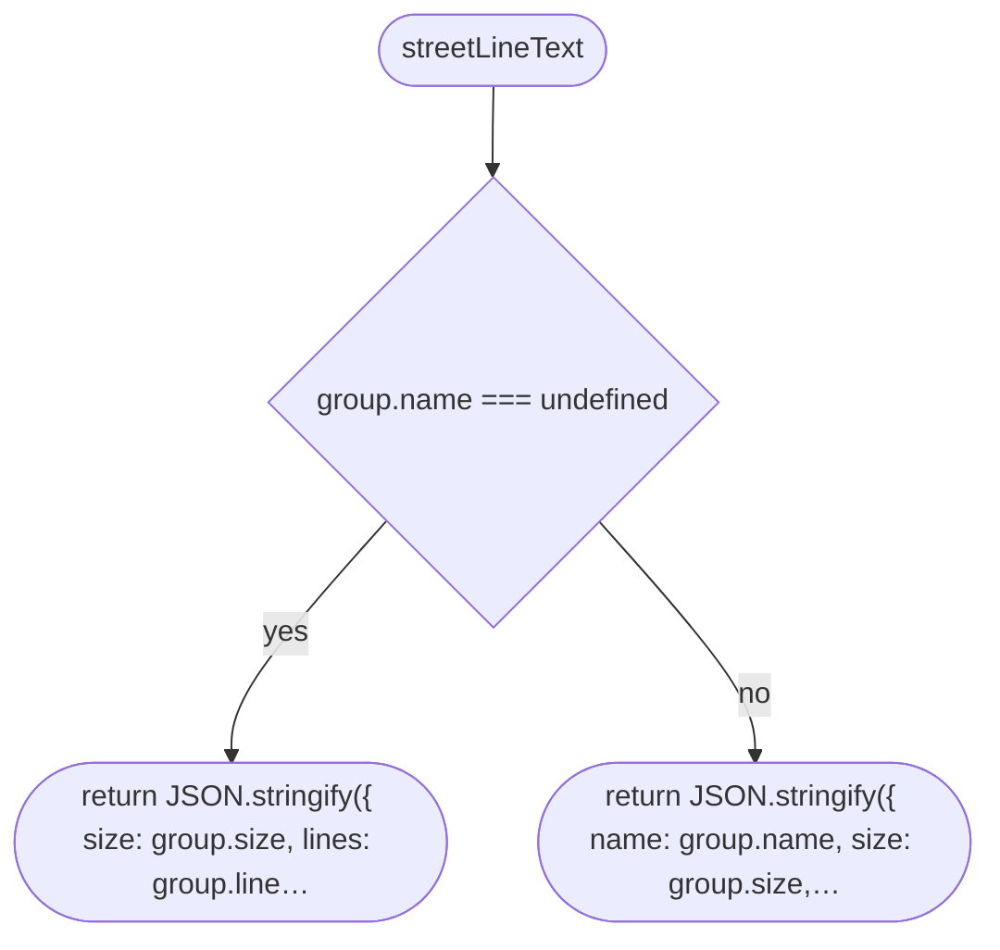
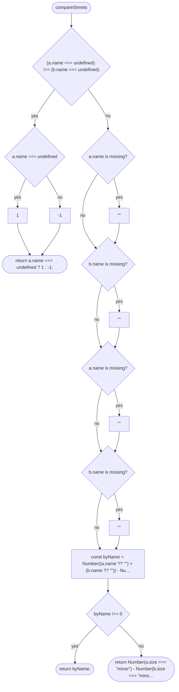
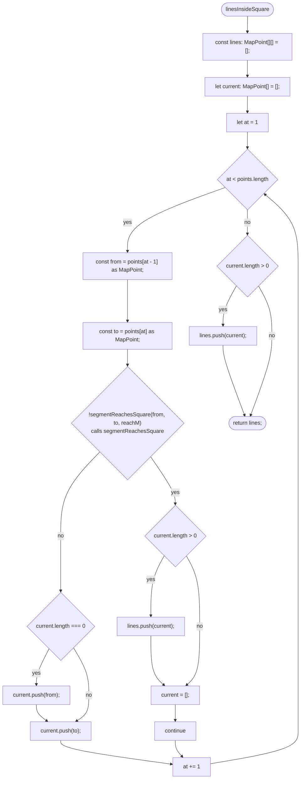
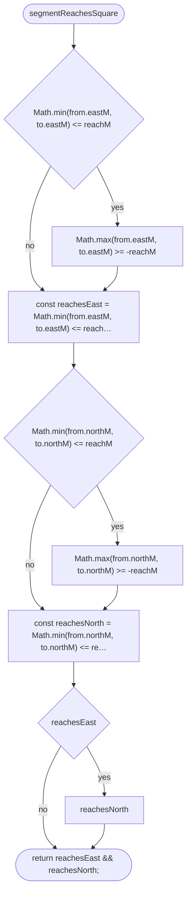
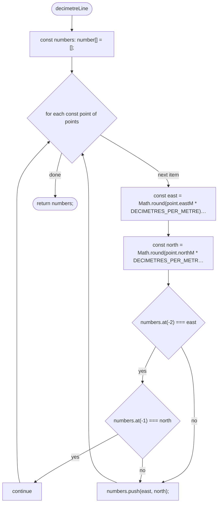

# tools/bake/streets.ts

Drawn from the code by `npm run diagrams` (TypeScript compiler, no AI). Do not edit by hand: change the code, then run it again.

## streetsFileText

## streetLineText

## compareStreets

## linesInsideSquare

## segmentReachesSquare

## decimetreLine

