# tools/diagrams/expressions.ts

Drawn from the code by `npm run diagrams` (TypeScript compiler, no AI). Do not edit by hand: change the code, then run it again.

## step

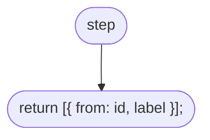

## drawBox

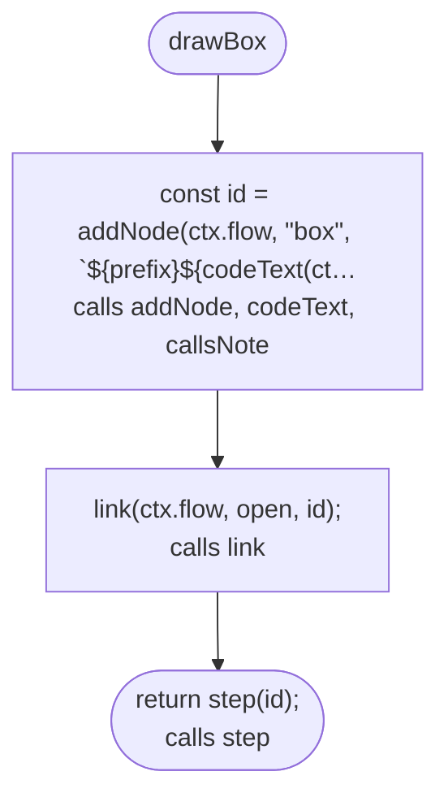

## unwrap

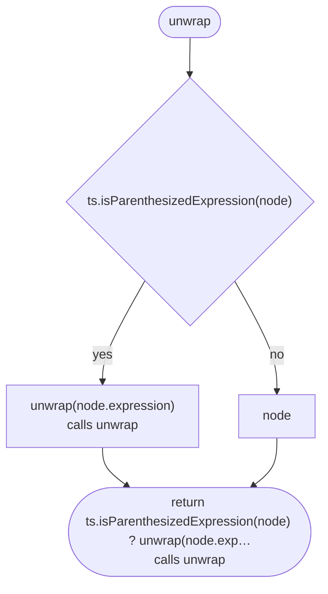

## splitGuard

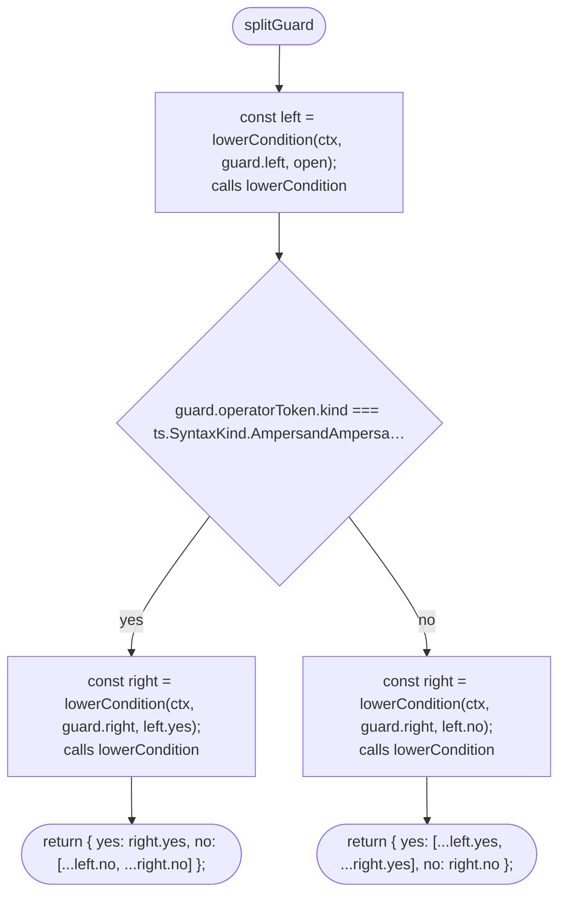

## isAndOr

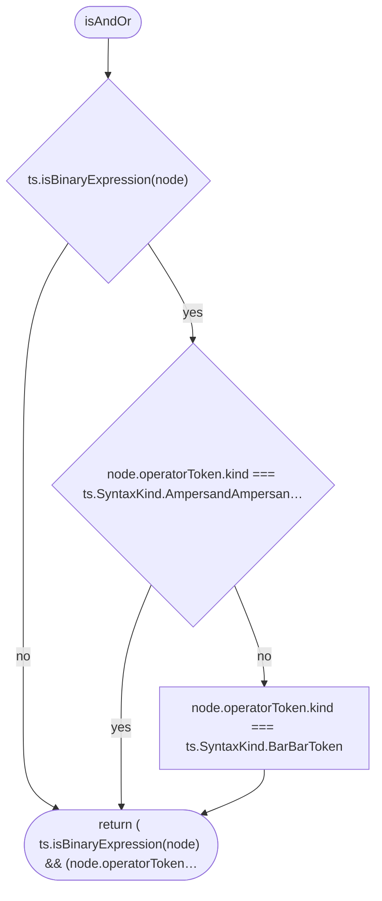

## lowerCondition

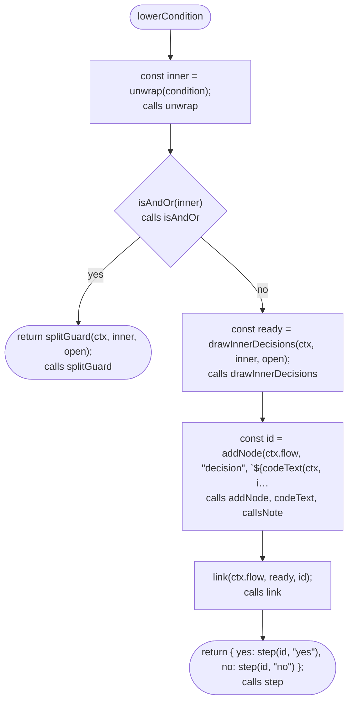

## drawBranch

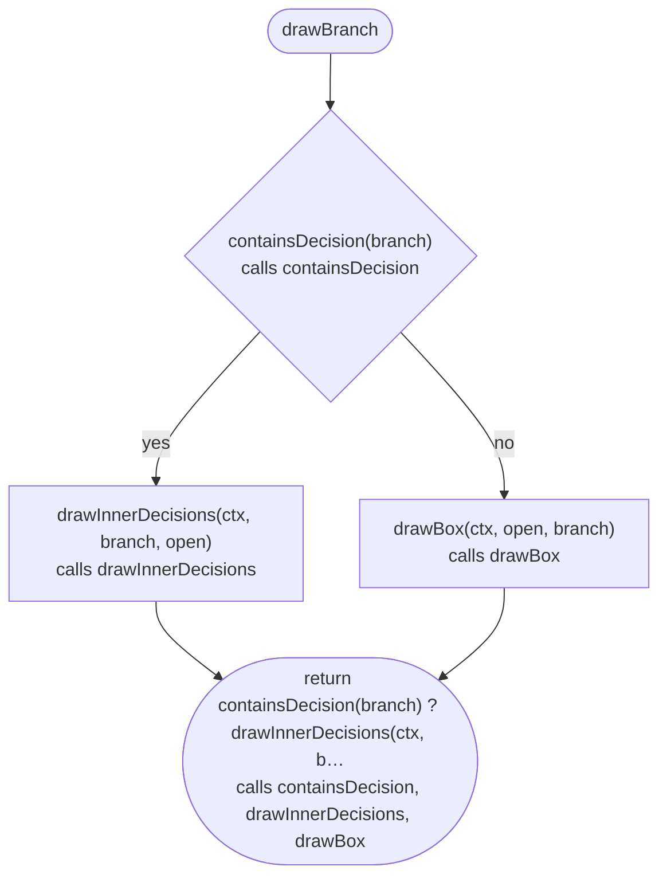

## drawTernary

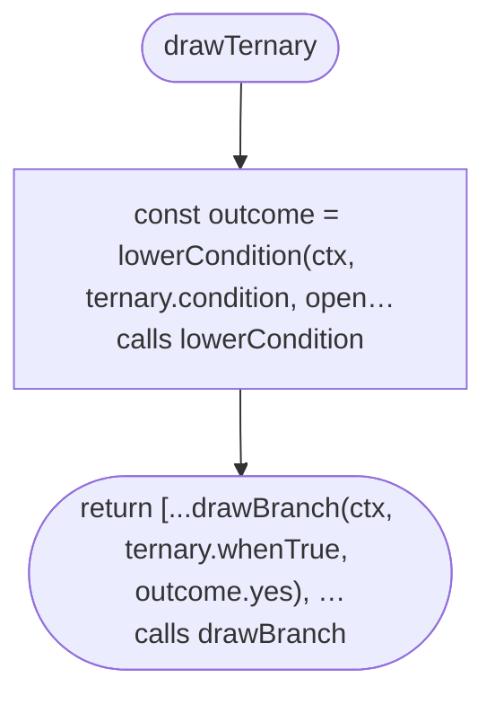

## drawMissingCheck

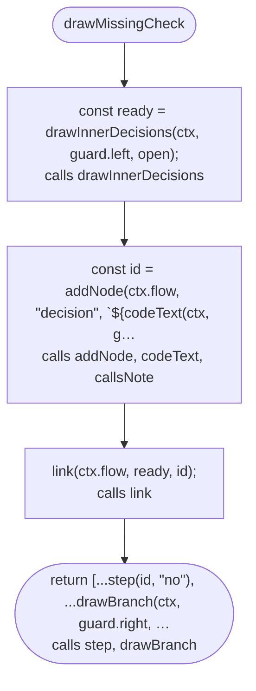

## drawAndOr

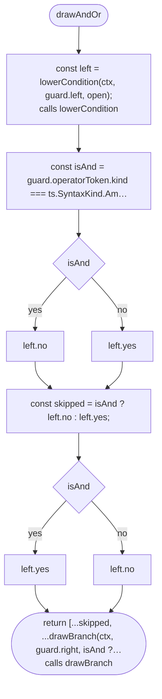

## drawGuard

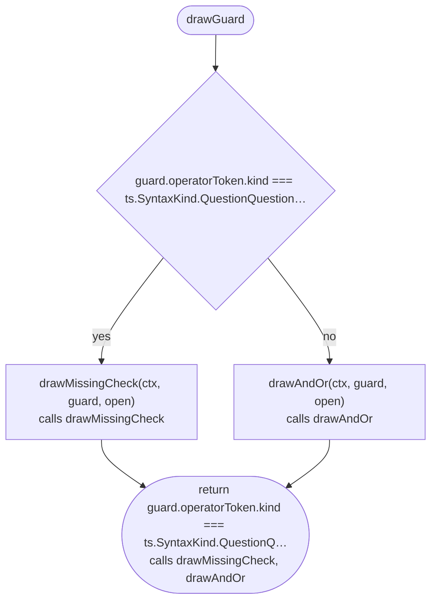

## drawInnerDecisions

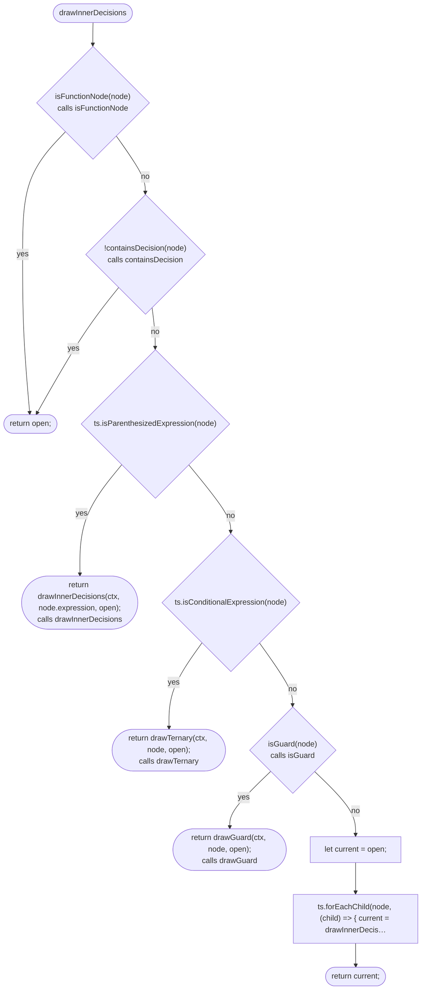

## drawInnerDecisions > inner function 1

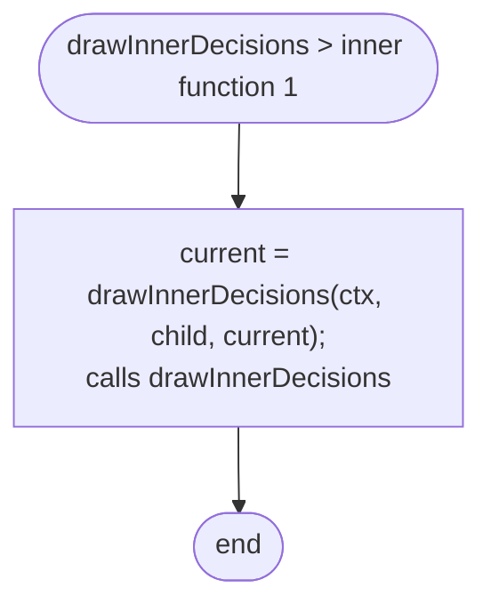
