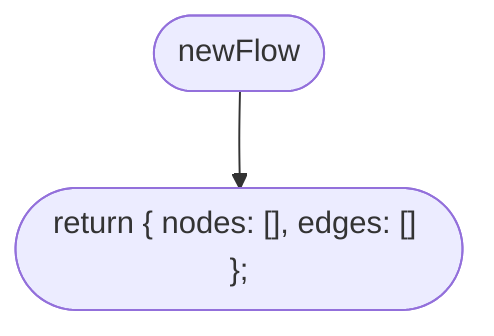
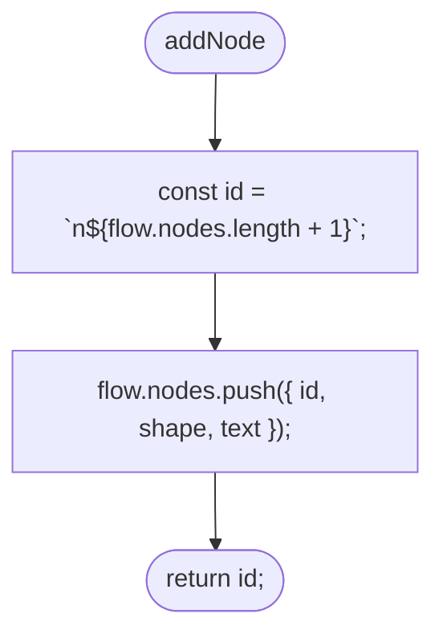
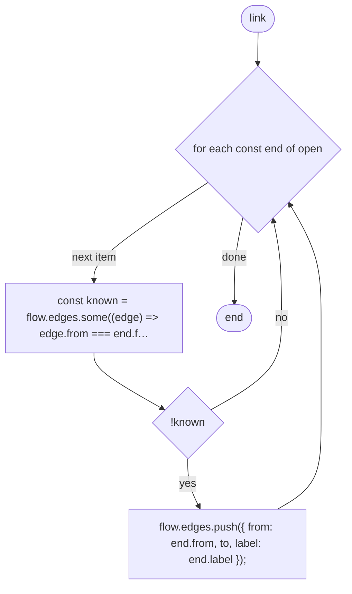
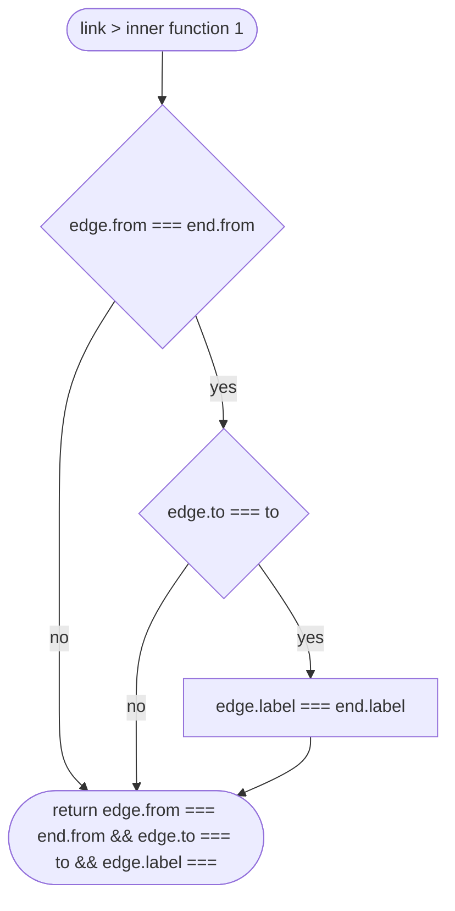
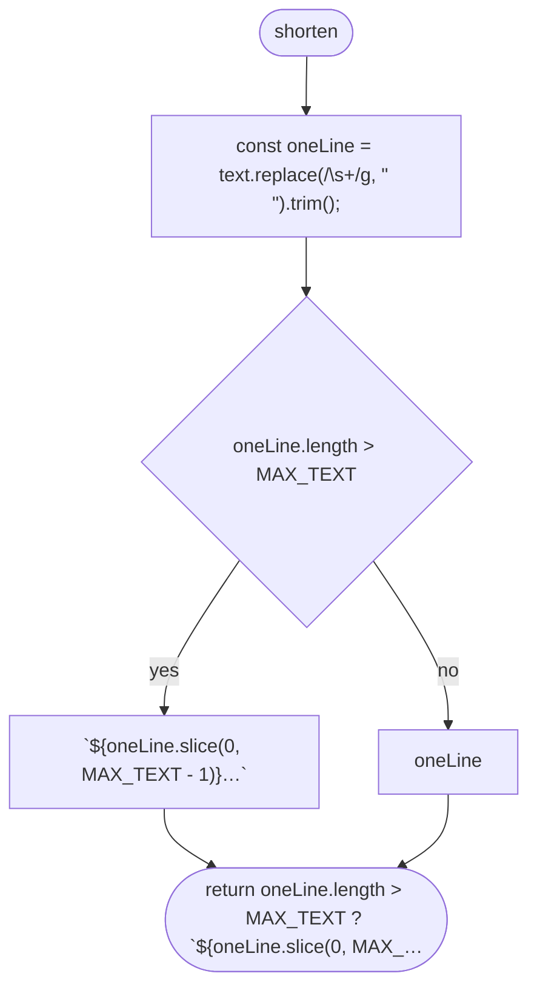
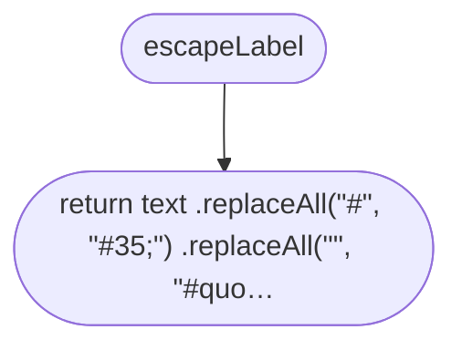
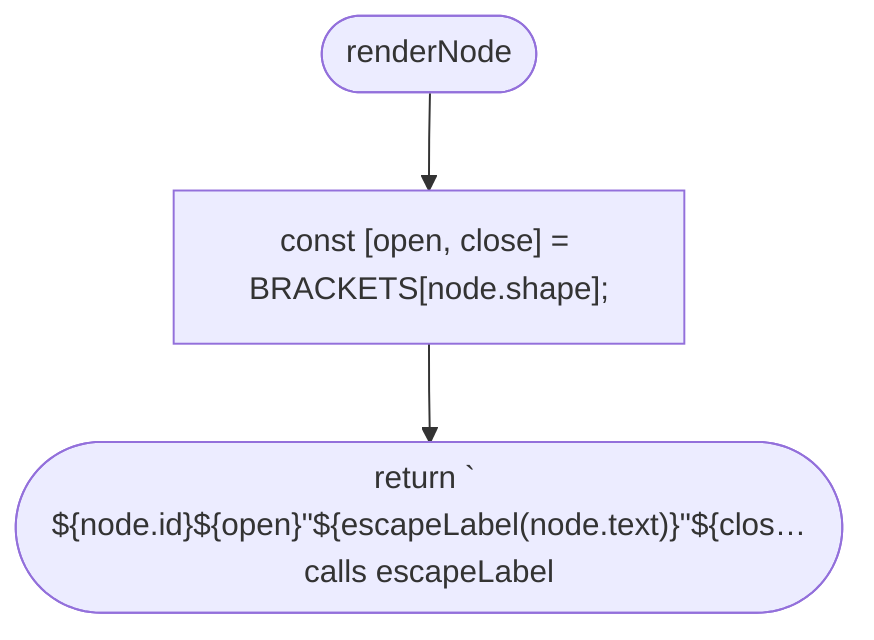
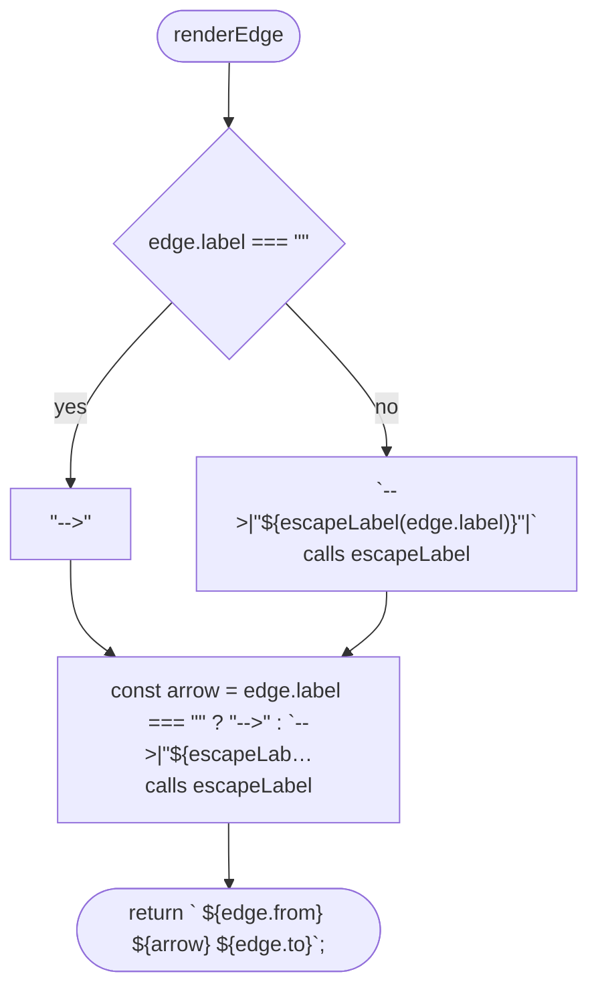
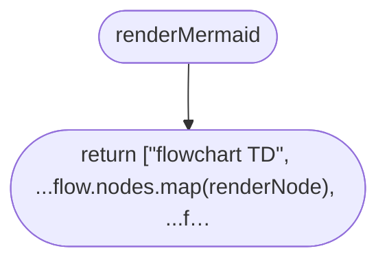

# tools/diagrams/flow-model.ts

Drawn from the code by `npm run diagrams` (TypeScript compiler, no AI). Do not edit by hand: change the code, then run it again.

## newFlow

## addNode

## link

## link > inner function 1

## shorten

## escapeLabel

## renderNode

## renderEdge

## renderMermaid

