# tools/diagrams/functions.ts

Drawn from the code by `npm run diagrams` (TypeScript compiler, no AI). Do not edit by hand: change the code, then run it again.

## isFunctionNode

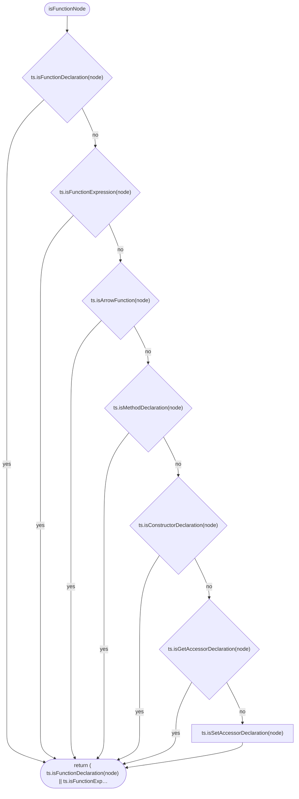

## propertyText

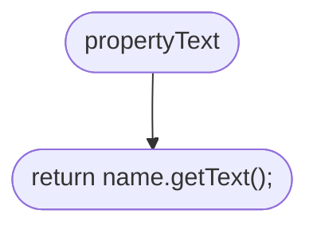

## ownerName

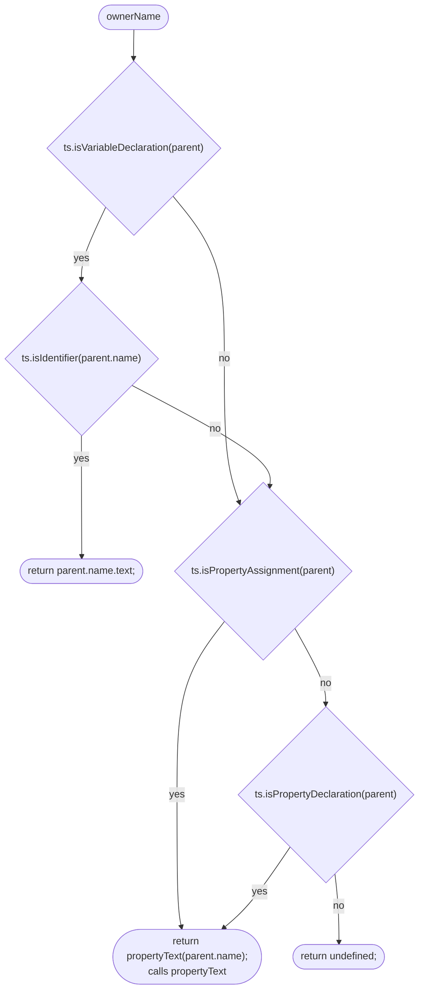

## classPrefix

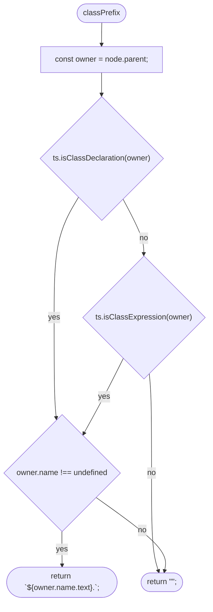

## memberName

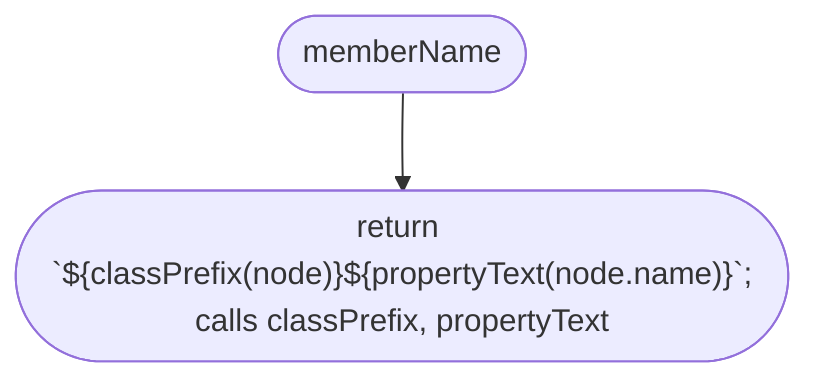

## expressionName

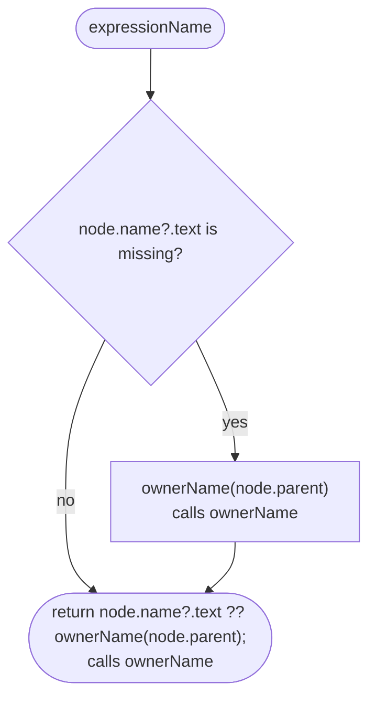

## declaredName

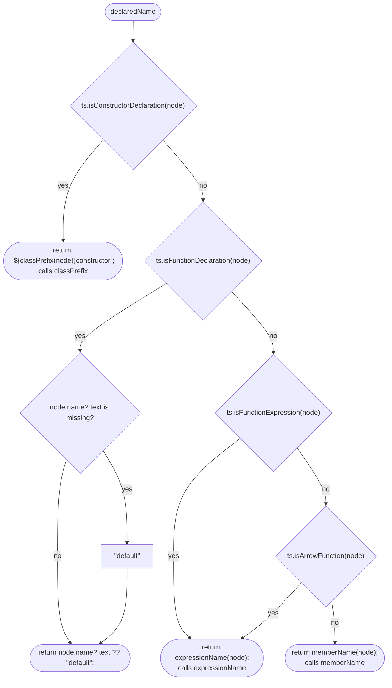

## anyInside

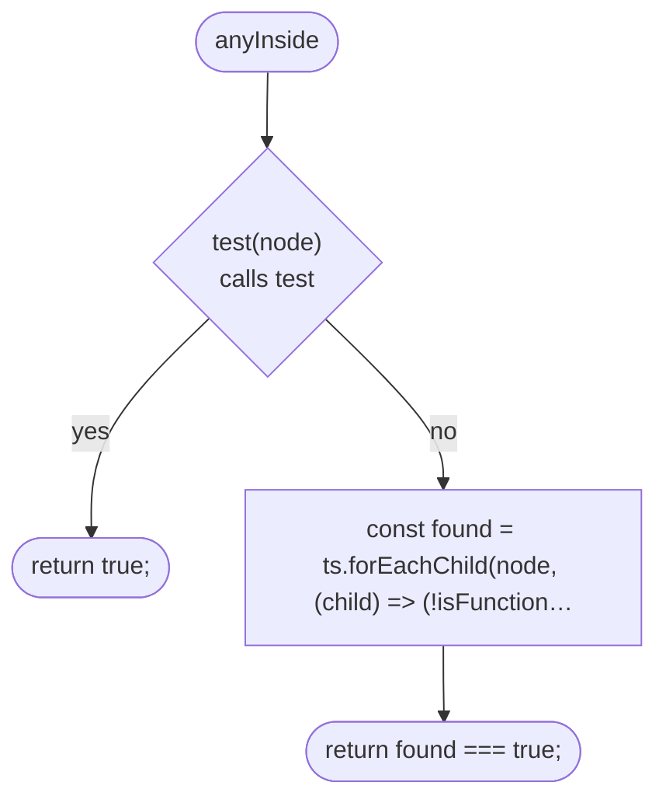

## anyInside > inner function 1

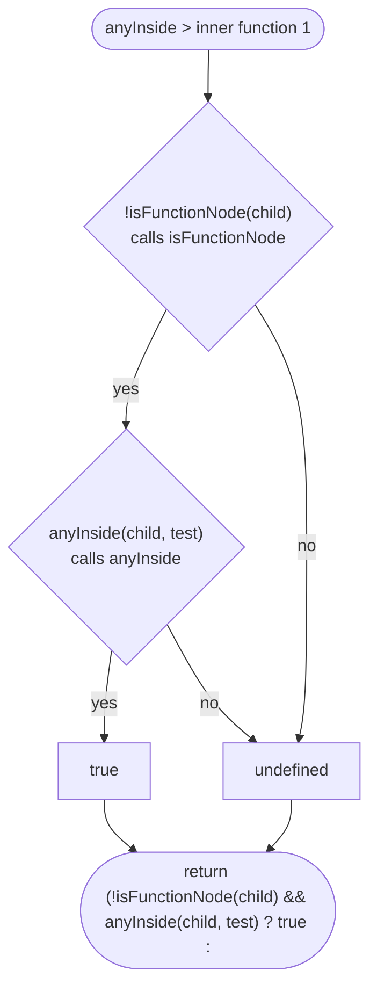

## containsDecision

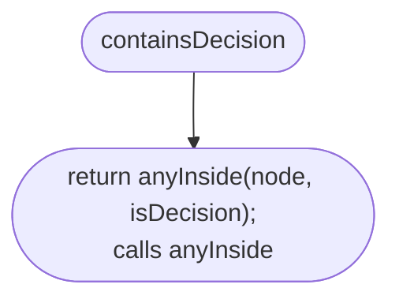

## isGuard

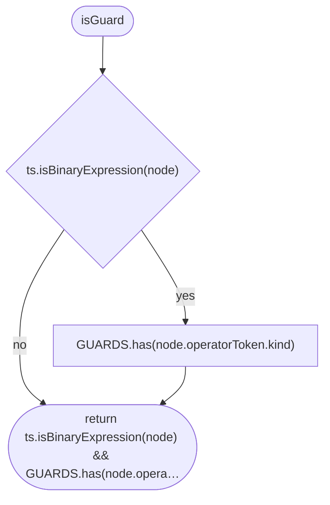

## isDecision

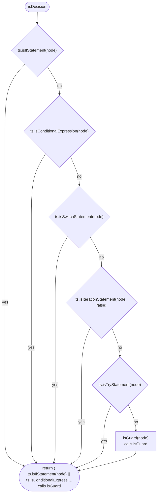

## hasOwnFlow

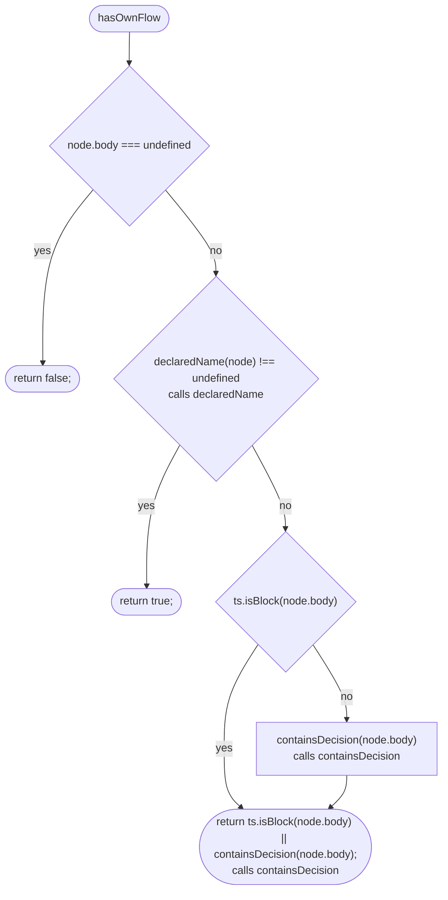

## uniqueName

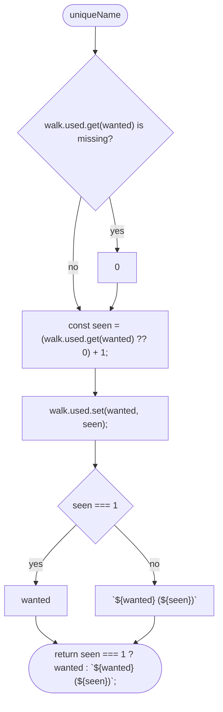

## entryName

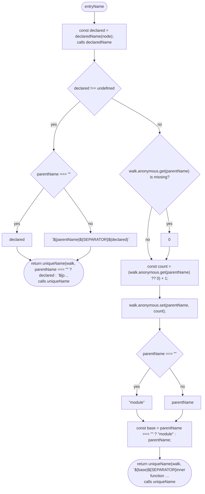

## visit

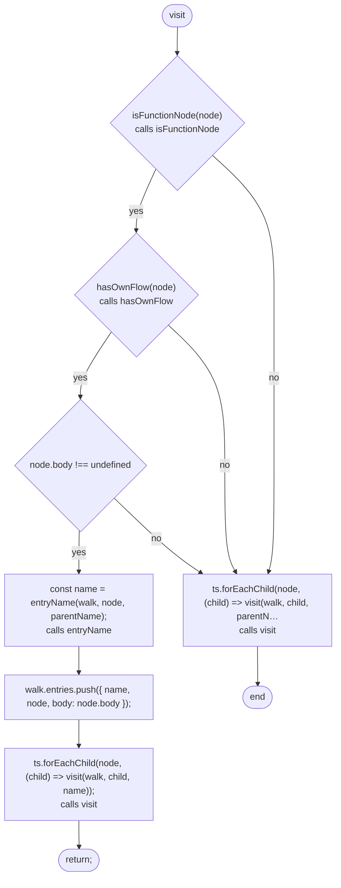

## listFunctions

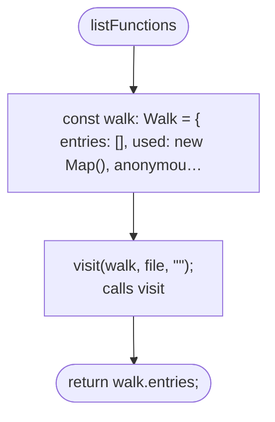
