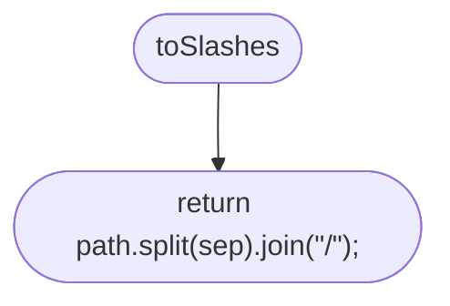
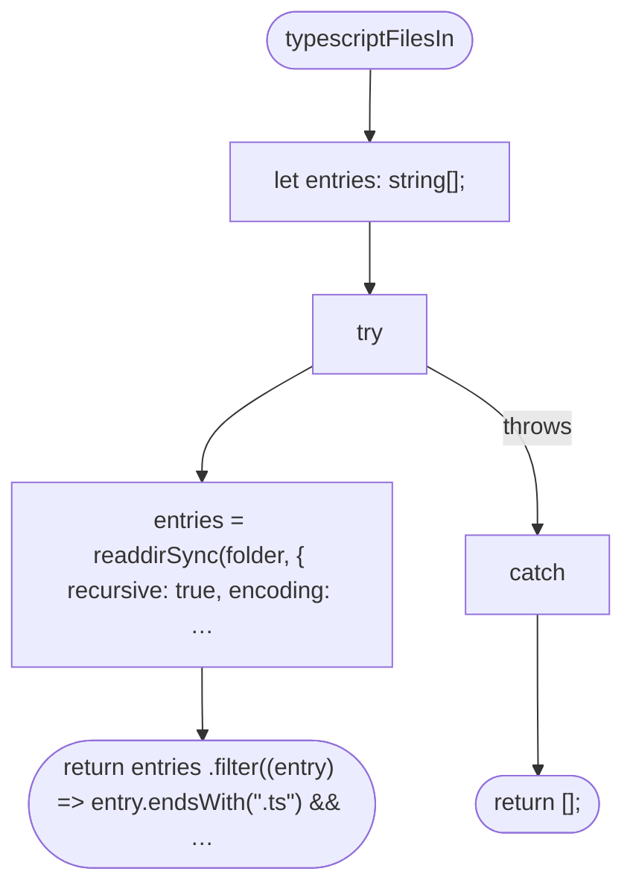
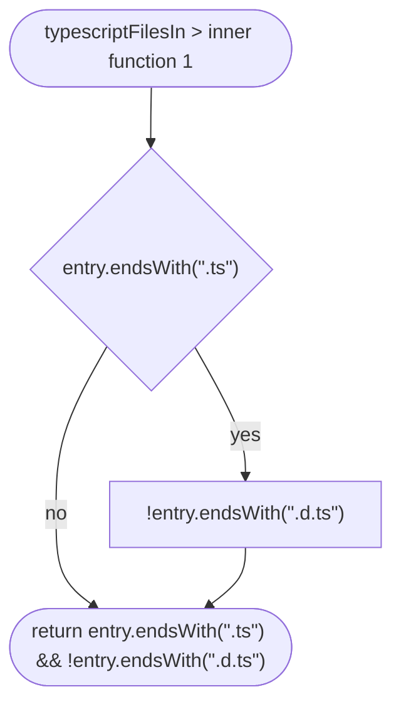
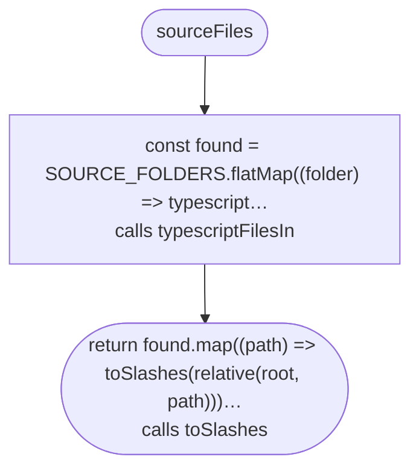
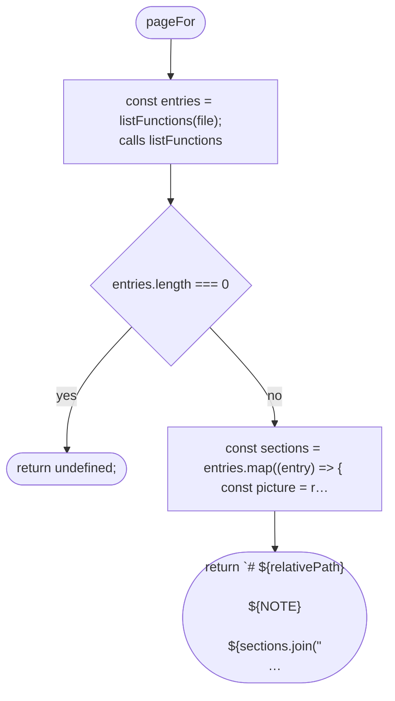
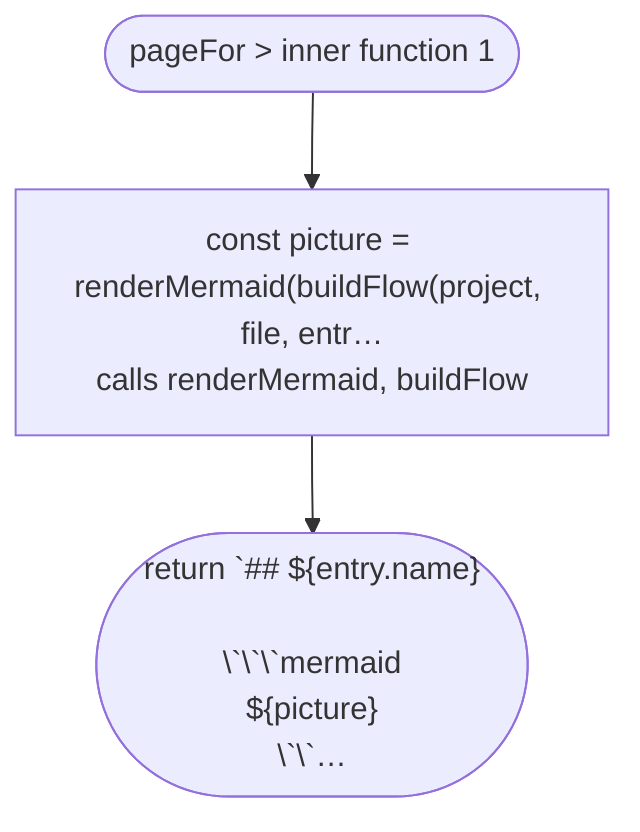
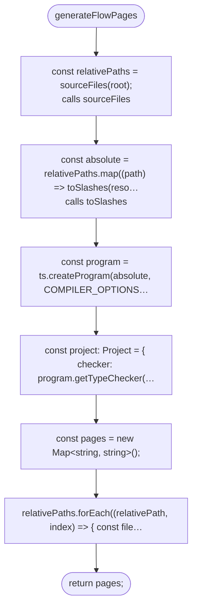
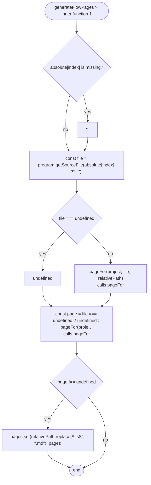

# tools/diagrams/generate.ts

Drawn from the code by `npm run diagrams` (TypeScript compiler, no AI). Do not edit by hand: change the code, then run it again.

## toSlashes

## typescriptFilesIn

## typescriptFilesIn > inner function 1

## sourceFiles

## pageFor

## pageFor > inner function 1

## generateFlowPages

## generateFlowPages > inner function 1

