# tools/diagrams/statements.ts

Drawn from the code by `npm run diagrams` (TypeScript compiler, no AI). Do not edit by hand: change the code, then run it again.

## typed

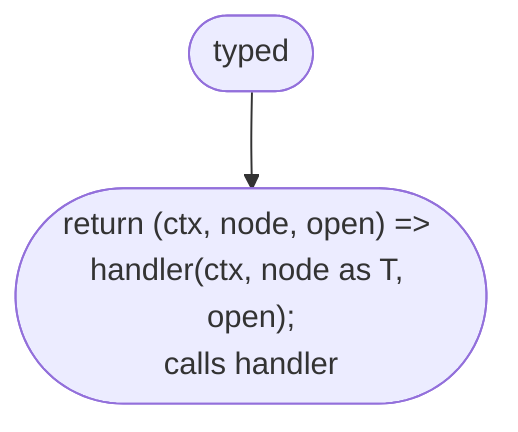

## drawStatements

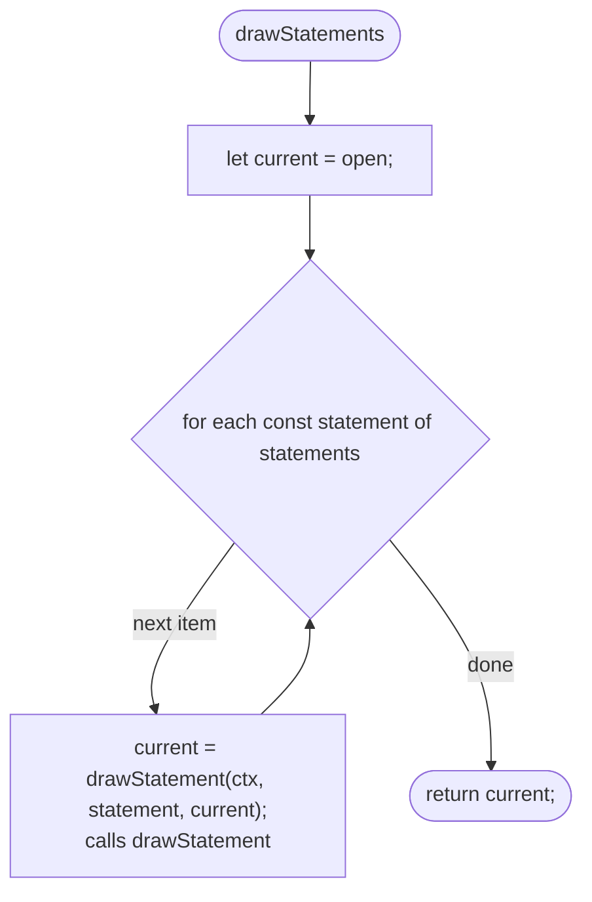

## drawStatement

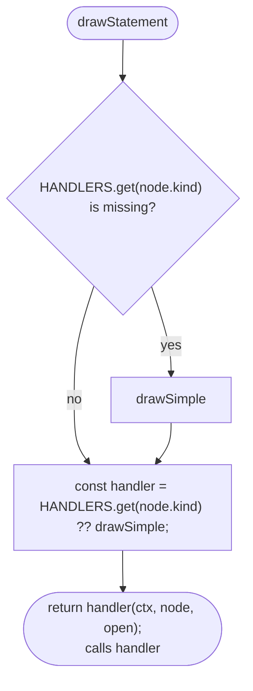

## drawSimple

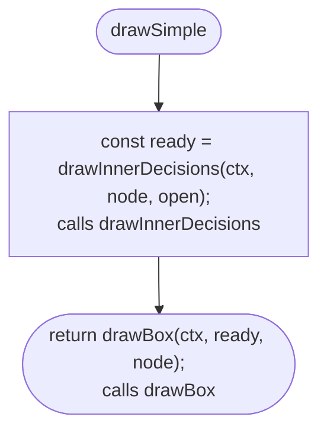

## drawNothing

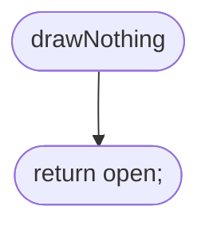

## drawBlock

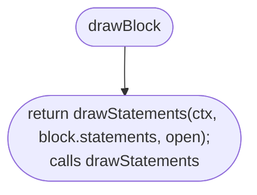

## drawIf

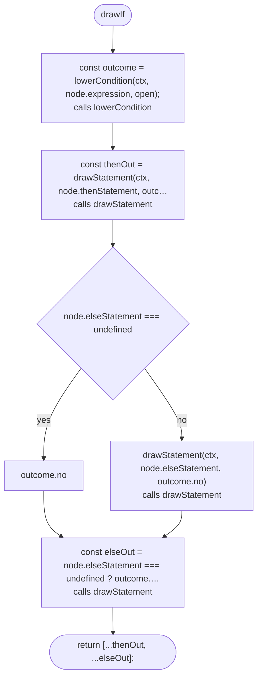

## drawExit

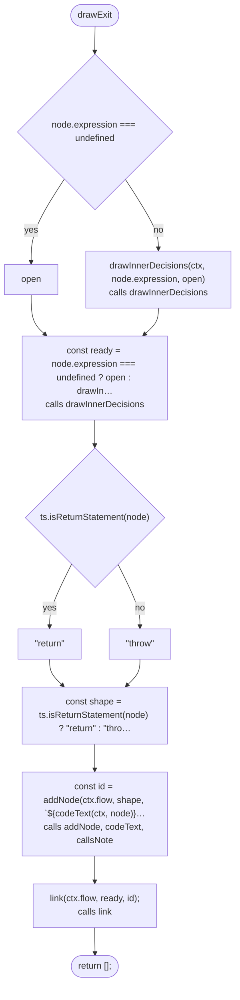

## openTarget

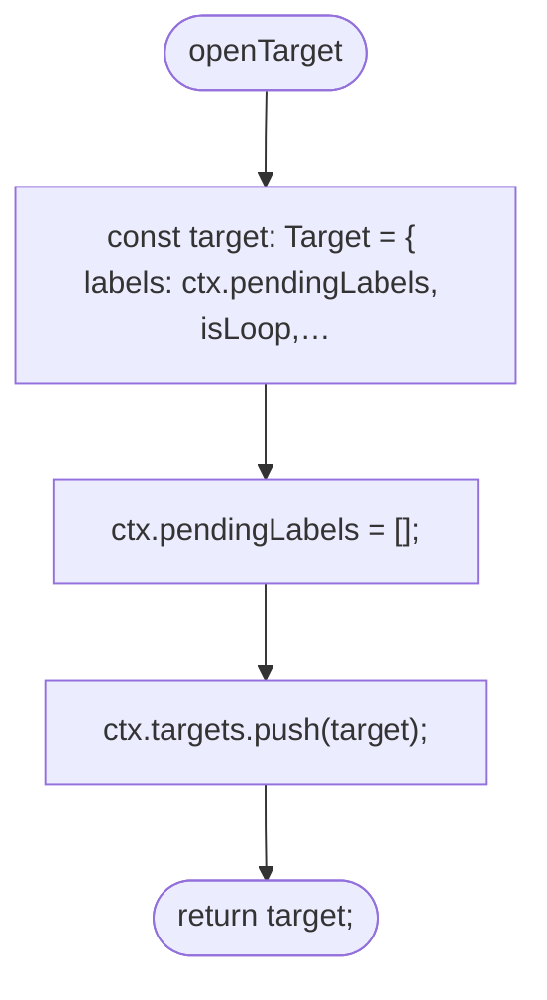

## findTarget

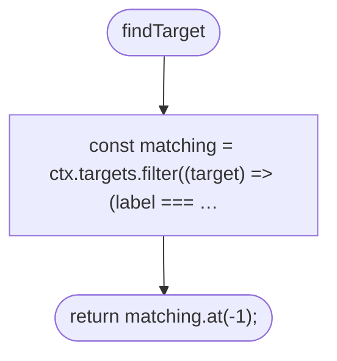

## findTarget > inner function 1

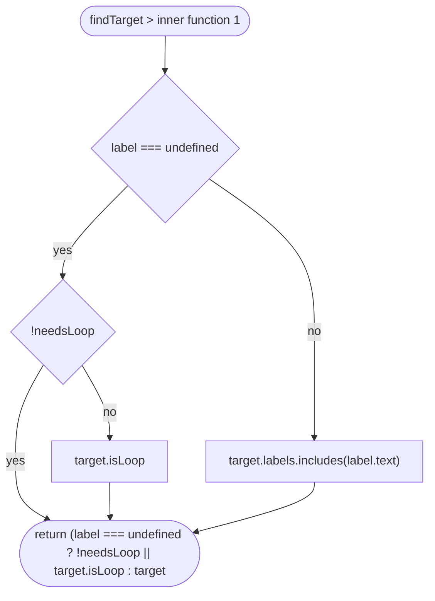

## drawJump

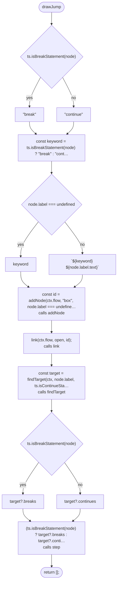

## drawLabeled

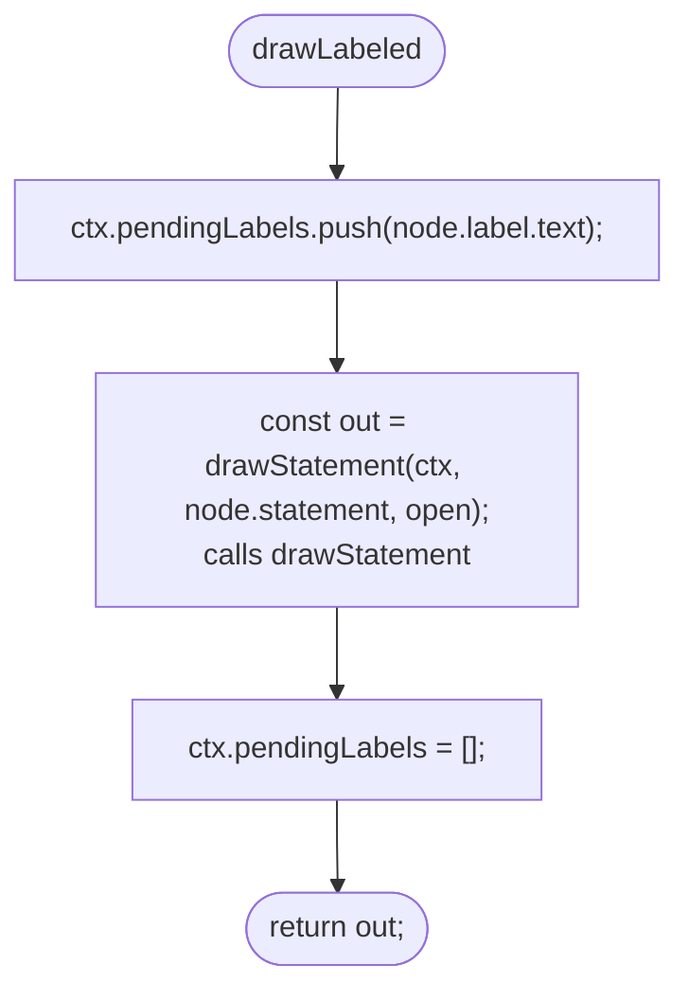

## drawLoopBody

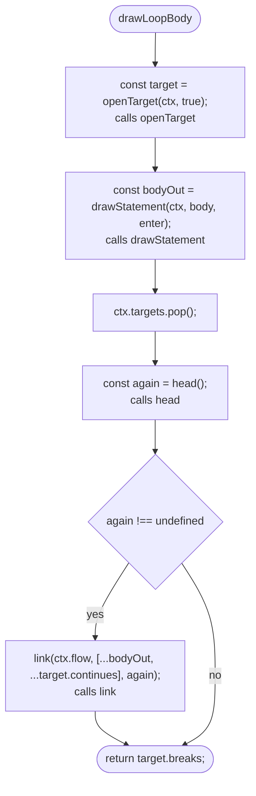

## firstNodeSince

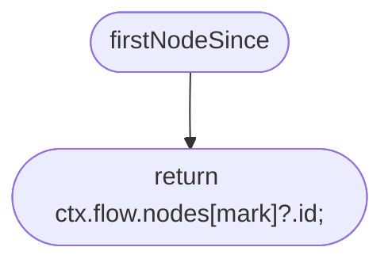

## drawWhile

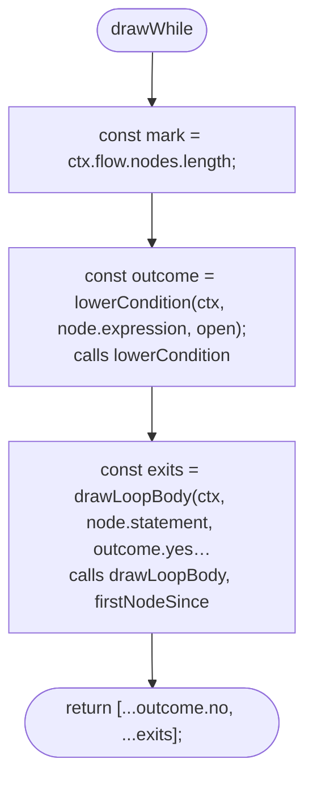

## drawDoWhile

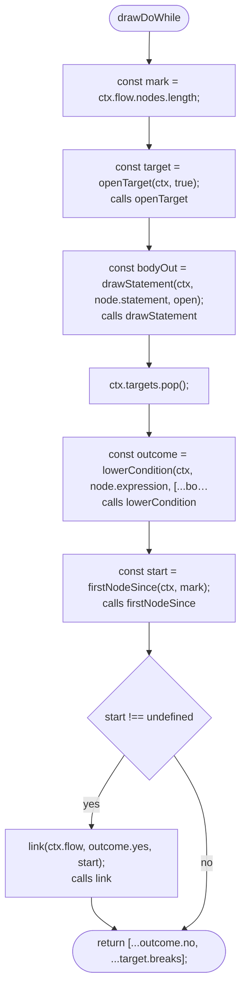

## drawForEach

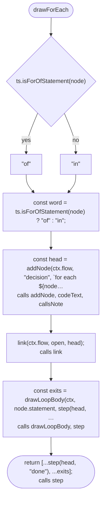

## drawForInit

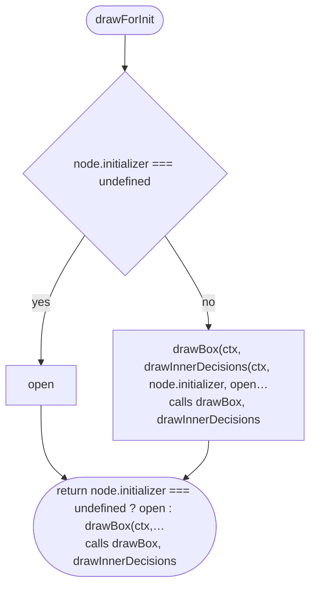

## drawFor

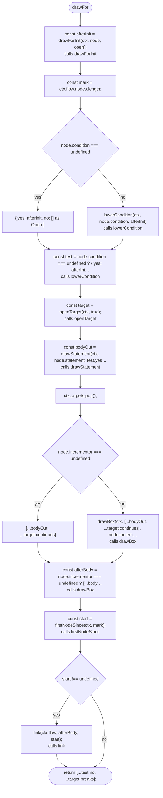

## caseLabel

```mermaid
flowchart TD
  n1(["caseLabel"])
  n2{"ts.isCaseClause(clause)"}
  n3["#96;case ${codeText(ctx, clause.expression)}#96;<br/>calls codeText"]
  n4["#quot;default#quot;"]
  n5(["return ts.isCaseClause(clause) ? #96;case ${codeText(ctx, clau…<br/>calls codeText"])
  n1 --> n2
  n2 -->|"yes"| n3
  n2 -->|"no"| n4
  n3 --> n5
  n4 --> n5
```

## drawSwitch

```mermaid
flowchart TD
  n1(["drawSwitch"])
  n2["const ready = drawInnerDecisions(ctx, node.expression, open…<br/>calls drawInnerDecisions"]
  n3["const head = addNode(ctx.flow, #quot;decision#quot;, #96;switch ${codeTe…<br/>calls addNode, codeText, callsNote"]
  n4["link(ctx.flow, ready, head);<br/>calls link"]
  n5["const target = openTarget(ctx, false);<br/>calls openTarget"]
  n6["let carry: Open = [];"]
  n7{"for each const clause of node.caseBlock.clauses"}
  n8["carry = drawStatements(ctx, clause.statements, [...step(hea…<br/>calls drawStatements, step, caseLabel"]
  n9["ctx.targets.pop();"]
  n10["const hasDefault = node.caseBlock.clauses.some(ts.isDefault…"]
  n11{"hasDefault"}
  n12["[]"]
  n13["step(head, #quot;no case matches#quot;)<br/>calls step"]
  n14(["return [...carry, ...target.breaks, ...(hasDefault ? [] : s…<br/>calls step"])
  n1 --> n2
  n2 --> n3
  n3 --> n4
  n4 --> n5
  n5 --> n6
  n6 --> n7
  n7 -->|"next item"| n8
  n8 --> n7
  n7 -->|"done"| n9
  n9 --> n10
  n10 --> n11
  n11 -->|"yes"| n12
  n11 -->|"no"| n13
  n12 --> n14
  n13 --> n14
```

## drawTry

```mermaid
flowchart TD
  n1(["drawTry"])
  n2["const start = addNode(ctx.flow, #quot;box#quot;, #quot;try#quot;);<br/>calls addNode"]
  n3["link(ctx.flow, open, start);<br/>calls link"]
  n4["const tryOut = drawBlock(ctx, node.tryBlock, step(start));<br/>calls drawBlock, step"]
  n5{"node.catchClause === undefined"}
  n6["[]"]
  n7["drawCatch(ctx, node.catchClause, step(start, #quot;throws#quot;))<br/>calls drawCatch, step"]
  n8["const catchOut = node.catchClause === undefined ? [] : draw…<br/>calls drawCatch, step"]
  n9["const joined = [...tryOut, ...catchOut];"]
  n10{"node.finallyBlock === undefined"}
  n11["joined"]
  n12["drawBlock(ctx, node.finallyBlock, joined)<br/>calls drawBlock"]
  n13(["return node.finallyBlock === undefined ? joined : drawBlock…<br/>calls drawBlock"])
  n1 --> n2
  n2 --> n3
  n3 --> n4
  n4 --> n5
  n5 -->|"yes"| n6
  n5 -->|"no"| n7
  n6 --> n8
  n7 --> n8
  n8 --> n9
  n9 --> n10
  n10 -->|"yes"| n11
  n10 -->|"no"| n12
  n11 --> n13
  n12 --> n13
```

## drawCatch

```mermaid
flowchart TD
  n1(["drawCatch"])
  n2{"clause.variableDeclaration === undefined"}
  n3["#quot;#quot;"]
  n4["#96; (${clause.variableDeclaration.name.getText(ctx.file)})#96;"]
  n5["const variable = clause.variableDeclaration === undefined ?…"]
  n6["const id = addNode(ctx.flow, #quot;box#quot;, #96;catch${variable}#96;);<br/>calls addNode"]
  n7["link(ctx.flow, open, id);<br/>calls link"]
  n8(["return drawBlock(ctx, clause.block, step(id));<br/>calls drawBlock, step"])
  n1 --> n2
  n2 -->|"yes"| n3
  n2 -->|"no"| n4
  n3 --> n5
  n4 --> n5
  n5 --> n6
  n6 --> n7
  n7 --> n8
```
