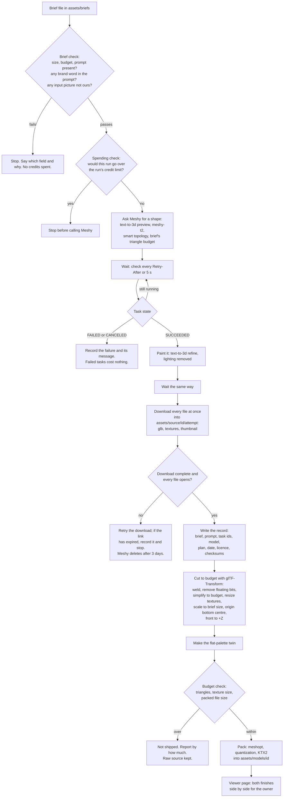

# Track 3: Assets (log)

Kept by the Assets orchestrator chat. Newest first.

## 2026-10-12: learner, maths-defined models, realism ladder

- **Pushing:** this chat still can't push with git; everything goes up through
  GitHub's web upload in the built-in browser (owner's instruction). The
  maths-shapes code is on `experiment/maths-shapes`; pull request #2 brings it
  into `track/assets` and is waiting for the owner to merge.
- **Learner (Corridor Crew way):** a shape factory makes made-up box cars with
  known recipes; a small 3D network learns to read the recipe. One hour on CPU:
  0.93 overlap on made-up cars, 0.85 on the real hatchback at a glance; glance
  plus 300 polish steps matched the hand-started search (0.953 vs 0.949).
  Stopped by the owner: made-up boxes don't look like real cars.
- **Owner's idea, researched (research/43):** test the learner on real models
  that come with their maths. DeepCAD (Onshape public designs) is the best
  source but is machine parts, almost no vehicles. Download blocked: needs
  `www.cs.columbia.edu` allowed, or the owner downloads `data.tar` once.
- **Realism ladder** (experiments/realism-ladder): Babatunde Ladega Street at
  three levels, timed on the phone, with a headroom test that doubles cars and
  trees on High. Owner's first run (iPhone, iOS 18.7, inside the Claude app):
  every level at exactly 30 fps, so the page was held to 30 by the app or
  Low Power Mode; High (1.8M triangles counting all passes, 345 draw calls)
  still held 30. Needs a rerun outside the app and a mid-range Android run.
- **First real cut:** the five World Drive cars went from ~800 KB to ~140 KB
  each (512 px WebP textures, meshopt) with glTF-Transform.

## 2026-10-11 (late): Scope 003 maths-shapes experiment run

- Fitted the World Drive hatchback with 8, 16 and 24 rounded boxes (runs A and
  B), on `experiment/maths-shapes`. Results in research/31: size and outline
  pass (0.95 overlap in 385 bytes), looks do not (boxy, one colour per box).
- Owner saw the simple-shape stand-ins first and judged them awful; the
  experiment confirms that maths shapes copy a good model, they don't make one.
- Side-by-side page published for the owner; speed on his phone not yet known.

## 2026-10-11: research done, plan waiting for the owner's yes

**Done**
- research/40-model-budgets-on-phones.md: how big a model may be on a phone,
  which file format, which tools cut it down.
- research/41-meshy-and-one-style.md: Meshy's API as it is today (the test
  key and `meshy-5` are gone), what we own on the paid plan, and how to keep
  AI models in one style.
- assets/briefs/: the four test briefs (kiosk, danfo body, keke body, street
  sign), each with its real-world size and where that size came from.

**Blocked on (needs the owner)**
- Meshy key and domains: the cloud can't reach `api.meshy.ai` (refused by
  the network allowlist), and no key is set. See "What the owner sets up".
- Pushing: this chat can't push (`world-engine` is not in the session's
  repositories). Nothing is committed yet either (see the next point); the
  files are saved in the "real world" project as `claude/assets-track-handover.md`
  so nothing is lost if this chat ends.
- `npm run check` fails on `main` before any Assets change: 4 tests in
  `tests/decisions/` still expect D-0022 in force, which D-0040 replaced.
  Request in docs/requests/platform.md.

**Next, once the owner says yes**
1. Pipeline designs (docs/designs/tools/assets/), then code with ordinary tests
   (not physics/money/cheating, so one session, D-0038).
2. One cheap live run (a 5-credit preview) to check the key, the hosts and
   the download.
3. The four test models, each in two finishes, shown on a viewer page.
4. Then the hatchback's body (vehicles/hatchback.json, "Ayo Kekere 1.2").

## The plan

### What every model must meet (the asset rules)

| Rule | Value | Where it comes from |
|---|---|---|
| Units and axes | metres, +Y up, front faces +Z | glTF 2.0 spec §3.4 |
| Origin | bottom centre, on the ground | common practice (research/41) |
| Size | scaled to the brief's real size, never rescaled in the game | brief; research/41 |
| File | GLB, meshopt + quantization, KTX2 textures | research/40 §3 |
| Triangles | per brief: danfo 6,000, keke 4,000, kiosk 2,000, sign 300 | orchestrator's proposal inside the published range (Meshy: under 10k for phones; Android demo: hero 11k, props ~3k); owner may change |
| Texture | at most 1024 px for vehicles, 512 for props, 256 for small props | research/40 §2 (memory per size) |
| Packed file | danfo 500 KB, keke 350 KB, kiosk 200 KB, sign 60 KB | orchestrator's proposal so 50 props stay well under the 30 MB start budget (D-0006) |
| Text and logos | none on the model; the game writes text on blank boards | research/41 §3; D-0017, D-0031 |
| Record | every model has a record: brief, exact prompt, Meshy model and task ids, plan, date, licence, checksums | TRACKS.md track 3 |

Frame budget for the whole screen (World look's to confirm on the real phone):
about 300,000 triangles and 150 draw calls (research/40 §1, derived).

### The pipeline, step by step

Football version: the brief is the team sheet, Meshy is the training ground,
the cut is the fitness test, the record is the player's registration. Nobody
plays without passing all four.

Edge cases the design must cover: the key missing or wrong (stop before any
call, say which setting), Meshy says "too many tasks" (wait and retry, no
`Retry-After` in that case), out of credits (stop, say so), the network drops
mid-download (retry; the source must never be half-written), the same brief run
twice (a new attempt folder, never overwriting the last), a model that comes
back far off its size or lying on its side (fixed by the cut, or refused and
reported).

### Brand guard

Before any call the brief check refuses prompts naming real makers or brands
(vehicle makers, telecoms, drinks, banks; a list in `assets/brand-words.json`
that anyone can add to) and refuses any input picture that is not listed as
our own. It can't catch everything (a prompt can describe a famous front face
without naming it), so the owner's look at the viewer page is the final check.

### What it costs (Meshy credits)

A preview with `meshy-t2` is 5 credits, painting it 10 (research/41). Allowing
three attempts each, the four test models are about 4 × 3 × 15 = 180 credits.
The run stops itself at a limit set in the run command, and the key can carry
its own monthly cap in Meshy's settings.

## What the owner sets up

1. In the cloud environment's settings, a secret named **`MESHY_API_KEY`**
   (from meshy.ai, API settings; set a monthly credit cap on it there).
2. Allowed domains: **`api.meshy.ai`** and **`assets.meshy.ai`**. (If the first
   live run shows files coming from another host, this log will say which.)
3. The world-engine repo added to this chat's repositories, so it can push
   `track/assets` and open the pull request.

## Needs from other tracks

- World look: the style guide, when it starts. Until then each model ships in
  two finishes so the look can be chosen on real models (D-0023).
- World data: `streets.json` names, already there, for the street sign's text.
- Platform: the failing `tests/decisions` check (docs/requests/platform.md);
  a viewer page route on the published link (to be requested with the design).
